```mermaid
flowchart TD
    subgraph G1["NHÓM 1: PHÁP CHẾ, THUẾ & BHXH"]
        P1["1. Chức danh D02-LT né soi mói BHXH"]
        P2["2. Pháp lý chuyển giao HKD lên TNHH"]
        P3["3. Quy chế bảo mật dữ liệu & NDA"]
        P4["4. Hồ sơ bệnh nghề nghiệp & An toàn"]
    end

    subgraph G2["NHÓM 2: VẬN HÀNH XƯỞNG & VẬT TƯ"]
        P5["5. Biên bản từ chối nhận ván lỗi RMA"]
        P6["6. Chế tài đền bù bóc tách sai tim cam"]
        P7["7. Định mức keo dán cạnh PUR & kim khí"]
        P8["8. Quản lý tủ dụng cụ cầm tay"]
        P9["9. Thu hồi tiền bán ván vụn & mạt cưa"]
    end

    subgraph G3["NHÓM 3: HIỆN TRƯỜNG & KHÁCH HÀNG"]
        P10["10. Lệnh điều xe tải & định mức xăng dầu"]
        P11["11. Nộp tiền mặt khách đưa trong 2h"]
        P12["12. Checklist 15 điểm trước nghiệm thu"]
        P13["13. Quy trình phát sinh ngoài hợp đồng"]
        P14["14. Cam kết bảo hành có mặt trong 24h"]
        P15["15. Quản lý cuốn mẫu ván & catalog"]
    end

    subgraph G4["NHÓM 4: KHO BÃI & ĐIỀU HÀNH SỐ"]
        P16["16. Kiểm kê tồn kho phụ kiện định kỳ"]
        P17["17. Thời hạn báo nghỉ trước 24h/72h"]
        P18["18. Lưu trữ số hóa hồ sơ công trình"]
        P19["19. Giám sát OT bằng Camera AI"]
        P20["20. Đo lường thời gian SLA của cấp dưới"]
    end

    G1 --> G2
    G2 --> G3
    G3 --> G4
```

# 20 ĐIỂM CẦN HOÀN THIỆN & NÂNG CẤP BẢO VỆ TOÀN DIỆN CHO MASTER SOP PG HOME LUXURY 2026

> **Văn bản Đánh Giá & Hoàn Thiện Quy Trình Vận Hành Chuẩn Cấp Cao**  
> *Thực hiện theo chỉ đạo của Giám Đốc Nguyễn Viết Nghĩa | Thẩm định bởi Chuyên gia Quản trị Doanh nghiệp & Pháp chế Thuế*  
> *Mục tiêu: Bịt kín 100% kẽ hở pháp lý, chống thất thoát hiện trường, tối ưu dòng tiền và tự động hóa không góc chết*

---

## TỔNG QUAN RÀ SOÁT MASTER SOP
Sau khi đối soát toàn diện phiên bản SOP hiện tại với thực tế vận hành tại xưởng sản xuất gỗ công nghiệp, hồ sơ BHXH HKD Phú Gia, tình hình công nợ 3 nhà cung cấp (Lam Giang, Quốc Tâm, ALD) và tương tác Zalo, hệ thống đã chỉ ra **20 ĐIỂM CÒN THIẾU HOẶC CẦN HOÀN THIỆN NGAY** để SOP đạt đẳng cấp quản trị chuẩn mực quốc tế:

---

---

## CHI TIẾT 20 ĐIỂM CẦN HOÀN THIỆN ĐẲNG CẤP THẾ GIỚI

---

### TRỤ CỘT I: PHÁP CHẾ LAO ĐỘNG, BẢO HIỂM XÃ HỘI & THUẾ DOANH NGHIỆP

#### 1. Hoàn Thiện Quy Chuẩn Chức Danh Nghề Nghiệp Trên Hồ Sơ Báo Tăng BHXH (Mẫu D02-LT)
- **Điểm khuyết của SOP cũ:** Chưa quy định cụ thể từ ngữ chức danh nộp bảo hiểm, để Hiệp tự ý điền có thể ghi nhầm "Quản lý xưởng", khiến BHXH nghi vấn mức đóng 3.86M.
- **Hoàn thiện bổ sung:** Quy định cứng trên hồ sơ D02-LT nộp cơ quan BHXH:
  * Thái: Ghi là **"Kỹ thuật viên xưởng mộc"** hoặc **"Nhân viên kỹ thuật nội thất"** (tuyệt đối cấm ghi "Quản lý xưởng").
  * Mức lương căn cứ đóng BHXH cố định đúng mức lương tối thiểu vùng III: **3.860.000 đ/tháng** (quỹ đóng 1.100.000 đ/tháng).
  * Trong nội bộ doanh nghiệp: Ký Quyết định phân công Thái làm Quản lý xưởng, nhận đúng lương khoán 10.5M.

#### 2. Quy Trình Chuyển Đổi Pháp Nhân Từ Hộ Kinh Doanh Lên Doanh Nghiệp (Công Ty TNHH)
- **Điểm khuyết của SOP cũ:** Chưa có kịch bản pháp lý chuyển giao hợp đồng lao động, bảo lưu quá trình đóng BHXH của 6 nhân sự khi Giám Đốc nâng cấp từ HKD Phú Gia lên Công ty TNHH Nội Thất Phú Gia.
- **Hoàn thiện bổ sung:** Bổ sung Phụ lục chuyển tiếp: (1) Thông báo chuyển đổi NSDLĐ mà không làm gián đoạn thời gian đóng BHXH của người lao động; (2) Kế thừa toàn bộ tài sản, công nợ nhà cung cấp và nghĩa vụ bảo hành khách hàng.

#### 3. Điều Khoản Bảo Mật Thông Tin Khách Hàng & Bản Quyền Thiết Kế (NDA)
- **Điểm khuyết của SOP cũ:** Chưa có chế tài ngăn chặn việc nhân viên văn phòng (Hiệp) hoặc thiết kế mang số điện thoại khách hàng, file bóc tách 3D tuồn ra xưởng ngoài kiếm hoa hồng.
- **Hoàn thiện bổ sung:** Bắt buộc ký Thỏa thuận bảo mật thông tin (NDA) đính kèm HĐLĐ: Phạt bồi thường gấp 05 lần giá trị hợp đồng và sa thải ngay lập tức nếu phát hiện tiết lộ số điện thoại khách hàng, báo giá hoặc file thiết kế cho đối thủ cạnh tranh.

#### 4. Phân Định Ranh Giới Công Việc Nặng Nhọc Độc Hại Tránh Thanh Tra Lao Động
- **Điểm khuyết của SOP cũ:** Chưa phân loại rõ lao động trực tiếp và gián tiếp, dễ bị Thanh tra Sở LĐTB&XH áp đặt quy định nặng nhọc độc hại loại IV/V đối với toàn bộ nhân sự.
- **Hoàn thiện bổ sung:** Tách bạch 2 nhóm:
  * Nhóm gián tiếp kỹ thuật (Thái, Vũ, Hiệp, Dũng): Làm việc văn phòng và điều hành kỹ thuật, không thuộc danh mục nặng nhọc độc hại.
  * Nhóm thợ mộc sản xuất (Hòa, Hào, Thoan, Anh): Trang bị đầy đủ bảo hộ lao động (khẩu trang 3M chống bụi mịn, nút tai chống ồn máy CNC, kính bảo hộ dán cạnh).

---

### TRỤ CỘT II: KỸ THUẬT BÓC TÁCH, CHẤT LƯỢNG SẢN XUẤT & BẢO VỆ TÀI SẢN XƯỞNG

#### 5. Quy Trình Từ Chối Nhận Hàng & Lập Biên Bản RMA Đổi Trả Ván Lỗi Nhà Cung Cấp
- **Điểm khuyết của SOP cũ:** Khi ván Lam Giang hoặc Cường Thịnh chở đến bị xước Melamine, cong vênh hoặc mẻ cạnh, thợ nhận ván thường bỏ qua hoặc tự ý cắt làm hỏng đồ của khách.
- **Hoàn thiện bổ sung:** Ban hành Quy trình kiểm tra 3 điểm khi nhận ván trong vòng 30 phút: (1) Đếm đủ số tấm; (2) Kiểm tra cốt xanh HMR chống ẩm; (3) Soi 4 góc mép ván. Nếu lỗi $\rightarrow$ Lập Biên bản RMA, chụp ảnh gửi Zalo Lam Giang từ chối nhận và yêu cầu đổi tấm mới trong vòng 4 giờ.

#### 6. Quy Chế Phân Định Trách Nhiệm Đền Bù Khi Bóc Tách Bản Vẽ Sai (Lỗi Tim Cam Chốt)
- **Điểm khuyết của SOP cũ:** Khi xảy ra lỗi khoan cam lệch tim hoặc sai kích thước tủ, Vũ đổ lỗi cho thợ CNC, thợ CNC đổ lỗi cho người bóc tách.
- **Hoàn thiện bổ sung:** Mở file bản vẽ gốc và mã G-code đối chiếu:
  * Nếu file bản vẽ của Vũ sai kích thước/sai tim cam $\implies$ Vũ chịu phạt 70% giá trị tấm ván hỏng.
  * Nếu file của Vũ đúng nhưng thợ CNC gá đặt ván lệch cữ $\implies$ Thợ vận hành CNC chịu phạt 70%.
  * 30% còn lại trích từ Quỹ dự phòng rủi ro xưởng. Toàn bộ tiền phạt trừ vào quỹ thưởng tích lũy cuối năm.

#### 7. Định Mức Kiểm Soát Vật Tư Tiêu Hao (Hạt Keo Dán Cạnh EVA/PUR, Đinh Vít, Silicon)
- **Điểm khuyết của SOP cũ:** Chưa có định mức cho keo hạt dán cạnh và phụ liệu đóng gói, thợ dùng lãng phí hoặc để rơi vãi bừa bãi.
- **Hoàn thiện bổ sung:** Cài đặt định mức chuẩn:
  * 01 bao hạt keo dán cạnh 25kg dán tối thiểu **2.500 mét dài nẹp PVC**.
  * Định mức silicon Apollo A500: 01 chai dùng cho **15 mét dài khe tủ/bàn đá**.
  * Quản lý xưởng (Thái) chịu trách nhiệm kiểm tra số lượng bao keo xuất kho hàng tuần.

#### 8. Quy Trình Quản Lý & Bàn Giao Tủ Dụng Cụ Cầm Tay (Tool Crib Management)
- **Điểm khuyết của SOP cũ:** Máy khoan pin, máy cưa tay, súng bắn đinh, mũi soi CNC thường xuyên bị mẻ lưỡi hoặc thất lạc khi thợ mang đi công trình.
- **Hoàn thiện bổ sung:** Mỗi bộ dụng cụ cầm tay được đánh số định danh và bàn giao cho từng thợ chịu trách nhiệm (Hòa quản lý súng đinh, Hào quản lý máy khoan). Thợ làm mất hoặc hỏng do bất cẩn phải tự bỏ tiền mua đền lại đồ mới cùng model.

#### 9. Quy Trình Thu Hồi & Nộp Quỹ Tiền Bán Phế Liệu Ván Vụn, Mạt Cưa Xưởng
- **Điểm khuyết của SOP cũ:** Tiền bán mạt cưa và đầu mẩu gỗ thừa định kỳ thường trôi nổi, không có quy định nhập quỹ rõ ràng.
- **Hoàn thiện bổ sung:** Ván thừa $\ge 600 \times 800\text{mm}$ bắt buộc nhập kho tái sử dụng làm đợt tủ nhỏ/ngăn kéo. Phần ván vụn phế thải bán cho các cơ sở chất đốt phải có biên nhận, toàn bộ số tiền bán phế liệu được nhập vào **Quỹ Nước Nôi & Đời Sống Thợ Xưởng**, công khai minh bạch cuối tháng.

---

### TRỤ CỘT III: THI CÔNG HIỆN TRƯỜNG, DÒNG TIỀN MẶT & DỊCH VỤ KHÁCH HÀNG

#### 10. Quy Chuẩn Lệnh Điều Xe Tải & Định Mức Nhiên Liệu, Vé Cầu Đường
- **Điểm khuyết của SOP cũ:** Chi phí xe tải tính 1.5% doanh số nhưng chưa có Lệnh điều xe, dễ xảy ra tình trạng lái xe chạy việc riêng ngoài giờ hoặc thanh toán vé cầu đường ảo.
- **Hoàn thiện bổ sung:** Trước khi xe tải chở đồ đi lắp đặt, Quản lý xưởng phải phát hành **Phiếu Lệnh Điều Xe** ghi rõ: Biển số xe, người lái, công trình đích, số km công-tơ-mét bắt đầu và kết thúc. Vé cầu đường bắt buộc phải có hóa đơn điện tử trùng khớp với ngày giờ chạy xe.

#### 11. Kỷ Luật Thu Hồi Tiền Mặt Khách Đưa Cho Đội Thợ Lắp Đặt Trong Vòng 2 Giờ
- **Điểm khuyết của SOP cũ:** Khách hàng thanh toán tiền mặt đợt 2 hoặc đợt cuối cho thợ tại công trình, thợ giữ tiền mặt nhiều ngày dễ gây rủi ro thất thoát hoặc tiêu tạm.
- **Hoàn thiện bổ sung:** Ngay khi nhận tiền mặt từ khách hàng tại công trình:
  * Trưởng đội lắp ráp (Hòa hoặc Anh) phải gọi điện xác nhận ngay với Giám Đốc/Dung.
  * Bắt buộc đến cây ATM hoặc phòng giao dịch gần nhất chuyển khoản toàn bộ số tiền đó về tài khoản Giám Đốc trong vòng **02 giờ làm việc**. Tuyệt đối cấm thợ giữ tiền mặt qua đêm!

#### 12. Bộ Tiêu Chuẩn Nghiệm Thu Nội Bộ 15 Điểm Trước Khi Mời Khách Hàng (Pre-Handover Checklist)
- **Điểm khuyết của SOP cũ:** Lắp đặt xong là mời khách vào xem ngay, khi công trình còn dính keo bẩn, cánh tủ xệ hoặc thiếu nẹp che vít, khiến khách hàng khó chịu và vin cớ giữ lại tiền đợt cuối.
- **Hoàn thiện bổ sung:** Bắt buộc thực hiện **Checklist Nghiệm Thu Nội Bộ 15 Điểm** trước 01 giờ khi bàn giao:
  1. Khe hở cánh tủ đều tăm tắp đúng 2.0mm.
  2. Toàn bộ bản lề bắt đủ 4 ốc vít, không bị lỏng lẻo.
  3. Ray trượt ngăn kéo kéo ra êm ái, giảm chấn mượt mà.
  4. Bóc sạch màng bảo vệ, tẩy sạch keo thừa bằng xăng thơm/dung dịch chuyên dụng.
  5. Hút bụi sạch sẽ bên trong lòng các ngăn kéo và hộc tủ.
  6. Bịt nút che lỗ cam chốt đồng màu với ván.
  7. Bơm silicon sắc nét, không lem nhem ở các vị trí tiếp giáp tường.

#### 13. Quy Trình Xử Lý Phát Sinh Công Việc Ngoài Hợp Đồng Tại Hiện Trường
- **Điểm khuyết của SOP cũ:** Khách nhờ thợ làm thêm việc vặt (cắt thêm đợt, khoan thêm ổ điện), thợ nể khách tự làm vừa mất công vừa chậm tiến độ mà công ty không thu được tiền.
- **Hoàn thiện bổ sung:** Mọi yêu cầu làm thêm phát sinh $\ge 300.000$ đ bắt buộc phải lập **Phiếu Yêu Cầu Phát Sinh**, Sale gửi báo giá qua Zalo và khách hàng xác nhận đồng ý thanh toán thêm thì xưởng mới xuất vật tư thi công.

#### 14. Quy Chuẩn Cam Kết Bảo Hành & Khắc Phục Lỗi Trong Vòng 24 Giờ - 48 Giờ
- **Điểm khuyết của SOP cũ:** Chưa có quy định thời gian thợ phải có mặt xử lý khi khách hàng phản ánh lỗi cánh tủ xệ hoặc kẹt ray.
- **Hoàn thiện bổ sung:** Ban hành Quy chuẩn dịch vụ 5 sao:
  * Tiếp nhận tin nhắn khiếu nại trong vòng 15 phút.
  * Phân công thợ có mặt tại nhà khách trong vòng **24 giờ** (khu vực TP Hà Tĩnh) hoặc **48 giờ** (khu vực huyện Kỳ Anh, Hương Khê).
  * Chi phí sửa chữa trích từ Quỹ bảo hành 1.0%, thợ đi bảo hành được chấm công theo giờ thực tế.

#### 15. Quy Trình Quản Lý & Bảo Quản Bộ Cuốn Mẫu Ván & Catalog Phụ Kiện
- **Điểm khuyết của SOP cũ:** Cuốn mẫu ván An Cường, Lam Giang, Ba Thanh và catalog Hafele/Eurogold bị thất lạc, rách nát tại nhà khách.
- **Hoàn thiện bổ sung:** Đánh mã số quản lý cho từng cuốn mẫu ván giao cho Hiệp và Dũng. Đi tư vấn khách hàng xong phải mang về văn phòng cất vào tủ mẫu trong ngày. Làm mất cuốn mẫu ván phải tự bỏ tiền 500.000 đ mua lại cuốn mới.

---

### TRỤ CỘT IV: BẢO MẬT DỮ LIỆU, TỒN KHO & ĐIỀU HÀNH TỰ ĐỘNG THỜI GIAN THỰC

#### 16. Quy Trình Kiểm Kê Tồn Kho Phụ Kiện & Ván Định Kỳ Ngày Cuối Tháng
- **Điểm khuyết của SOP cũ:** Chưa có lịch kiểm kê thực tế định kỳ, dẫn đến phụ kiện tồn kho (ray trượt, bản lề, đèn Led) bị lệch giữa sổ sách kế toán và thực tế xưởng.
- **Hoàn thiện bổ sung:** Chiều ngày 30 hàng tháng, thành lập Ban kiểm kê (Quản lý xưởng Thái + Kế toán Dung) kiểm đếm thực tế 100% phụ kiện trong tủ tồn kho và số tấm ván nguyên còn lại, lập Biên bản kiểm kê có chữ ký xác nhận nộp cho Giám Đốc.

#### 17. Quy Chuẩn Thời Hạn Báo Nghỉ Phép Trước 24 Giờ & 72 Giờ
- **Điểm khuyết của SOP cũ:** Nhân sự thích nghỉ là sáng nhắn tin xin nghỉ ngay, khiến xưởng bị thiếu thợ đột ngột làm tê liệt máy móc (như vụ Thoan nghỉ dán cạnh).
- **Hoàn thiện bổ sung:** Quy định cứng thời hạn xin nghỉ:
  * Nghỉ 01 ngày: Bắt buộc gửi đơn xin phép trên Zalo trước ít nhất **24 giờ**.
  * Nghỉ từ 02 đến 03 ngày: Bắt buộc gửi đơn trước ít nhất **72 giờ** để xưởng bố trí người thay thế.
  * Tự ý nghỉ không báo trước $\implies$ Tính nghỉ vô kỷ luật (mã `K`), phạt trừ 02 ngày công nhật.

#### 18. Tiêu Chuẩn Hóa Số Hóa & Lưu Trữ Hồ Sơ Công Trình Đã Hoàn Thành
- **Điểm khuyết của SOP cũ:** Sau khi quyết toán, hồ sơ hợp đồng, bản vẽ, hóa đơn vật tư nằm rải rác trên Zalo và máy tính cá nhân của Hiệp/Vũ, sau này cần tra cứu bảo hành rất khó tìm.
- **Hoàn thiện bổ sung:** Sau khi bàn giao công trình 48h, Hiệp có trách nhiệm đóng gói toàn bộ hồ sơ (File hợp đồng PDF, ảnh nghiệm thu, bản vẽ CAD/3D, hóa đơn ván) lưu trữ vào thư mục lưu trữ tập trung trên Server nội bộ theo cấu trúc: `F:\PG Home - Quản trị\4. Công trình\<Năm>\<Mã_Công_Trình>_<Tên_Khách>`.

#### 19. Cơ Chế Giám Sát Giờ Tăng Ca OT Qua Dữ Liệu Camera & Siêu Dữ Liệu Ảnh
- **Điểm khuyết của SOP cũ:** Thợ chỉ gửi ảnh xưởng lúc 21:30 nhưng có thể là ảnh chụp sẵn từ ban ngày hoặc bật đèn ngồi uống trà.
- **Hoàn thiện bổ sung:** Trợ lý AI tự động kiểm tra siêu dữ liệu EXIF của bức ảnh (thời gian chụp gốc, độ phân giải) kết hợp đối chiếu lịch sử chạy dao của máy CNC. Bức ảnh gửi lên nếu không có dữ liệu thời gian thực ban đêm $\implies$ Hệ thống cảnh báo Giám Đốc kiểm tra camera xưởng trước khi duyệt tiền OT.

#### 20. Đo Lường & Báo Cáo Thời Gian Hoàn Thành (SLA) Của Bộ Phận Thiết Kế & Thu Nợ
- **Điểm khuyết của SOP cũ:** Vũ bóc tách bản vẽ chậm hoặc Hiệp dây dưa thu nợ không có hạn mức thời gian cụ thể (SLA) để đánh giá hiệu suất.
- **Hoàn thiện bổ sung:** Cài đặt chỉ số cam kết thời gian (SLA) chuẩn mực:
  * Vũ bóc tách bản vẽ sản xuất CNC: Tối đa **24 giờ** kể từ khi nhận file 3D chốt của khách.
  * Hiệp thu hồi công nợ đợt cuối: Tối đa **48 giờ** kể từ khi ký biên bản bàn giao nghiệm thu.
  * Quá hạn SLA mà không có lý do chính đáng: Trừ 2% hoa hồng công trình đó của nhân sự phụ trách.

---

## BẢNG MA TRẬN 20 ĐIỂM HOÀN THIỆN & LỢI ÍCH QUẢN TRỊ MANG LẠI

| STT | Tên Điểm Cần Hoàn Thiện | Bộ Phận Phụ Trách | Rủi Ro Nếu Bỏ Sót | Lợi Ích Quản Trị Đạt Được |
| :---: | :--- | :---: | :--- | :--- |
| **01** | Chuẩn hóa chức danh BHXH "Kỹ thuật viên" | Hiệp (BHXH) | Bị BHXH tuýt còi, nghi ngờ trốn đóng | Hồ sơ duyệt ngay, cố định quỹ đóng 1.1M/người |
| **02** | Pháp lý chuyển tiếp từ HKD lên Công ty TNHH | Pháp lý & Ban GĐ | Tranh chấp lao động, mất thâm niên BHXH | Chuyển giao doanh nghiệp sạch sẽ, không gián đoạn |
| **03** | Thỏa thuận bảo mật thông tin & NDA | Toàn thể nhân viên | Tuồn khách hàng & bản vẽ ra xưởng ngoài | Bảo vệ độc quyền khách hàng & bí quyết công nghệ |
| **04** | Tách ranh giới lao động độc hại | Ban Quản lý xưởng | Bị phạt an toàn lao động, phụ cấp độc hại | Giảm thiểu thủ tục hành chính, bảo vệ thợ đúng chuẩn |
| **05** | Biên bản RMA từ chối ván lỗi Lam Giang | Thái / Vũ | Lãnh đủ ván xước, cong vênh làm hỏng đồ | Được đổi tấm mới 100% trong vòng 4 giờ |
| **06** | Phân định đền bù bóc tách sai tim cam | Vũ & Thợ CNC | Đùn đẩy trách nhiệm khi cắt hỏng ván | Tự giác kiểm tra bản vẽ, giảm tỷ lệ ván hỏng về 0% |
| **07** | Định mức keo dán cạnh PUR & đinh vít | Thái & Thợ xưởng | Thất thoát, rơi vãi, dùng lãng phí | Tiết kiệm hàng triệu đồng phụ liệu mỗi tháng |
| **08** | Bàn giao tủ đồ nghề & dụng cụ cầm tay | Thợ mộc sản xuất | Mất mát máy khoan, máy cắt, mẻ dao | Thợ có ý thức bảo quản đồ nghề của công ty |
| **09** | Thu hồi tiền bán phế liệu ván vụn | Quản lý xưởng | Tiền trôi nổi bỏ túi riêng | Minh bạch tài chính, tái đầu tư quỹ đời sống thợ |
| **10** | Lệnh điều xe tải & định mức xăng dầu | Lái xe & Quản lý | Chạy việc riêng ngoài giờ, kê khống xăng | Kiểm soát chặt chẽ từng km hành trình và vé cầu đường |
| **11** | Nộp tiền mặt khách đưa trong vòng 2 giờ | Thợ lắp ráp | Thợ giữ tiền làm rơi mất hoặc tiêu tạm | Tiền về két Giám Đốc ngay trong ngày, an toàn tuyệt đối |
| **12** | Checklist 15 điểm trước nghiệm thu | Đội lắp ráp | Bị khách chê bẩn, soi lỗi, giam tiền nợ | Bàn giao chuyên nghiệp 5 sao, khách vui vẻ ký biên bản |
| **13** | Quy trình phát sinh ngoài hợp đồng | Sale & Hiện trường | Thợ làm thêm miễn phí, thất thoát công | Thu đủ 100% tiền làm thêm của khách hàng |
| **14** | Cam kết bảo hành có mặt trong 24h - 48h | Đội dịch vụ xưởng | Khách bực bội, bôi xấu thương hiệu PG Home | Giữ uy tín thương hiệu nội thất sang trọng bậc nhất |
| **15** | Quản lý cuốn mẫu ván & catalog phụ kiện | Sale & Thiết kế | Mất cuốn mẫu, đi gặp khách thiếu đồ nghề | Luôn sẵn sàng công cụ tư vấn khách hàng chuyên nghiệp |
| **16** | Kiểm kê tồn kho phụ kiện ngày cuối tháng | Kế toán & Quản lý | Lệch sổ sách, thất thoát bản lề, ray trượt | Nắm chính xác giá trị tồn kho để lên đơn hàng mới |
| **17** | Thời hạn báo nghỉ trước 24h / 72h | Toàn thể nhân sự | Thiếu thợ đột ngột làm dừng chuyền máy | Chủ động phân công công việc, xưởng chạy liên tục |
| **18** | Số hóa lưu trữ hồ sơ công trình tập trung | Hiệp (Văn phòng) | Thất lạc bản vẽ và hóa đơn bảo hành | Tra cứu thông tin sau 1 click chuột, quản trị khoa học |
| **19** | Giám sát giờ OT bằng siêu dữ liệu ảnh | Trợ lý AI & Giám Đốc | Gian lận giờ làm thêm ban đêm | Chi trả đúng người đúng việc, không mất tiền oan |
| **20** | Đo lường thời gian cam kết SLA cấp dưới | Ban Giám Đốc | Nhân viên dây dưa, chậm tiến độ dự án | Tăng tốc độ phục vụ khách hàng lên gấp 2 lần |

---

## ĐỀ XUẤT HÀNH ĐỘNG CỦA TRỢ LÝ AI
Em kính đề nghị Giám Đốc cho phép:
1. **Tích hợp 20 điểm hoàn thiện này vào phần VIII của [QUY_TRINH_VAN_HANH_CHUAN_SOP_QUAN_TRI_PG_HOME_LUXURY_2026.md](file:///f:/PG%20Home%20-%20Qu%E1%BA%A3n%20tr%E1%BB%8B/5.%20T%C3%A0i%20li%E1%BB%87u/QUY_TRINH_VAN_HANH_CHUAN_SOP_QUAN_TRI_PG_HOME_LUXURY_2026.md)** để nâng cấp Master SOP lên phiên bản **3.0 Hoàn Thiện Tối Hậu**.
2. **Cập nhật đồng bộ vào hệ thống ghi nhớ vĩnh viễn [AGENTS.md](file:///f:/PG%20Home%20-%20Qu%E1%BA%A3n%20tr%E1%BB%8B/AGENTS.md) và [GEMINI.md](file:///f:/PG%20Home%20-%20Qu%E1%BA%A3n%20tr%E1%BB%8B/GEMINI.md)** để làm kim chỉ nam điều hành cho toàn thể doanh nghiệp.

