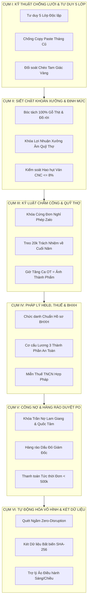

# 30 CẢI TIẾN TỐI ƯU SOP ĐẲNG CẤP QUẢN TRỊ THẾ GIỚI - DỰ ÁN PG HOME LUXURY 2026
## HỆ THỐNG GIẢI PHÁP CHỐNG LƯỜI - CHỐNG LÀM ẨU - BẢO VỆ DÒNG TIỀN VÀ PHÁP LÝ TOÀN DIỆN

> **Văn bản Quy chuẩn Quản trị Doanh nghiệp Cấp cao**  
> *Được đúc kết từ 100% các sai sót thực tế, kẽ hở quản lý và chỉ đạo thép của Giám Đốc Nguyễn Viết Nghĩa*  
> *Hệ thống thẩm định: Chuyên gia Quản trị Tài chính, Thuế & Pháp lý Lao động*

---

## PHẦN I: TỔNG QUAN CHIẾN LƯỢC & NGUYÊN TẮC CỐT TỬ CỦA GIÁM ĐỐC
Doanh nghiệp nội thất gỗ công nghiệp PG Home Luxury vận hành theo cơ chế khoán tinh gọn nhưng phải đối mặt với các nguy cơ cố hữu:
1. **Bệnh lười biếng & làm ẩu:** Cấp dưới sao chép số liệu cũ (vụ án Thoan 27 công), tự vẽ bảng lương (vụ Hiệp 29 công), không chịu đối soát đến tận gốc dữ liệu thô.
2. **Bệnh tư lợi & vơ vét tiền mặt:** Lén lút cộng phụ cấp trách nhiệm (560k của Hòa, 600k của Hào), đòi rút tiền thưởng vượt mức hàng tháng làm nghẽn dòng tiền nhập hàng.
3. **Bệnh vống doanh số ảo:** Tính gộp gỗ thịt, phụ kiện thương mại vào doanh số xưởng gỗ CN làm vống quỹ khoán thợ 15% và vật tư 40%.
4. **Rủi ro thanh tra Thuế & BHXH:** Khai báo chức danh quản lý nhưng đóng mức lương tối thiểu vùng không khéo léo dễ bị cơ quan bảo hiểm truy thu hoặc phạt vi phạm hành chính.

---

---

## PHẦN II: 30 CẢI TIẾN TỐI ƯU ĐẲNG CẤP QUẢN TRỊ THẾ GIỚI

---

### CỤM I: HỆ THỐNG KỸ THUẬT CHỐNG LƯỜI - CHỐNG LÀM ẨU - TƯ DUY 5 LỚP
*(Đập tan hoàn toàn thói quen làm việc qua loa, cẩu thả, báo cáo đối phó của cấp dưới)*

#### 1. Cơ Chế Suy Nghĩ Đa Chiều 5 Lớp Bắt Buộc (5-Layer Multi-Dimensional Thinking)
- Mọi phân tích, báo cáo hoặc quyết định tài chính phải đi qua 5 bộ lọc:
  * *Lớp 1 (Ground Truth):* Truy xuất dữ liệu thô nguyên bản (tin nhắn Zalo từng giây, ảnh phiếu xuất kho, sao kê UNC ngân hàng).
  * *Lớp 2 (Motive Check):* Đặt câu hỏi: "Ai lập báo cáo này? Họ có động cơ vơ vét tiền mặt hay che giấu sai phạm không?".
  * *Lớp 3 (Technical Proof):* Thuật toán có quét đủ 100% dữ liệu không? Có bị ngắt quãng hay sót tệp tin nào không?
  * *Lớp 4 (Triangulation):* Đối soát chéo độc lập ít nhất 3 nguồn độc lập trước khi kết luận.
  * *Lớp 5 (Executive Cash Protection):* Kết luận này bảo vệ dòng tiền Giám Đốc thế nào? Có ngăn thất thoát tiền mặt không?

#### 2. Kỷ Luật Thép Chống Sao Chép Số Liệu Tháng Cũ (Anti-Copy-Paste Protocol - Vụ Án Thoan)
- Cấm tuyệt đối việc lấy số ngày công hoặc đơn giá tháng trước áp sang tháng sau.
- Từng nhân sự là một cá thể độc lập với nhật ký làm việc riêng. Hệ thống tự động so sánh bảng lương mới nộp với tháng trước: Nếu độ tương đồng dữ liệu $> 95\%$ trên nhân sự có biến động nghỉ việc (như Thoan), hệ thống tự động từ chối bảng lương và phạt cảnh cáo người lập.

#### 3. Bộ Quy Tắc Phỏng Vấn Giám Sát Độc Lập (Interrogation Audit Trail)
- Khi phát hiện số liệu bất thường (ví dụ: Hiệp xin nghỉ 3 ngày nhưng vẫn tự chấm 29 công), hệ thống tự động xuất ra bảng đối chất từng ngày: Ngày nào có mặt? Giờ nào gửi file? Ai xác nhận? Không giải trình được bằng chứng cứ số thì tự động cắt bỏ.

#### 4. Quy Chuẩn Xác Minh Hiện Trường 2 Bước (Two-Step Physical Verification)
- Không chấp nhận báo cáo mồm hoặc tin nhắn văn bản suông về khối lượng công việc.
- Báo cáo hoàn thành xưởng hoặc lắp đặt công trình bắt buộc phải có: (1) Ảnh chụp góc rộng hiện trường rõ nét, và (2) Định vị GPS hoặc thời gian thực khớp với ca làm việc.

#### 5. Bảng Điểm Kỷ Luật Trách Nhiệm Cán Bộ Quản Lý (Management Accountability Scorecard)
- Thái (Quản lý xưởng) và Hiệp (Sale Admin) chịu trách nhiệm liên đới bằng chính quỹ thưởng cuối năm: Nếu để xảy ra 01 trường hợp chấm công khống hoặc đặt hàng chui không báo cáo, trừ ngay 10% quỹ thưởng tích lũy cuối năm của cán bộ phụ trách.

---

### CỤM II: SIẾT CHẶT KHOÁN XƯỞNG, BÓC TÁCH GỖ THỊT & ĐỊNH MỨC VẬT TƯ
*(Bảo vệ tỷ lệ định mức vật tư 40% và quỹ thợ 15% luôn chính xác tuyệt đối)*

#### 6. Thuật Toán Bóc Tách Bắt Buộc Gỗ Thịt & Đồ Rời Khỏi Doanh Số Xưởng Gỗ CN
- Công thức chuẩn hóa bất di bất dịch:
  $$\text{Doanh số Xưởng Gỗ CN} = \text{Tổng HĐ} - \text{Gỗ Thịt (Tự nhiên)} - \text{Phụ Kiện Bán Kèm} - \text{Thiết Bị Thương Mại}$$
- Áp dụng triệt để:
  * HĐ Cậu Chiến: Loại cửa và bàn ghế gỗ thịt 16.5M $\implies$ DS xưởng gỗ CN: **137.5M**.
  * HĐ Thắm Minh: Loại phụ kiện thương mại 8.84M $\implies$ DS xưởng gỗ CN: **78.59M**.
  * HĐ Anh Tuấn: Loại thiết bị Hafele 14.8M $\implies$ DS xưởng gỗ CN: **97.0M** (T9: 58.2M).
  * HĐ Chị Hoa: Loại giường ngủ sồi Nga 22M + Thiết bị 29.24M $\implies$ DS xưởng gỗ CN: **176.54M**.

#### 7. Khóa Cứng Lợi Nhuận Xưởng 2.2% (Col BG) Khi Quỹ Thợ Bị Âm
- Quy tắc sống còn: Nếu tổng tiền lương thợ thực trả lớn hơn quỹ khoán 15% doanh số xưởng:
  $$\text{Lợi nhuận xưởng (Col BG)} = 0\text{ đồng}$$
- Toàn bộ tiền trả thợ thực tế được đưa vào Tổng chi phí hệ thống (Col BC). Tuyệt đối không cho phép nhân 2.2% trên doanh số để tạo ra con số lợi nhuận ảo trên giấy tờ.

#### 8. Kiểm Soát Hao Hụt Ván MDF HMR & Sơ Đồ Cắt Nesting CNC $\le 8.0\%$
- Trước khi Vũ xuất file cắt ván CNC, tỷ lệ hao hụt (Waste Ratio) phải được tối ưu $\le 8.0\%$.
- Mọi tấm ván thừa có kích thước $\ge 600 \times 800\text{ mm}$ phải được đánh mã số dán tem và nhập vào kho tái sử dụng, không được phép coi là phế liệu để vứt bỏ hoặc bán phế liệu bỏ túi riêng.

#### 9. Tách Bạch Tuyệt Đối Con Số "Khoán 40%" Và "Hóa Đơn Đặt Ván Zalo Thực Tế"
- Con số 40% chỉ dùng trên Bảng CCSC để tính chi phí định mức quản trị của Giám Đốc.
- Danh mục đặt hàng vật tư thực tế phải ghi đúng 100% số lượng tấm ván và số tiền theo hóa đơn Zalo của Lam Giang (như mã DH29767: 11.935M; DH29930: 496k; Cường Thịnh PO-0902: 11.76M). Cấm bịa mã đơn ảo từ con số khoán 40%.

#### 10. Định Mức Kiểm Soát Cánh Acrylic Noline Gia Công Ngoài (ALD/NTD)
- Cánh Acrylic bóng gương noline đặt gia công ngoài có giá trị cao (1.1M - 1.25M/m2 hoặc md), bắt buộc phải có bảng bóc tách kích thước cánh chi tiết đính kèm ảnh tủ thực tế.
- Đối soát chéo từng milimét cánh tủ Chị Hoa (12.21M) và Vinhomes Anh Minh (22.75M), ngăn chặn việc xưởng đặt dư cánh để làm hàng ngoài.

---

### CỤM III: KỶ LUẬT CHẤM CÔNG, ĐIỂM DANH & QUẢN TRỊ QUỸ THỢ NÒNG CỐT
*(Chấm dứt hoàn toàn tình trạng chấm công khống, lén cộng phụ cấp và đòi tiền vượt mức)*

#### 11. Đơn Giá Công Nhật Cố Định Chuẩn Tuyệt Đối & Khóa Cột Phụ Cấp Hàng Tháng
- Đơn giá công nhật thực chi hàng tháng:
  * **Hà Viết Hòa (Thợ cả):** Đúng **530.000 đ / ngày công** + Tiền làm thêm giờ OT.
  * **Lương Thể Hào (Thợ nòng cốt):** Đúng **450.000 đ / ngày công** + Tiền làm thêm giờ OT.
- **Quy tắc sắt:** Cột phụ cấp trách nhiệm hàng tháng của Hòa và Hào trên bảng lương chi tiền mặt cố định bằng **0 đồng**.

#### 12. Cơ Chế Treo Quỹ Trách Nhiệm Thợ Nòng Cốt Về Cuối Năm Quyết Toán Thưởng Tết
- Khoản 20.000 đ/công trách nhiệm của Hòa và Hào được hệ thống tự động trích lập vào **QUỸ TÍCH LŨY CUỐI NĂM**.
- Khoản này chỉ được giải ngân 1 lần duy nhất vào kỳ lương Tết Nguyên Đán với điều kiện: Trong năm xưởng không xảy ra tai nạn lao động nghiêm trọng, sản phẩm không bị khách hàng phạt do lỗi kỹ thuật xưởng, và thợ gắn bó chiến đấu hết ngày 28 Tết.

#### 13. Cơ Chế Tam Giác Vàng Cho Thưởng Vượt Mức Doanh Số > 500 Triệu
- Thưởng vượt mức của Thái (0.5%), Vũ (0.3%), Hiệp (0.5%) bắt buộc dồn lại cuối năm mới quyết toán, **TUYỆT ĐỐI CẤM CHI TIỀN MẶT HÀNG THÁNG**.
- Điều kiện giải ngân: (1) Chiến đấu đến ngày làm việc cuối cùng giáp Tết; (2) Công nợ khách hàng đã thu hồi $\ge 85\%$; (3) Lợi nhuận ròng thực tế cả năm đạt kế hoạch của Giám Đốc.

#### 14. Khóa Cứng Ngày Nghỉ Theo Đơn Xin Phép Trên Nhóm Zalo (Mã P & K)
- Bất kỳ nhân sự nào nhắn tin xin nghỉ trên nhóm Zalo (như Hiệp xin nghỉ việc riêng, Thoan xin nghỉ từ 16/10), hệ thống tự động ghi nhận mã `P` (nghỉ phép) hoặc `K` (nghỉ không phép) và **KHÓA CỨNG** ngày công từ ngày đó.
- Cấm mọi hành vi cuối tháng "chấm bù", "chấm nể" hoặc vẽ công khống để bù tiền lương.

#### 15. Kiểm Soát Giờ Làm Thêm OT Bằng 3 Lớp Bằng Chứng Số
- Thợ làm thêm giờ OT bắt buộc phải:
  * Đăng ký trước 17:00 trên nhóm Zalo Xưởng.
  * Khi kết thúc ca tăng ca (21:00 hoặc 21:30), thợ phải chụp ảnh thành phẩm vừa ráp xong gửi lên nhóm.
  * Đối chiếu với nhật ký chạy máy CNC và thời gian ngắt điện xưởng. Không có ảnh thành phẩm $\implies$ Cắt 100% giờ OT ca đó!

---

### CỤM IV: QUẢN TRỊ PHÁP LÝ HỢP ĐỒNG LAO ĐỘNG, CHỨC DANH NGHỀ & TỐI ƯU BẢO HIỂM - THUẾ
*(Xử lý chuẩn chỉ 100% mối quan hệ giữa Hợp đồng lao động của Thái, cơ quan BHXH và cơ quan Thuế)*

#### 16. Chức Danh Nghệ Thuật Trên Hồ Sơ BHXH: Tuyệt Đối Tránh Ghi "Quản Lý / Giám Đốc"
- **Thực trạng pháp lý:** Nếu trên Mẫu D02-LT nộp cho Cơ quan BHXH ghi chức danh là "Quản lý xưởng" hay "Giám đốc" mà mức lương đóng lại ghi đúng mức lương tối thiểu vùng (3.860.000 đ), cán bộ BHXH sẽ lập tức nghi vấn trốn đóng BHXH và yêu cầu thanh tra giải trình hợp đồng lao động thực tế.
- **Giải pháp tối ưu:**
  * Trên Hợp đồng lao động và hồ sơ nộp BHXH, chức danh của Thái được chuẩn hóa là: **"Nhân viên kỹ thuật xưởng"** hoặc **"Kỹ thuật viên nội thất"** (hoặc "Tổ trưởng kỹ thuật sản xuất").
  * Chức danh này hoàn toàn khớp với mức lương tối thiểu vùng III (3.860.000 đ) mà không bao giờ bị cán bộ BHXH soi mói hay làm khó.
  * Trong nội bộ doanh nghiệp, Giám Đốc ban hành Quyết định phân công nhiệm vụ: Thái chịu trách nhiệm Quản lý xưởng và hưởng đúng định mức lương nội bộ.

#### 17. Cơ Cấu Lương 3 Thành Phần Trên HĐLĐ Chuẩn Pháp Luật & Tối Ưu BHXH
- Hợp đồng lao động của Thái và các nhân sự được thiết kế theo cấu trúc chuẩn Điều 30 Thông tư 59/2015/TT-BLĐTBXH:
  * **Thành phần 1 (Lương chính đóng BHXH):** Đúng mức lương tối thiểu vùng III: **3.860.000 đồng/tháng** (Mức trích nộp BHXH cố định 1.100.000 đ/tháng cho cả chủ và thợ).
  * **Thành phần 2 (Phụ cấp hỗ trợ không tính BHXH):** Phụ cấp điện thoại, xăng xe, ăn trưa theo quy định miễn thuế và miễn BHXH.
  * **Thành phần 3 (Lương năng suất & Thưởng theo hiệu quả KPI):** Biến đổi theo sản lượng công trình và tiến độ nghiệm thu xưởng.
- Cấu trúc này vừa bảo đảm tính pháp lý vững chắc trước cơ quan BHXH, vừa bảo toàn quỹ bảo hiểm tối ưu cho Giám Đốc.

#### 18. An Toàn Tuyệt Đối Trước Cơ Quan Thuế TNCN (Thuế Suất 0%)
- Mức giảm trừ gia cảnh cho bản thân người lao động là **11.000.000 đ/tháng** (132 triệu/năm).
- Lương thực tế của Thái dao động từ 9.5M đến 10.5M/tháng, hoàn toàn nằm dưới ngưỡng 11.000.000 đ/tháng. Sau khi trừ thêm các khoản đóng BHXH bắt buộc, **thu nhập tính thuế TNCN của Thái là 0 đồng**.
- Không phát sinh thuế TNCN phải nộp, không có rủi ro truy thu thuế đối với người lao động lẫn hộ kinh doanh.

#### 19. Hợp Pháp Hóa Chi Phí Hộ Kinh Doanh Lộ Trình Lên Doanh Nghiệp TNHH
- Hộ kinh doanh hiện đóng thuế theo phương pháp khoán doanh thu (tỷ lệ 1.5% đối với gia công sản xuất, 1% đối với thương mại). Thuế khoán không thanh tra chi phí lương thợ.
- Bộ hồ sơ HĐLĐ chuẩn của Thái, Vũ, Hiệp, Dũng, Hào sẽ là chứng từ gốc hoàn hảo để chuyển giao sạch sẽ khi Giám Đốc nâng cấp Hộ kinh doanh lên Công ty TNHH Nội Thất Phú Gia sau này.

#### 20. Tránh Danh Mục Công Việc Nặng Nhọc Độc Hại Cho Cán Bộ Kỹ Thuật
- Thợ mộc trực tiếp vận hành máy cưa, tiếp xúc bụi gỗ thuộc danh mục công việc nặng nhọc loại IV/V, bắt buộc phải khám sức khỏe bệnh nghề nghiệp định kỳ và đóng bảo hiểm tai nạn nghề nghiệp.
- Khi ghi chức danh của Thái là "Kỹ thuật viên xưởng", tính chất công việc nghiêng về bóc tách kỹ thuật, kiểm tra bản vẽ và giám sát chất lượng, giúp doanh nghiệp giảm thiểu các thủ tục kiểm tra an toàn lao động phức tạp.

---

### CỤM V: QUẢN TRỊ DÒNG TIỀN, CÔNG NỢ NHÀ CUNG CẤP & HÀNG RÀO PHÊ DUYỆT
*(Bảo vệ từng đồng vốn lưu động, dẹp bỏ nhập hàng chui và kiểm soát công nợ gối đầu)*

#### 21. Cổng Phê Duyệt Vàng PO: Hàng Rào Dấu Đỏ Điện Tử Của Giám Đốc
- Mọi Phiếu Đề Xuất Đặt Hàng Vật Tư từ Vũ hoặc Thái bắt buộc phải có **CHỮ KÝ & DẤU ĐỎ ĐIỆN TỬ CỦA GIÁM ĐỐC NGUYỄN VIẾT NGHĨA**.
- Gửi thông báo bằng văn bản đến Tổng Kho Ván Lam Giang và Phụ Kiện Quốc Tâm: *"Đơn hàng nào không có phiếu duyệt đóng dấu đỏ của Giám Đốc Nghĩa, PG Home sẽ không chịu trách nhiệm thanh toán"*.
- Nếu nhân sự tự ý đặt hàng chui, nhân sự đó phải tự xuất tiền túi thanh toán dứt điểm (như vụ Vũ tự chuyển khoản 496k ngày 04/11).

#### 22. Thiết Lập Khóa Trần Nợ Tín Dụng Từng Nhà Cung Cấp
- Cài đặt trần nợ cố định:
  * **Phụ Kiện Quốc Tâm:** Trần nợ **30.000.000 đ** (Cảnh báo khi đạt 27M; Dư nợ hiện tại: 26.09M - Vùng an toàn).
  * **Tổng Kho Ván Lam Giang:** Trần nợ **170.000.000 đ** (Cảnh báo khi đạt 150M; Dư nợ hiện tại: 147.49M sau khi Dung chuyển trả 16.838M).
  * **Gỗ NT Cầu Vượt:** Trần nợ **85.000.000 đ** (Dư nợ hiện tại: 82.065M - Tiệm cận trần).
- Tuyệt đối không cho phép công nợ vượt trần để tránh nguy cơ bị cắt nguồn cấp hàng bất ngờ.

#### 23. Kỷ Luật Thanh Toán Dứt Điểm Đơn Mua Lẻ Phát Sinh $< 500.000\text{ đ}$
- Mọi đơn mua vật tư lẻ phát sinh có giá trị dưới 500k (như 2 cuộn Led 170k Quốc Tâm, hay cước xe 50k) phải thanh toán tiền mặt dứt điểm trong ngày.
- Cấm ghi nợ gối đầu các khoản tiền lẻ để tránh làm rối sổ nợ và thất thoát dòng tiền.

#### 24. Khiên Chắn Dòng Tiền Thu Hồi Công Nợ Khách Hàng 3 Chặng
- Quy tắc thu tiền hợp đồng thi công:
  * **Chặng 1 (Ký HĐ):** Tạm ứng đủ $40\% - 50\%$ mới xuất lệnh cắt ván tại xưởng.
  * **Chặng 2 (Giao hàng đến công trình):** Thu đủ $40\%$ khi xe tải vừa hạ hàng xuống nhà khách. Chưa thu đủ tiền Chặng 2 $\implies$ Cấm thợ bóc màng bọc nilong để lắp đặt.
  * **Chặng 3 (Nghiệm thu bàn giao):** Thu nốt $10\% - 20\%$ còn lại trong vòng 48 giờ kể từ khi ký biên bản bàn giao.

#### 25. Đối Soát Định Kỳ Kép Ngày 15 & Ngày 30 Hàng Tháng
- Định kỳ 1 tháng 2 lần (ngày 15 và ngày 30), kế toán văn phòng và xưởng bắt buộc phải đối soát công nợ bằng văn bản với Lam Giang và Quốc Tâm, có chữ ký xác nhận của đại diện 2 bên. Không để nợ dồn qua nhiều tháng gây tranh chấp số liệu.

---

### CỤM VI: TỰ ĐỘNG HÓA VÔ HÌNH, TRÍ TUỆ NHÂN TẠO & KÉT DỮ LIỆU BẤT BIẾN
*(Ứng dụng công nghệ hàng đầu thế giới để Giám Đốc điều hành tự động, rảnh tay 100%)*

#### 26. Cơ Chế Quét Ngầm Vô Hình Tuyệt Đối (Zero-Disruption Architecture)
- Script nền chạy ở mức ưu tiên IDLE (`0x00000040`), CPU $\le 0.3\%$, RAM $\le 30\text{ MB}$.
- Lắng nghe trực tiếp chỉ mục `.rescache` và LevelDB Write-Ahead Logs. Tuyệt đối không chiếm chuột, không cướp Focus, không giật màn hình khi Giám Đốc đang vẽ CAD, gõ Word, Excel hay nhắn tin Zalo.

#### 27. Trí Tuệ Nhân Tạo Tự Động Nhận Diện Hóa Đơn & Ủy Nhiệm Chi (Smart OCR)
- Tự động nhận diện ảnh chụp màn hình chuyển khoản ngân hàng qua tỷ lệ khung hình ($h/w \ge 1.65$) và dải màu app ngân hàng (VietinBank, Techcombank, VIB).
- Bóc tách tức thời số tiền và mã giao dịch, tự động giảm trừ công nợ nhà cung cấp trên hệ thống Web App theo thời gian thực (như vụ nhận diện Dung chuyển trả Lam Giang 16.838M và Quốc Tâm 15M).

#### 28. Két Dữ Liệu Lịch Sử Bất Biến Khóa Mã Băm SHA-256 (Immutable Ledger)
- Toàn bộ số liệu đã quyết toán của Tháng 8, Tháng 9 và Tháng 10 được đóng dấu băm SHA-256 lưu trữ trong trạng thái Read-only.
- Cấm tuyệt đối mọi hành vi chỉnh sửa số liệu lịch sử để hợp thức hóa sai phạm hiện tại.

#### 29. Bảng Điều Khiển Quản Trị Sống Web App 24/7 (Live Executive Dashboard)
- Tích hợp toàn diện trên máy chủ local `http://localhost:8080/index.html`:
  * Dashboard dòng tiền và công nợ 3 nhà cung cấp sống từng phút.
  * Bảng chấm công 7 thợ xưởng và 2 nhân viên văn phòng cập nhật theo thời gian thực.
  * Báo cáo CCSC trực quan có nút tải trực tiếp file Excel gốc.

#### 30. Trợ Lý Ảo Điều Hành Tự Động Báo Cáo Đầu Ngày & Cuối Ngày (Executive AI Briefing)
- **Đúng 07:30 Sáng:** Tự động gửi thông báo tổng hợp quân số thợ có mặt, lịch giao ván/phụ kiện trong ngày, số dư nợ cần thanh toán gấp.
- **Đúng 18:30 Chiều:** Tự động gửi báo cáo số mét vuông ván xưởng đã cắt, danh sách thợ tăng ca OT kèm ảnh thành phẩm, tiến độ thu tiền khách hàng và lợi nhuận ròng dự phóng.
- Giám Đốc nắm trọn quyền chỉ huy doanh nghiệp trong lòng bàn tay mà không cần phải gọi điện hỏi han hay lo lắng cấp dưới làm sai.

---

## BẢNG TỔNG HỢP 30 CẢI TIẾN & PHÂN CÔNG THỰC HIỆN

| STT | Tên Cải Tiến | Cụm Chiến Lược | Bộ Phận Chịu Trách Nhiệm | Cơ Chế Kiểm Soát |
| :---: | :--- | :---: | :---: | :--- |
| **01** | Tư duy 5 lớp độc lập | Cụm I | Toàn thể quản lý & AI | Lọc qua 5 lớp dữ liệu gốc |
| **02** | Kỷ luật chống Copy-Paste tháng cũ | Cụm I | Nhân sự & Bảng lương | Check trùng lặp > 95% phạt cảnh cáo |
| **03** | Bộ quy tắc phỏng vấn giám sát độc lập | Cụm I | Giám Đốc & Kế toán | Đối chất từng ngày công bất thường |
| **04** | Quy chuẩn xác minh hiện trường 2 bước | Cụm I | Xưởng & Công trình | Ảnh góc rộng + Thời gian số |
| **05** | Bảng điểm kỷ luật trách nhiệm quản lý | Cụm I | Thái & Hiệp | Trừ 10% quỹ thưởng cuối năm nếu sai |
| **06** | Thuật toán bóc tách gỗ thịt & đồ rời | Cụm II | Bóc tách & Báo giá | Công thức: Tổng HĐ - Gỗ thịt - Phụ kiện |
| **07** | Khóa lợi nhuận xưởng Col BG khi âm | Cụm II | Báo cáo CCSC Giám Đốc | Lương thợ > 15% -> Col BG = 0 đ |
| **08** | Kiểm soát hao hụt ván Nesting <= 8% | Cụm II | Vũ (CNC) & Thái | Tận dụng ván thừa >= 600x800mm |
| **09** | Tách bạch khoán 40% vs Hóa đơn thật | Cụm II | Kế toán & Vật tư Zalo | Ghi đúng mã đơn thật Lam Giang/Cường Thịnh |
| **10** | Định mức kiểm soát Acrylic ALD ngoài | Cụm II | Vũ & ALD | Bóc tách m2 / md chi tiết theo bản vẽ |
| **11** | Khóa cột phụ cấp tiền mặt hàng tháng | Cụm III | Bảng lương thợ xưởng | Hòa 530k, Hào 450k; Phụ cấp = 0 đ |
| **12** | Treo 20k trách nhiệm về cuối năm | Cụm III | Hòa & Hào | Quyết toán 1 lần cùng thưởng Tết |
| **13** | Tam giác vàng thưởng doanh số > 500M | Cụm III | Thái, Vũ, Hiệp | Treo cuối năm, chỉ chi khi nợ >= 85% |
| **14** | Khóa cứng ngày nghỉ theo đơn Zalo | Cụm III | Chấm công toàn bộ | Ghi nhận P/K, cấm sửa bù công cuối tháng |
| **15** | Kiểm soát OT bằng ảnh thành phẩm | Cụm III | Thợ xưởng tăng ca | Bắt buộc có ảnh thành phẩm + file CNC |
| **16** | Chức danh chuẩn hồ sơ nộp BHXH | Cụm IV | Hiệp & Hồ sơ BHXH | Ghi "Kỹ thuật viên xưởng", cấm ghi "Quản lý" |
| **17** | Cơ cấu lương 3 thành phần trên HĐLĐ | Cụm IV | HĐLĐ 12 tháng | Lương chính vùng III + Phụ cấp + Thưởng KPI |
| **18** | An toàn thuế TNCN thuế suất 0% | Cụm IV | Bảng lương nhân sự | Lương Thái < 11M -> Thuế TNCN = 0 đ |
| **19** | Hồ sơ sạch lộ trình lên Công ty TNHH | Cụm IV | Pháp lý doanh nghiệp | Lưu trữ chứng từ HĐLĐ hợp chuẩn |
| **20** | Tránh danh mục nặng nhọc độc hại | Cụm IV | An toàn lao động | Phân loại lao động gián tiếp kỹ thuật |
| **21** | Cổng phê duyệt vàng PO Dấu Đỏ | Cụm V | Giám Đốc & Xưởng | Phải có Dấu Đỏ Giám Đốc mới được giao ván |
| **22** | Khóa trần nợ tín dụng nhà cung cấp | Cụm V | QT, LG, Cầu Vượt | QT <= 30M, LG <= 170M, CV <= 85M |
| **23** | Thanh toán dứt điểm đơn lẻ < 500k | Cụm V | Xuất quỹ hàng ngày | Thanh toán trong ngày, không ghi nợ lẻ |
| **24** | Khiên chắn dòng tiền thu tiền 3 chặng | Cụm V | Sale & Khách hàng | Cọc 50% -> Hạ ván thu 40% -> Xong thu 10% |
| **25** | Đối soát định kỳ kép ngày 15 & 30 | Cụm V | Kế toán văn phòng | Chốt công nợ 2 lần/tháng bằng văn bản |
| **26** | Quét ngầm vô hình Zero-Disruption | Cụm VI | Hệ thống AI Daemon | IDLE priority, không cướp Focus/chuột |
| **27** | Nhận diện thông minh UNC & Hóa đơn | Cụm VI | AI Vision & OCR | Tự động đọc số tiền & giảm trừ nợ NCC |
| **28** | Két dữ liệu bất biến SHA-256 | Cụm VI | Cơ sở dữ liệu | Khóa cứng lịch sử T8, T9, T10 Read-only |
| **29** | Dashboard quản trị sống trên Web App | Cụm VI | Web Server 8080 | Hiển thị dòng tiền, công nợ & chấm công |
| **30** | Trợ lý ảo tóm tắt điều hành 07:30/18:30| Cụm VI | AI Trợ Lý Điều Hành | Báo cáo tự động sáng và chiều cho Giám Đốc |

