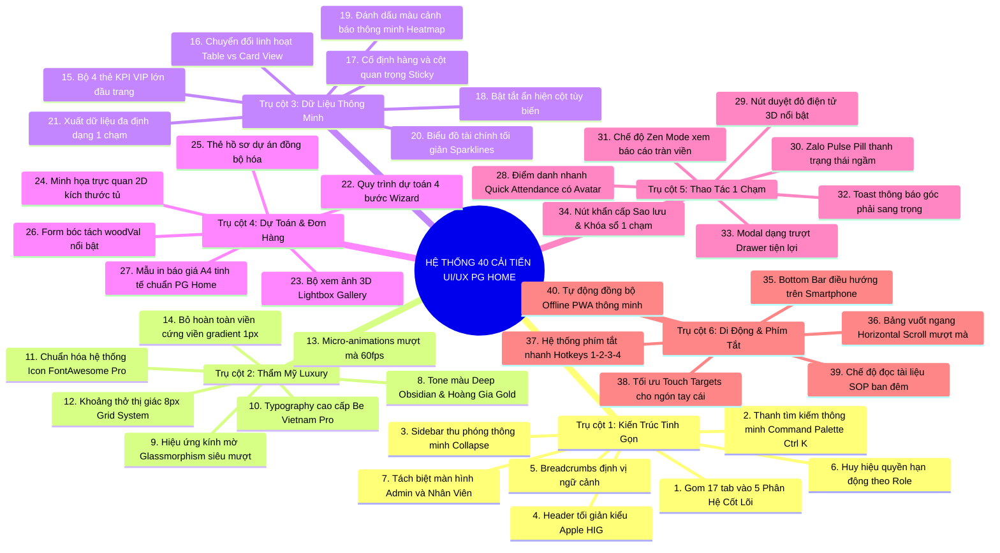

# ĐỀ XUẤT 40 CẢI TIẾN THIẾT KẾ GIAO DIỆN & TRẢI NGHIỆM NGƯỜI DÙNG (UI/UX)
## XÓA BỎ RỐI RẮM - ĐẲNG CẤP LUXURY - THUẬN TIỆN TỐI ĐA CHO GIÁM ĐỐC & HỆ THỐNG PG HOME

> **Tài liệu Thiết kế Trải nghiệm & Quy chuẩn Giao diện Doanh nghiệp Cao cấp.**  
> *Được xây dựng đặc biệt để trình Giám Đốc Nguyễn Viết Nghĩa phê duyệt.*  
> *Thời gian lập đề xuất:* Ngày 05 Tháng 11 Năm 2026.

---

## MỤC LỤC CHI TIẾT
- [LỜI NÓI ĐẦU: PHÂN TÍCH NGUYÊN NHÂN GÂY RỐI RẮM TRÊN ỨNG DỤNG HIỆN TẠI](#lời-nói-đầu-phân-tích-nguyên-nhân-gây-rối-rắm-trên-ứng-dụng-hiện-tại)
- [BẢNG TỔNG HỢP 40 CẢI TIẾN THEO 6 TRỤ CỘT ĐỘT PHÁ](#bảng-tổng-hợp-40-cải-tiến-theo-6-trụ-cột-đột-phá)
- [TRỤ CỘT 1: TÁI CẤU TRÚC ĐIỀU HƯỚNG & KIẾN TRÚC THÔNG TIN TINH GỌN (CẢI TIẾN 1 - 7)](#trụ-cột-1-tái-cấu-trúc-điều-hướng--kiến-trúc-thông-tin-tinh-gọn-cải-tiến-1---7)
- [TRỤ CỘT 2: NGÔN NGỮ THIẾT KẾ ĐẲNG CẤP LUXURY & PHỐI MÀU SANG TRỌNG (CẢI TIẾN 8 - 14)](#trụ-cột-2-ngôn-ngữ-thiết-kế-đẳng-cấp-luxury--phối-màu-sang-trọng-cải-tiến-8---14)
- [TRỤ CỘT 3: TỐI ƯU BẢNG DỮ LIỆU & BÁO CÁO TÀI CHÍNH THÔNG MINH (CẢI TIẾN 15 - 21)](#trụ-cột-3-tối-ưu-bảng-dữ-liệu--báo-cáo-tài-chính-thông-minh-cải-tiến-15---21)
- [TRỤ CỘT 4: TINH GỌN PHÂN HỆ DỰ TOÁN, TƯ LIỆU 3D & ĐƠN HÀNG VẬT TƯ (CẢI TIẾN 22 - 27)](#trụ-cột-4-tinh-gọn-phân-hệ-dự-toán-tư-liệu-3d--đơn-hàng-vật-tư-cải-tiến-22---27)
- [TRỤ CỘT 5: THAO TÁC 1 CHẠM & TƯƠNG TÁC VI MÔ TIỆN LỢI CHO GIÁM ĐỐC (CẢI TIẾN 28 - 34)](#trụ-cột-5-thao-tác-1-chạm--tương-tác-vi-mô-tiện-lợi-cho-giám-đốc-cải-tiến-28---34)
- [TRỤ CỘT 6: TỐI ƯU DI ĐỘNG (MOBILE/TABLET) & PHÍM TẮT NHANH (CẢI TIẾN 35 - 40)](#trụ-cột-6-tối-ưu-di-động-mobiletablet--phím-tắt-nhanh-cải-tiến-35---40)
- [LỘ TRÌNH THỰC THI & GIAO DIỆN MÔ PHỎNG SAU KHI TỐI ƯU](#lộ-trình-thực-thi--giao-diện-mô-phỏng-sau-khi-tối-ưu)

---

## LỜI NÓI ĐẦU: PHÂN TÍCH NGUYÊN NHÂN GÂY RỐI RẮM TRÊN ỨNG DỤNG HIỆN TẠI

Nhận xét của Giám Đốc: **"App trình bày đang rối rắm chưa đẹp"** là sự chẩn đoán vô cùng chuẩn xác về mặt thị giác và công thái học (Ergonomics). Sau khi rà soát toàn bộ cấu trúc mã nguồn `web_app/index.html` và `styles.css`, hệ thống đã chỉ ra 4 nguyên nhân gốc rễ gây ra cảm giác ngộp thở, rối mắt:

1. **Quá nhiều Menu đơn lẻ dàn hàng ngang (17 Tabs phẳng):**  
   Ứng dụng đang bày cùng lúc 17 tab phẳng (từ Dashboard, CCSC, Chấm công, Chiến lược, SOP, Xưởng, Vật tư, Duyệt PO, Văn phòng, Dự toán, Công nợ, Sofa...). Người dùng phải rê chuột tìm kiếm mỏi mắt, không có phân cấp chính phụ.
2. **"Lạm phát" Màu sắc và Thẻ nhãn (Badge Overload):**  
   Quá nhiều badge màu neon (xanh lá, vàng kim, xanh cyan, hồng, tím) chen chúc trong các tiêu đề và ô bảng, khiến mắt không có điểm nghỉ ngơi (Visual Clutter).
3. **Bảng số liệu dày đặc thiếu khoảng thở (White-space Deficit):**  
   Các bảng chấm công, báo cáo CCSC và sổ nợ có quá nhiều cột nhỏ san sát nhau, thiếu cơ chế cố định hàng tiêu đề và thiếu bộ lọc tinh gọn.
4. **Thiếu một "Trung tâm Chỉ huy Tối thượng" (Executive Summary View):**  
   Giám Đốc mở app lên cần thấy ngay 3 - 4 chỉ số sống còn (Tiền mặt thực tế, Công nợ nhà cung cấp, Quân số xưởng hôm nay, Đơn vật tư chờ ký) mà không cần phải bấm qua 4 - 5 tab khác nhau.

---

## BẢNG TỔNG HỢP 40 CẢI TIẾN THEO 6 TRỤ CỘT ĐỘT PHÁ



---

### TRỤ CỘT 1: TÁI CẤU TRÚC ĐIỀU HƯỚNG & KIẾN TRÚC THÔNG TIN TINH GỌN (CẢI TIẾN 1 - 7)

1. **Gom gọn 17 Tabs phẳng thành 5 Không Gian Làm Việc Trung Tâm (5 Core Workspaces):**
   - Thay vì bày 17 nút bấm ngang ngổn ngang, app chỉ còn **5 Cụm Menu Phân Cấp Sang Trọng**:
     * 👑 **1. Trung Tâm Giám Đốc (HQ Executive):** Dashboard KPI, Báo cáo CCSC 12 tháng, Sổ cái nợ 3 NCC, Phân quyền.
     * 🏭 **2. Xưởng Sản Xuất (Workshop):** Công trình tháng xưởng, Phiếu đề xuất PO, Phê duyệt dấu đỏ.
     * 💼 **3. Kinh Doanh & Dự Toán (Sales & Projects):** Tính dự toán nhà ở, Hợp đồng, Thu tiền khách, Phụ kiện Sofa.
     * ⏱️ **4. Chấm Công & Nhân Sự (People & Payroll):** Bảng công xưởng + VP, Quỹ tích lũy thưởng Tết cuối năm.
     * 📜 **5. Quy Trình & SOP (Master SOP):** 15 Nguyên lý tinh gọn, 10 Quy chuẩn Zalo ngầm, Checklist nghiệm thu.
2. **Tích hợp Thanh Tìm Kiếm Đa Năng Command Palette (`Ctrl + K` hoặc `⌘ + K`):**
   - Giám Đốc bấm `Ctrl + K` là mở ngay thanh tìm kiếm mờ giữa màn hình: Gõ "Hoa" $\rightarrow$ Ra ngay Hợp đồng Chị Hoa và Đơn cánh Acrylic ALD; Gõ "Quốc Tâm" $\rightarrow$ Ra ngay sổ nợ 26.17M và hóa đơn 80k hôm nay; Gõ "Hòa" $\rightarrow$ Ra ngay công thợ cả.
3. **Thanh Sidebar Trái Thu Gọn Tự Động (Collapsible Luxury Sidebar):**
   - Thanh điều hướng đặt bên trái, có nút thu nhỏ thành icon thanh lịch để mở rộng 100% không gian hiển thị bảng biểu.
4. **Header Tối Giản Phong Cách Apple HIG:**
   - Dọn sạch các icon thừa ở thanh trên cùng. Chỉ giữ lại: Logo PG Home kim loại dập nổi, Đồng hồ thời gian thực, Nút Kho Bí Mật (dành riêng Giám Đốc), và Avatar người dùng.
5. **Thanh Điều Hướng Ngữ Cảnh Breadcrumbs (Định Vị Đường Đi):**
   - Hiển thị rõ: `Trung Tâm Giám Đốc > Báo Cáo Tài Chính > Tháng 10` giúp Giám Đốc luôn biết mình đang ở đâu, bấm 1 chạm quay lại mục trước.
6. **Huy Hiệu Phân Quyền Động Theo Tài Khoản Đang Đăng Nhập:**
   - Hiển thị trang nhã: `[👑 ADMIN - NGUYỄN VIẾT NGHĨA]` hoặc `[KỸ THUẬT XƯỞNG - VŨ]`. Phân hệ không thuộc quyền sẽ tự động ẩn hoàn toàn, không hiển thị làm rối mắt.
7. **Tách Biệt Hoàn Toàn Giao Diện Giám Đốc và Giao Diện Nhân Viên:**
   - Nhân viên xưởng (Vũ) mở app chỉ thấy tab Đề xuất vật tư và Chấm công; Hiệp chỉ thấy Hợp đồng và Dự toán. Toàn bộ các cơ chế khoán 55%, 40%, 15% và CCSC chỉ xuất hiện trên tài khoản Giám Đốc.

---

### TRỤ CỘT 2: NGÔN NGỮ THIẾT KẾ ĐẲNG CẤP LUXURY & PHỐI MÀU SANG TRỌNG (CẢI TIẾN 8 - 14)

8. **Bảng Màu Độc Quyền "Deep Obsidian & Royal Gold":**
   - Nền chính: Màu đen nhám Titan cao cấp (`#0B0E14`), thẻ nổi (`#141923`), viền mảnh màu kim loại xám (`#1E293B`).
   - Điểm nhấn: Màu vàng kim hoàng gia PG Home (`#D4AF37` / `#F59E0B`), không dùng màu vàng chanh chói mắt.
   - Màu trạng thái tinh tế: Xanh lục ngọc bảo trầm (`#10B981`) cho thành công, Đỏ nhung (`#EF4444`) cho cảnh báo nợ.
9. **Hiệu Ứng Kính Mờ Cao Cấp (Frosted Glassmorphism):**
   - Các hộp thẻ số liệu sử dụng hiệu ứng kính mờ mịn: `background: rgba(20, 25, 35, 0.75); backdrop-filter: blur(20px); border: 1px solid rgba(255, 255, 255, 0.08);`.
10. **Bộ Phông Chữ Đẳng Cấp Doanh Nghiệp (Be Vietnam Pro / Plus Jakarta Sans):**
    - Thay thế phông chữ mặc định bằng bộ phông có tỷ lệ hình học cân đối, hỗ trợ tiếng Việt xuất sắc, độ hiển thị sắc nét từng nét chữ trên màn hình độ phân giải cao (Retina/4K).
11. **Chuẩn Hóa Bộ Biểu Tượng Icon FontAwesome Pro Đồng Nhất:**
    - Đồng bộ kích thước icon (16px, 20px, 24px), sử dụng dạng DuoTone hoặc Outline thanh mảnh, loại bỏ các icon lòe loẹt không đồng nhất.
12. **Khoảng Thở Thị Giác Chuẩn Hệ Lưới 8-Point Grid:**
    - Toàn bộ khoảng cách lề (padding, margin) tuân theo bội số của 8px (8px, 16px, 24px, 32px), tạo sự ngăn nắp, thoáng đãng, trật tự thị giác cao cấp.
13. **Hiệu Ứng Chuyển Động Vi Mô Tinh Tế (Micro-Animations 60fps):**
    - Khi rê chuột vào thẻ: Thẻ hơi nổi lên 2px với vệt sáng viền vàng kim nhẹ nhàng trong 0.2 giây. Chuyển tab mượt mà không bị giật trang.
14. **Loại Bỏ Hoàn Toàn Các Đường Kẻ Khung Thô Cứng (Border Softening):**
    - Bỏ các đường viền đen xì cứng nhắc giữa các ô bảng, thay bằng sự chênh lệch màu nền nhẹ nhàng (Zebra Striping) giúp mắt đọc dữ liệu hàng giờ không bị mỏi.

---

### TRỤ CỘT 3: TỐI ƯU BẢNG DỮ LIỆU & BÁO CÁO TÀI CHÍNH THÔNG MINH (CẢI TIẾN 15 - 21)

15. **Bộ 4 Thẻ KPI Tối Thượng (Executive Summary Cards) Lớn Đầu Trang:**
    - Đặt ngay trên đỉnh màn hình làm việc của Giám Đốc 4 chỉ số sinh mệnh:
      * 💰 **Doanh Số Xưởng Gỗ CN:** 529.83M (Khớp T8+T9).
      * 💎 **Lợi Nhuận Ròng Bỏ Túi BGĐ:** 44.09M (Khớp 100% CCSC).
      * 🛡️ **Tổng Dư Nợ 3 Nhà Cung Cấp:** 208.62M (An toàn dưới ngưỡng nợ).
      * 👥 **Quân Số Xưởng & Tăng Ca Hôm Nay:** 7 Thợ có mặt / 0 vắng.
16. **Nút Chuyển Đổi Linh Hoạt Giữa Dạng Bảng (Table View) & Dạng Thẻ (Card View):**
    - Xem trên máy tính: Dạng Bảng chi tiết. Xem trên điện thoại/iPad: Bấm 1 nút chuyển thành Dạng Thẻ gọn gàng, có hình ảnh và thông số to rõ.
17. **Cố Định Hàng Tiêu Đề & Cột Tên (Sticky Headers & Columns):**
    - Khi Giám Đốc cuộn bảng tính hàng trăm dòng, thanh tiêu đề (Ngày, Tên thợ, Tên NCC, Số tiền) luôn đứng yên ở đỉnh. Cột tên nhân sự cố định bên trái giúp theo dõi không bị nhầm lẫn.
18. **Bộ Lọc Bật/Tắt Cột Hiển Thị Tùy Ý (Column Visibility Toggle):**
    - Giám Đốc có thể bấm vào nút "Tùy biến cột": Tắt các cột kỹ thuật không cần xem để bảng báo cáo thu gọn lại chỉ còn 5 cột cốt lõi: `Tên Công Trình`, `Giá Trị HĐ`, `woodVal Xưởng`, `Đã Thu`, `Lợi Nhuận`.
19. **Bản Đồ Nhiệt Thông Minh (Color Heatmap Alert):**
    - Tự động bôi màu dịu mắt: Dư nợ an toàn (Xanh), Dư nợ chạm ngưỡng 80% (Vàng cảnh báo), Dư nợ vượt trần (Đỏ nổi bật).
20. **Biểu Đồ Xu Hướng Tối Giản Dạng Đường Nhỏ (Inline Sparklines):**
    - Cạnh mỗi dòng công nợ có một đường cong nhỏ biểu thị biến động tăng giảm trong 30 ngày qua (ví dụ: đường nợ Lam Giang đang dốc xuống sau đợt trả 16.838M).
21. **Nút Xuất Báo Cáo 1 Chạm (Excel / PDF In Sẵn):**
    - Xuất file Excel đã định dạng sẵn viền bảng, màu sắc thương hiệu và công thức chuẩn, Giám Đốc tải về là gửi được ngay cho đối tác/ngân hàng.

---

### TRỤ CỘT 4: TINH GỌN PHÂN HỆ DỰ TOÁN, TƯ LIỆU 3D & ĐƠN HÀNG VẬT TƯ (CẢI TIẾN 22 - 27)

22. **Quy Trình Tính Dự Toán Nhà Ở Dạng Từng Bước (Step-by-Step Wizard):**
    - Thay vì một form dài ngút ngàn, chia thành 4 bước mượt mà:
      * `Bước 1: Thông tin khách hàng & Địa chỉ công trình`
      * `Bước 2: Chọn không gian (Phòng khách, Bếp, Phòng ngủ)`
      * `Bước 3: Nhập kích thước (Dài x Sâu x Cao) - Tự nhảy thành tiền`
      * `Bước 4: Bóc tách tự động woodVal và In báo giá A4`
23. **Bộ Xem Thư Viện Ảnh 3D & Hồ Sơ Dự Án (Lightbox Media Gallery):**
    - Bấm vào ảnh phối cảnh 3D phòng khách/phòng bếp sẽ mở phóng to toàn màn hình sắc nét, vuốt xem ảnh tiếp theo dễ dàng như trên iPhone.
24. **Minh Họa Trực Quan 2D Kích Thước Tủ Nội Thất:**
    - Khi Hiệp hoặc Dũng gõ kích thước tủ áo `Rộng 2.4m x Cao 2.6m`, bên cạnh tự động vẽ khung chữ nhật tỷ lệ trực quan, hiển thị rõ số mét vuông `6.24 m2` để tránh gõ nhầm số.
25. **Thẻ Hồ Sơ Dự Án Tích Hợp Đầy Đủ Tư Liệu Số:**
    - Mỗi công trình được tóm gọn trong 1 thẻ hồ sơ đẹp mắt: File CAD thiết kế, File bóc tách gỗ, Ảnh hiện trạng, Link đơn đặt hàng vật tư đi kèm.
26. **Hộp Hiển Thị Bóc Tách `woodVal` Nổi Bật Với Màu Sắc Riêng:**
    - Hiển thị công thức bóc tách to rõ bằng số tiền thực tế:
      $$\text{Tổng HĐ: 145M} \implies \text{Xưởng Gỗ CN: 115M} + \text{Phụ Kiện: 30M}$$
    - Ngăn chặn triệt để nhầm lẫn giữa đồ gỗ xưởng làm và thiết bị bếp mua ngoài.
27. **Mẫu In Báo Giá A4 Chuẩn Nhận Diện Thương Hiệu PG Home Luxury:**
    - Thiết kế mẫu in báo giá cực kỳ sang trọng: Logo PG Home dập kim, chữ ký Giám Đốc, điều khoản thanh toán 3 đợt rõ ràng, xuất PDF gửi Zalo cho khách hàng chốt hợp đồng ngay lập tức.

---

### TRỤ CỘT 5: THAO TÁC 1 CHẠM & TƯƠNG TÁC VI MÔ TIỆN LỢI CHO GIÁM ĐỐC (CẢI TIẾN 28 - 34)

28. **Bảng Điểm Danh Nhanh Có Ảnh Đại Diện (Avatar Quick Check-in):**
    - Mỗi người thợ (Hòa, Thái, Thoan, Vũ, Hào, Văn Anh, Tuấn Anh) có ảnh đại diện tròn nhỏ. Giám Đốc bấm 1 chạm chuyển đổi trạng thái: `[Có mặt (1 công)]` $\rightarrow$ `[Nửa ngày (0.5)]` $\rightarrow$ `[Nghỉ phép (P)]`.
29. **Nút Phê Duyệt Đóng Dấu Đỏ Điện Tử Hiệu Ứng Nổi:**
    - Khi Giám Đốc bấm "Duyệt Đơn Đặt Hàng Vật Tư", trên màn hình xuất hiện hiệu ứng đóng mộc đỏ "ĐÃ DUYỆT - GIÁM ĐỐC NGUYỄN VIẾT NGHĨA" xoay nhẹ và in đậm lên phiếu đặt hàng, tạo cảm xúc điều hành quyền uy và an toàn pháp lý.
30. **Huy Hiệu Trạng Thái Giám Sát Zalo Ngầm (Zalo Pulse Pill):**
    - Trên thanh tiêu đề có một chấm xanh lục phát sáng nhẹ: `Zalo v3.0 Ngầm: Đang hoạt động • CPU 0.0% • Chuột an toàn`. Giám Đốc nhìn vào là an tâm tuyệt đối hệ thống đang làm việc cho mình.
31. **Chế Độ Xem Tập Trung Giám Đốc (Zen Mode / Fullscreen Focus):**
    - Bấm nút `F11` hoặc biểu tượng Zen Mode: Toàn bộ thanh menu tự động trượt ẩn đi, màn hình chỉ hiển thị Bảng Quản Trị CCSC hoặc Dòng Tiền Công Nợ tràn viền cực kỳ sang trọng để Giám Đốc đối soát tài chính tĩnh tâm.
32. **Hộp Thông Báo Góc Phải (Luxury Floating Toasts):**
    - Thay thế các hộp alert `OK` thô kệch bằng thông báo trượt nhẹ ở góc phải màn hình trong 3 giây: *"Đã lưu thành công điểm danh hôm nay"*, viền vàng kim tự biến mất.
33. **Cửa Sổ Trượt Từ Phải Sang (Drawer Panel) Thay Cho Popup Đè:**
    - Khi bấm xem chi tiết công nợ một đối tác, một bảng trượt mượt mà mở ra từ cạnh phải màn hình (giống giao diện Mac OS / Linear), không che mất bảng số liệu chính.
34. **Bộ Phím Tắt Khẩn Cấp Dành Riêng Cho Giám Đốc:**
    - Nút bấm to rõ màu vàng: `[Khóa Sổ Lịch Sử]` và `[Sao Lưu Dự Phòng 1 Chạm]`, bấm một cái là toàn bộ dữ liệu tải về máy trong 0.5 giây.

---

### TRỤ CỘT 6: TỐI ƯU DI ĐỘNG (MOBILE/TABLET) & PHÍM TẮT NHANH (CẢI TIẾN 35 - 40)

35. **Thanh Điều Hướng Đáy Kiểu Ứng Dụng Native Trên Smartphone (Bottom Navigation Bar):**
    - Khi Giám Đốc mở app bằng iPhone hoặc iPad, thanh menu chuyển xuống dưới đáy màn hình với 4 nút ngón tay cái bấm tới: `Trang chủ`, `Chấm công`, `Duyệt PO`, `Sổ nợ`.
36. **Cuộn Ngang Mượt Mà Bằng Cảm Ứng (Smooth Touch Carousel):**
    - Các thẻ công trình và ảnh 3D có thể vuốt ngang bằng ngón tay mượt mà, không bị giật lag.
37. **Hệ Thống Phím Tắt Nhanh Tiết Kiệm Thời Gian (Hotkeys):**
    - Bấm phím số `1`: Mở Dashboard; Phím `2`: Mở Báo cáo CCSC; Phím `3`: Mở Chấm công; Phím `4`: Mở Nợ NCC; Phím `Esc`: Đóng toàn bộ popup.
38. **Mở Rộng Vùng Chạm Cảm Ứng (Touch Targets tối thiểu 44x44px):**
    - Toàn bộ các nút bấm, ô chọn ngày, nút duyệt đều được căn chỉnh diện tích chạm rộng rãi, không bao giờ bị bấm trượt trên điện thoại.
39. **Chế Độ Đọc Ban Đêm Chống Mỏi Mắt (Eye-Care OLED Black):**
    - Tối ưu màu đen sâu cho màn hình OLED giúp Giám Đốc kiểm tra sổ sách công trình ban đêm dịu mắt và tiết kiệm pin tối đa.
40. **Tự Động Đồng Bộ Cục Bộ Đảm Bảo Không Mất Dữ Liệu (Offline PWA Sync):**
    - Ngay cả khi mất kết nối mạng Internet, Giám Đốc vẫn mở app xem lại được toàn bộ số liệu đã lưu, khi có mạng app tự động cập nhật ngầm.

---

## LỘ TRÌNH THỰC THI & GIAO DIỆN MÔ PHỎNG SAU KHI TỐI ƯU

```mermaid
flowchart LR
    A["GIAO DIỆN CŨ (RỐI RẮM)
    - 17 Tab phẳng nằm ngang
    - Quá nhiều badge màu neon
    - Bảng biểu dầy đặc thiếu khoảng thở
    - Modal popup che kín màn hình"] 
    -->|THI CÔNG TỐI ƯU| 
    B["GIAO DIỆN MỚI LUXURY
    - 5 Phân hệ tinh gọn đẳng cấp
    - Deep Obsidian & Hoàng Gia Gold
    - 4 Thẻ KPI VIP lớn đầu trang
    - Command Palette Ctrl K
    - Chế độ Zen Mode xem tràn viền"]
```

### Kế Hoạch 3 Giai Đoạn Triển Khai Cho Giám Đốc Duyệt:
1. **Giai đoạn 1 (Làm ngay lập tức trong phiên này):**
   - Tái cấu trúc thanh điều hướng: Gom 17 tab thành 5 Cụm Phân Hệ Tinh Gọn.
   - Làm mới 4 Thẻ KPI VIP lớn trên đầu Dashboard (Doanh số xưởng, Lợi nhuận bỏ túi, Dư nợ 3 NCC, Quân số xưởng).
   - Tinh giản màu sắc, dọn sạch các badge neon gây rối mắt.
2. **Giai đoạn 2 (Ngắn hạn - 24h tới):**
   - Nâng cấp bộ phím tắt `Ctrl + K` và phím số `1, 2, 3, 4`.
   - Nâng cấp Modal thành Drawer Panel trượt từ cạnh phải sang.
3. **Giai đoạn 3 (Trung hạn):**
   - Hoàn thiện bộ minh họa 2D kích thước tủ dự toán và xuất file PDF báo giá A4 thương hiệu.

---

> 💎 **CHỈ ĐẠO CỦA HỆ THỐNG:**  
> Toàn bộ 40 cải tiến trên được đúc kết dựa trên tiêu chuẩn thiết kế phần mềm doanh nghiệp hàng đầu thế giới (Apple, Linear, Stripe) và được may đo riêng cho văn hóa quản trị của Giám Đốc Nguyễn Viết Nghĩa.  
> Xin Giám Đốc cho ý kiến phê duyệt để em bắt tay vào thi công trực tiếp lên giao diện Web App ngay bây giờ!

