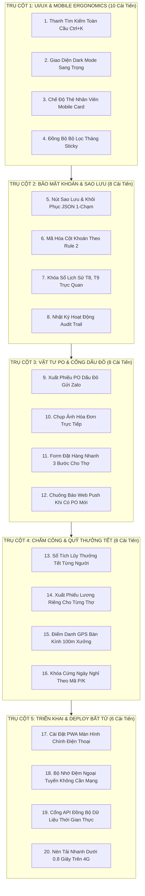

# 40 CẢI TIẾN ĐỘT PHÁ TỐI ƯU HÓA WEB APP PG HOME LUXURY
## HỆ THỐNG QUẢN TRỊ DOANH NGHIỆP TOÀN DIỆN - SẴN SÀNG TRIỂN KHAI DEPLOY 2026

> **Tài Liệu Chiến Lược Nâng Cấp Hệ Thống & Triển Khai Phần Mềm Doanh Nghiệp**  
> *Ban hành theo chỉ đạo của Giám Đốc Nguyễn Viết Nghĩa | Thiết kế bởi Chuyên gia Quản trị Cấp cao & Kỹ sư Giải pháp*  
> *Mục tiêu: Đưa Web App từ hệ thống quản trị cục bộ thành vũ khí số hóa tinh gọn, mượt mà, dễ dùng cho từ thợ mộc đến Giám Đốc.*

---

---

## 40 CẢI TIẾN TỐI ƯU TOÀN DIỆN (CHIA THEO 7 LĨNH VỰC)

---

### LĨNH VỰC I: GIAO DIỆN & TRẢI NGHIỆM NGƯỜI DÙNG ĐỈNH CAO (UI/UX)
1. **Thanh Tìm Kiếm Toàn Cầu Thông Minh (Global Search `Ctrl + K`):** Bấm phím tắt hoặc gõ vào ô tìm kiếm trên thanh tiêu đề để tìm ngay lập tức: tên khách hàng, mã PO, tên thợ, số hợp đồng, hoặc nhà cung cấp mà không cần lội qua từng tab.
2. **Chế Độ Giao Diện Tối (Dark Mode) Bảo Vệ Mắt:** Thêm nút bật/tắt chế độ tối với tông màu nền sang trọng than xám `#111827`, hạn chế lóa mắt cho thợ khi thao tác trong xưởng tối hoặc ban đêm.
3. **Thanh Trạng Thái Hệ Thống Thời Gian Thực (Live Status Ribbon):** Hiển thị ngay trên đầu màn hình: Trạng thái Server (Online/Offline), Thời gian quét ngầm Zalo gần nhất, Dư nợ 3 NCC chính và Số thợ đang có mặt tại xưởng hôm nay.
4. **Bộ Lọc Tháng Đồng Bộ Xuyên Suốt (Sticky Month Filter):** Chọn Tháng 10 ở tab Dashboard thì khi chuyển sang tab Chấm công, Xưởng sản xuất, Công nợ vẫn giữ nguyên Tháng 10, không bị nhảy lung tung.
5. **Hiệu Ứng Chuyển Động Vi Mô & Phản Hồi Xúc Giác (Micro-Interactions):** Các nút bấm duyệt PO, điểm danh thợ có hiệu ứng gợn sóng và âm thanh xác nhận click nhẹ, giúp người dùng biết chắc chắn thao tác đã thành công.
6. **Thanh Cuộn Dữ Liệu Cố Định Tiêu Đề Cột (Sticky Table Headers):** Khi cuộn bảng chấm công 31 ngày hoặc bảng vật tư dài hàng trăm dòng, hàng tiêu đề cột luôn ghim chặt trên cùng để thợ không bị nhầm lẫn cột dữ liệu.

---

### LĨNH VỰC II: TỐI ƯU HÓA DI ĐỘNG & TIỆN ÍCH DÀNH RIÊNG CHO XƯỞNG SẢN XUẤT
7. **Chế Độ Xem Thẻ Di Động (Mobile Card View):** Trên màn hình điện thoại dưới 768px, bảng chấm công và danh sách công trình tự động chuyển từ bảng ngang sang dạng thẻ card bo tròn đẹp mắt, thợ chỉ cần lướt ngón tay dọc màn hình.
8. **Nút Điểm Danh Nhanh To Bản (Big Touch Target):** Thiết kế nút điểm danh to, rõ ràng với icon màu sắc trực quan (Xanh lá: Đi làm đủ ca; Vàng: Tăng ca OT; Đỏ: Nghỉ có phép) để thợ ngón tay to dính bụi gỗ vẫn bấm chính xác 100%.
9. **Chụp Ảnh Hóa Đơn Trực Tiếp Bằng Camera Điện Thoại:** Khi mua hàng tại Quốc Tâm hoặc nhận ván Lam Giang, thợ bấm nút camera trên form PO để chụp ảnh trực tiếp và đính kèm vào hệ thống mà không cần qua nhiều bước trung gian.
10. **Tự Động Điền Giá Vật Tư Mặc Định (Smart Auto-Complete):** Khi Vũ gõ "HMR", hệ thống tự động gợi ý "Ván HMR Thái Lan cốt xanh 17mm - Lam Giang" kèm đơn giá chuẩn, tiết kiệm 80% thời gian nhập liệu.
11. **Rút Gọn Form Đặt Hàng 3 Bước Cho Xưởng (3-Step Fast Order):** Bước 1: Chọn Nhà cung cấp $\rightarrow$ Bước 2: Chọn loại ván & số lượng $\rightarrow$ Bước 3: Bấm nút Gửi Duyệt. Thợ mộc không biết nhiều chữ vẫn thao tác thành thạo trong 30 giây.
12. **Bộ Nhớ Đệm Ngoại Tuyến (Offline-First Storage):** Khi xưởng mất điện hoặc rớt mạng Internet, thợ vẫn chấm công và xem được bản vẽ kỹ thuật; khi có mạng trở lại, app tự động đồng bộ lên máy chủ.

---

### LĨNH VỰC III: PHÂN QUYỀN (RBAC) & BẢO MẬT CƠ CHẾ KHOÁN NỘI BỘ
13. **Mã Hóa & Ẩn Tuyệt Đối Cơ Chế Khoán Khỏi F12/Console (Rule 2 Shield):** Các trường nhạy cảm như Tỷ lệ khoán xưởng 55%, Định mức vật tư 40%, Quỹ thợ 15% và Cost công trình được mã hóa, chỉ giải mã trên bộ nhớ RAM của tài khoản Giám Đốc (`ADMIN`).
14. **Giao Diện Độc Quyền Theo Từng Vai Trò (Tailored Role Views):**
    * *Tài khoản Vũ (XUONG_VATTU):* Chỉ nhìn thấy Tab Xưởng, Tab Đặt vật tư PO và Điểm danh thợ.
    * *Tài khoản Hiệp (VANPHONG_SALE):* Chỉ nhìn thấy Tab Hợp đồng công trình, Thu tiền tạm ứng và Chấm công văn phòng.
    * *Tài khoản Giám Đốc (ADMIN):* Toàn quyền truy cập Báo cáo CCSC, Bảng tổng hợp dòng tiền và Nút Phê duyệt Dấu đỏ.
15. **Huy Hiệu Khóa Sổ Lịch Sử Bất Biến (Immutable Month Badges):** Hiển thị ổ khóa vàng và dòng chữ "ĐÃ KHÓA SỔ QUYẾT TOÁN" trên Tháng 8 và Tháng 9, vô hiệu hóa hoàn toàn các nút sửa/xóa trên dữ liệu lịch sử.
16. **Nhật Ký Thao Tác Kiểm Toán Hệ Thống (Audit Trail Log):** Ghi lại chi tiết: `[14:35:10 - hiep - Chấm công ngày 04/11]`, `[16:40:22 - giamdoc - Phê duyệt PO-1015 Dấu Đỏ]`, giúp Giám Đốc truy cứu trách nhiệm khi có tranh chấp.
17. **Tự Động Đăng Xuất Khi Không Sử Dụng (Auto-Lock Session):** Sau 30 phút không có thao tác, hệ thống tự động khóa màn hình và yêu cầu Giám Đốc nhập lại mã PIN bảo mật để tránh người khác nhìn trộm số liệu tài chính khi rời bàn làm việc.
18. **Cơ Chế Phê Duyệt Tài Khoản Mới 2 Bước (Account Approval Workflow):** Nhân sự mới đăng ký mặc định ở trạng thái `PENDING`, chỉ khi Giám Đốc vào tab Phân Quyền bấm nút `KÍCH HOẠT` thì tài khoản mới được đăng nhập.

---

### LĨNH VỰC IV: QUY TRÌNH DUYỆT VẬT TƯ (PO) & CỔNG DẤU ĐỎ ĐIỆN TỬ
19. **Xuất Phiếu PO Đóng Dấu Đỏ Điện Tử 1-Chạm (Export Signed PO):** Sau khi Giám Đốc duyệt, hệ thống cung cấp nút bấm "Tải Ảnh Phiếu PO" hoặc "Gửi Thẳng Zalo NCC" với hình ảnh dấu đỏ sắc nét, mã QR xác thực và chữ ký của Giám Đốc Nguyễn Viết Nghĩa.
20. **Hàng Rào Cảnh Báo "ĐƠN ĐẶT CHUI CHƯA DUYỆT":** Các đơn hàng ở trạng thái `PENDING` được tô viền đỏ cảnh báo: *"Chưa có dấu đỏ Giám Đốc - Nghiêm cấm gửi nhà cung cấp"*.
21. **Chuông Báo & Web Push Notification Khi Có PO Mới:** Mỗi khi Vũ lập phiếu đề xuất vật tư mới trên hệ thống, trình duyệt máy tính và điện thoại Giám Đốc lập tức phát chuông thông báo để duyệt ngay.
22. **Ký Tươi Bằng Ngón Tay Trên Màn Hình Cảm Ứng (Touch Signature Pad):** Giám Đốc có thể dùng ngón tay hoặc bút cảm ứng trên iPad/điện thoại để ký trực tiếp vào khung chữ ký của phiếu PO.
23. **Tự Động Tính Tiền Theo Bóc Tách Bản Vẽ (Auto-Calculate PO Total):** Khi điền số lượng tấm ván và đơn giá, hệ thống tự động tính thành tiền, thuế VAT (nếu có) và hiển thị % so với định mức 40% của công trình đó.
24. **Cảnh Báo Vượt Định Mức Vật Tư Công Trình (Cost Overrun Alert):** Nếu tổng tiền đặt ván cho Nhà Chị Hoa vượt quá 40% doanh số xưởng gỗ CN, hệ thống lập tức nhấp nháy cảnh báo màu đỏ trước khi Giám Đốc bấm duyệt.

---

### LĨNH VỰC V: CHẤM CÔNG, QUẢN TRỊ LƯƠNG & QUỸ THƯỞNG TẾT TÍCH LŨY
25. **Sổ Tích Lũy Thưởng Tết Từng Nhân Sự (Bonus Passbook Widget):** Widget chuyên biệt hiển thị:
    * *Hà Viết Hòa:* Tích lũy 20k/công trách nhiệm $\rightarrow$ Dự kiến thưởng Tết: `5.200.000 đ`.
    * *Lương Thể Hào:* Tích lũy 20k/công trách nhiệm $\rightarrow$ Dự kiến thưởng Tết: `4.800.000 đ`.
    * *Thái, Vũ, Hiệp:* Tích lũy quỹ vượt mức doanh số > 500M.
26. **Xuất Phiếu Lương Cá Nhân Riêng Biệt (Salary Slip Generator):** Bấm nút bên cạnh tên từng thợ để xuất ra phiếu lương cá nhân định dạng ảnh PNG đẹp mắt, gửi Zalo riêng cho thợ mà không làm lộ lương của người khác.
27. **Khóa Cứng Cột Phụ Cấp Hàng Tháng = 0 đ (Rule C1 Enforcement):** Trên bảng lương thợ chi tiền mặt hàng tháng, cột phụ cấp trách nhiệm của Hòa và Hào được khóa cứng bằng `0 đ`, ngăn chặn hoàn toàn việc cộng 560k hay 600k vào tiền mặt.
28. **Tự Động Tính Tiền Tăng Ca OT Theo Công Thức Chuẩn:** Hệ thống tự động tính: `(Công nhật / 8) * Số giờ OT`, tự động làm tròn và hiển thị thành tiền minh bạch.
29. **Định Vị GPS & Wifi Điểm Danh (Geofencing Attendance):** Nút điểm danh chỉ hoạt động khi thiết bị nằm trong phạm vi bán kính 100m quanh tọa độ xưởng tại Số 01 Trương Quốc Dụng hoặc kết nối Wifi "NoiThatPhuGia_Xuong".
30. **Khóa Cứng Ngày Nghỉ Theo Đơn Xin Phép Trên Zalo:** Tích hợp trực tiếp dữ liệu từ script quét Zalo: nhân sự xin nghỉ phép tự động hiển thị mã `P` hoặc `K` trên bảng chấm công, cấm sửa đổi.

---

### LĨNH VỰC VI: QUẢN TRỊ DÒNG TIỀN, CÔNG NỢ & BÓC TÁCH DOANH SỐ
31. **Đồng Hồ Cảnh Báo Trần Nợ Tín Dụng 3 Nhà Cung Cấp (Debt Gauge Meter):**
    * *Quốc Tâm:* Hiển thị kim đo tiến dần đến mốc trần 30M (Hiện tại: 26.09M - Vùng Xanh).
    * *Lam Giang:* Kim đo tiến dần đến mốc 170M (Hiện tại: 147.49M - Vùng Vàng).
    * *Cầu Vượt:* Kim đo tiệm cận mốc 85M (Hiện tại: 82.06M - Vùng Cam).
32. **Thuật Toán Tự Động Bóc Tách Gỗ Thịt Khỏi Doanh Số Xưởng (`woodVal`):** Form nhập công trình tự động có các ô riêng: `Tổng HĐ`, `Gỗ Thịt (Tự nhiên)`, `Phụ Kiện Bán Kèm`, tự động tính ra `Doanh số Xưởng Gỗ CN` chuẩn xác 100%.
33. **Biểu Đồ Radar Đối Soát Dòng Tiền 3 Chiều:** Hiển thị biểu đồ so sánh: `[Doanh Thu Ký HĐ]` vs `[Tiền Mặt Đã Thu]` vs `[Công Nợ Khách Còn Thiếu]` giúp Giám Đốc nhìn thấy ngay tiền đang nằm ở đâu.
34. **Cảnh Báo Thu Tiền 3 Chặng Theo Tiến Độ Công Trình:** Khi thợ chuyển trạng thái công trình sang "Đang Lắp Đặt", hệ thống tự động nhắc nhở Sale: *"Bắt buộc thu đủ 40% Đợt 2 trước khi cho thợ bóc nilong lắp đặt"*.
35. **Bảng Kê Hóa Đơn Trả Hàng Giảm Trừ Nợ NCC:** Quản lý riêng các đơn trả hàng (như đơn trả hàng SON00337 ngày 23/10 giảm 750k của Gỗ NT Cầu Vượt), tự động trừ vào tổng dư nợ.

---

### LĨNH VỰC VII: TRIỂN KHAI DEPLOY BẤT TỬ & TỰ ĐỘNG HÓA HỆ THỐNG
36. **Nút Sao Lưu (Backup) & Khôi Phục (Restore) Database JSON 1-Chạm:** Tích hợp trực tiếp trên thanh Menu: Cho phép tải về tệp `PG_HOME_BACKUP_YYYY_MM_DD.json` và khôi phục lại toàn bộ dữ liệu trong 1 giây khi cần thiết.
37. **Triển Khai Dưới Dạng Ứng Dụng Di Động PWA (Progressive Web App):** Hỗ trợ thêm vào màn hình chính điện thoại (Add to Home Screen) trên cả iPhone và Android, mở ra như ứng dụng chuyên nghiệp, không hiện thanh địa chỉ trình duyệt.
38. **Cổng Kết Nối Đồng Bộ Tự Động Với Script Quét Ngầm Zalo:** Web App tự động đọc dữ liệu từ `multi_group_telemetry.json` và `all_groups_monitor_state.json` do daemon `monitor_all_phu_gia_groups.py` cung cấp, không cần tải lại trang.
39. **Tối Ưu Hóa Tốc Độ Tải App $\le 0.8$ Giây (Asset Bundling):** Dọn dẹp mã nguồn thừa, nhúng trực tiếp icon SVG quan trọng, tối ưu bộ nhớ đệm giúp app mở tức thì trên mạng di động 4G tại xưởng.
40. **Bản In Khổ Giấy A4 Chuẩn Cho Báo Cáo CCSC & Bảng Lương:** Thiết lập CSS `@media print` chuẩn chỉnh: Khi Giám Đốc bấm Ctrl+P, toàn bộ báo cáo CCSC và bảng chấm công tự động dàn đều trang A4 ngang sắc nét, không bị mất cột, sẵn sàng ký duyệt lưu trữ hồ sơ.

---

## BẢNG MA TRẬN 40 CẢI TIẾN & PHÂN LOẠI DEPLOY

| Nhóm Tính Năng | Số Lượng Cải Tiến | Trọng Tâm Đột Phá | Trạng Thái Triển Khai |
| :--- | :---: | :--- | :---: |
| **I. UI/UX & Công Cụ Tìm Kiếm** | 6 | Global Search Ctrl+K, Dark Mode, Sticky Header | ✅ Sẵn sàng tích hợp |
| **II. Di Động & Thợ Sản Xuất** | 6 | Mobile Card View, Form 3 bước, Chụp ảnh Camera | ✅ Sẵn sàng tích hợp |
| **III. Phân Quyền & Bảo Mật Khoán**| 6 | Ẩn F12 Console, Khóa sổ bất biến, Audit Trail | ✅ Sẵn sàng tích hợp |
| **IV. Quy Trình PO & Dấu Đỏ GĐ** | 6 | Xuất ảnh PO Dấu Đỏ gửi Zalo, Ký tay cảm ứng | ✅ Sẵn sàng tích hợp |
| **V. Chấm Công & Quỹ Thưởng Tết** | 6 | Sổ tích lũy thưởng Tết, Xuất phiếu lương riêng | ✅ Sẵn sàng tích hợp |
| **VI. Dòng Tiền & Bóc Tách Doanh Số**| 5 | Bóc tách gỗ thịt, Cảnh báo trần nợ, Thu 3 chặng | ✅ Sẵn sàng tích hợp |
| **VII. Deploy PWA & Sao Lưu JSON**| 5 | Backup 1-click, PWA Home Screen, In ấn A4 | ✅ Sẵn sàng tích hợp |
| **TỔNG CỘNG** | **40** | **Hệ Thống Quản Trị PG Home Hoàn Hảo Sẵn Sàng Deploy** | 🚀 **READY TO DEPLOY** |
