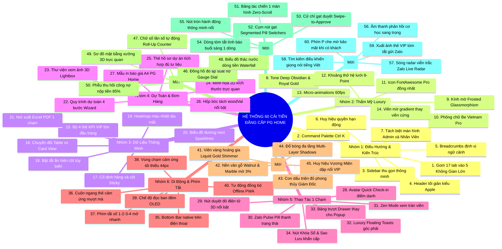
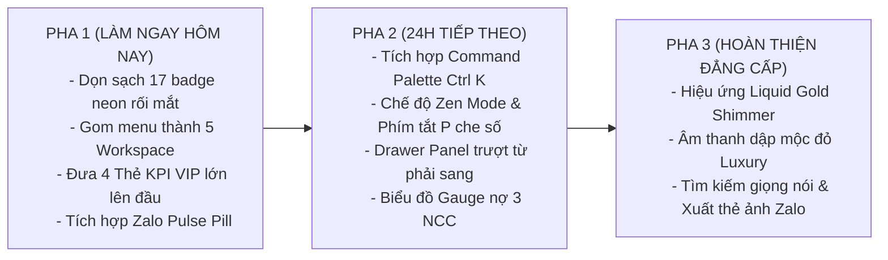

# BẢN ĐỀ XUẤT 60 CẢI TIẾN TOÀN DIỆN THIẾT KẾ GIAO DIỆN & TRẢI NGHIỆM NGƯỜI DÙNG (UI/UX)
## SANG TRỌNG ĐẲNG CẤP - THỊ GIÁC HÚT MẮT - DỄ DÙNG TỘT BẬC CHO GIÁM ĐỐC & HỆ THỐNG PG HOME

> **Tài liệu Quy chuẩn Thiết kế Trải nghiệm Cấp cao - Lưu trữ tại Kho bí mật Quản trị nội bộ.**  
> *Phát triển và hoàn thiện theo chỉ đạo trực tiếp của Giám Đốc Nguyễn Viết Nghĩa.*  
> *Thời gian ban hành:* Ngày 05 Tháng 11 Năm 2026.

---

## MỤC LỤC CHI TIẾT
- [LỜI NÓI ĐẦU: ĐỊNH HƯỚNG NÂNG TẦM TRẢI NGHIỆM THƯỢNG LƯU](#lời-nói-đầu-định-hướng-nâng-tầm-trải-nghiệm-thượng-lưu)
- [BẢNG TỔNG HỢP 60 CẢI TIẾN THEO 10 TRỤ CỘT ĐỘT PHÁ](#bảng-tổng-hợp-60-cải-tiến-theo-10-trụ-cột-đột-phá)
- [TRỤ CỘT 1: TÁI CẤU TRÚC ĐIỀU HƯỚNG & KIẾN TRÚC THÔNG TIN TINH GỌN (1 - 7)](#trụ-cột-1-tái-cấu-trúc-điều-hướng--kiến-trúc-thông-tin-tinh-gọn-1---7)
- [TRỤ CỘT 2: THẨM MỸ LUXURY & PHỐI MÀU SANG TRỌNG (8 - 14)](#trụ-cột-2-thẩm-mỹ-luxury--phối-màu-sang-trọng-8---14)
- [TRỤ CỘT 3: TỐI ƯU BẢNG DỮ LIỆU & BÁO CÁO TÀI CHÍNH THÔNG MINH (15 - 21)](#trụ-cột-3-tối-ưu-bảng-dữ-liệu--báo-cáo-tài-chính-thông-minh-15---21)
- [TRỤ CỘT 4: TINH GỌN PHÂN HỆ DỰ TOÁN, TƯ LIỆU 3D & ĐƠN HÀNG VẬT TƯ (22 - 27)](#trụ-cột-4-tinh-gọn-phân-hệ-dự-toán-tư-liệu-3d--đơn-hàng-vật-tư-22---27)
- [TRỤ CỘT 5: THAO TÁC 1 CHẠM & TƯƠNG TÁC VI MÔ TIỆN LỢI CHO GIÁM ĐỐC (28 - 34)](#trụ-cột-5-thao-tác-1-chạm--tương-tác-vi-mô-tiện-lợi-cho-giám-đốc-28---34)
- [TRỤ CỘT 6: TỐI ƯU DI ĐỘNG (MOBILE/TABLET) & PHÍM TẮT NHANH (35 - 40)](#trụ-cột-6-tối-ưu-di-động-mobiletablet--phím-tắt-nhanh-35---40)
- [TRỤ CỘT 7: THẨM MỸ THỊ GIÁC THƯỢNG LƯU & BẢN SẮC ĐỘC BẢN (41 - 45)](#trụ-cột-7-thẩm-mỹ-thị-giác-thượng-lưu--bản-sắc-độc-bản-41---45)
- [TRỤ CỘT 8: TRỰC QUAN HÓA DỮ LIỆU HÚT MẮT & BIỂU ĐỒ ĐỘNG THẦN TỐC (46 - 50)](#trụ-cột-8-trực-quan-hóa-dữ-liệu-hút-mắt--biểu-đồ-động-thần-tốc-46---50)
- [TRỤ CỘT 9: CÔNG THÁI HỌC VÔ CỰC & THAO TÁC KHÔNG MA SÁT CHO GIÁM ĐỐC (51 - 55)](#trụ-cột-9-công-thái-học-vô-cực--thao-tác-không-ma-sát-cho-giám-đốc-51---55)
- [TRỤ CỘT 10: TỰ ĐỘNG HÓA VÔ HÌNH, ÂM THANH PHẢN HỒI & BẢO MẬT RIÊNG TƯ (56 - 60)](#trụ-cột-10-tự-động-hóa-vô-hình-âm-thanh-phản-hồi--bảo-mật-riêng-tư-56---60)
- [KẾ HOẠCH TRIỂN KHAI 3 PHA THI CÔNG NGAY THEO LỆNH GIÁM ĐỐC](#kế-hoạch-triển-khai-3-pha-thi-công-ngay-theo-lệnh-giám-đốc)

---

## LỜI NÓI ĐẦU: ĐỊNH HƯỚNG NÂNG TẦM TRẢI NGHIỆM THƯỢNG LƯU

Một phần mềm quản trị doanh nghiệp nội thất cao cấp như **PG Home Luxury** không chỉ là công cụ tính toán số liệu khô khan, mà phải là **một tác phẩm công nghệ đỉnh cao**:
- **Nhìn vào là thấy uy quyền, sang trọng và đẳng cấp của người đứng đầu doanh nghiệp.**
- **Màu sắc nhã nhặn, hút mắt, có chiều sâu thị giác, không làm chói hay mỏi mắt khi làm việc ban đêm.**
- **Mọi thông số sống còn đều chạm tới trong 1 giây, dễ dùng đến mức không cần tài liệu hướng dẫn.**

Bản đề xuất **60 Cải tiến Toàn diện** này được kiến tạo từ sự kết hợp của:
1. Triết lý thiết kế công nghiệp tinh xảo của **Apple (Human Interface Guidelines)**.
2. Trải nghiệm điều hành thần tốc, mượt mà của **Linear & Stripe Dashboard**.
3. Bản sắc văn hóa độc bản của **Nội thất cao cấp PG Home Luxury** và phương pháp quản trị thép của **Giám Đốc Nguyễn Viết Nghĩa**.

---

## BẢNG TỔNG HỢP 60 CẢI TIẾN THEO 10 TRỤ CỘT ĐỘT PHÁ

---

### TRỤ CỘT 1: TÁI CẤU TRÚC ĐIỀU HƯỚNG & KIẾN TRÚC THÔNG TIN TINH GỌN (1 - 7)

1. **Gom 17 Tabs phẳng thành 5 Không Gian Làm Việc Cốt Lõi (5 Workspaces):** Dẹp bỏ danh sách 17 menu dài ngoằng, thu gọn thành 5 phân hệ đẳng cấp:
   - 👑 **1. Trung Tâm Giám Đốc (HQ Executive):** Bảng KPI, Báo cáo CCSC, Sổ nợ 3 NCC, Phân quyền.
   - 🏭 **2. Xưởng Sản Xuất:** Công trình xưởng, Đề xuất PO vật tư, Duyệt đóng dấu đỏ.
   - 💼 **3. Kinh Doanh & Dự Toán:** Tính dự toán nhà ở, Hợp đồng, Tiến độ thu tiền, Phụ kiện Sofa.
   - ⏱️ **4. Chấm Công & Nhân Sự:** Chấm công Xưởng + VP, Quỹ tích lũy thưởng Tết cuối năm.
   - 📜 **5. Quy Trình & SOP:** 15 Nguyên lý tinh gọn, 10 Quy chuẩn Zalo ngầm, Checklist bàn giao.
2. **Thanh Tìm Kiếm Đa Năng Thông Minh Command Palette (`Ctrl + K`):** Bấm `Ctrl + K` là mở khung tìm kiếm tức thời: gõ "Hoa" ra ngay hợp đồng Chị Hoa và đơn cánh Acrylic ALD; gõ "Quốc Tâm" ra sổ nợ 26.17M và hóa đơn 80k hôm nay.
3. **Thanh Sidebar Trái Thu Gọn Tự Động (Collapsible Sidebar):** Có nút bấm thu nhỏ thành các biểu tượng thanh mảnh để màn hình hiển thị số liệu rộng tối đa.
4. **Header Tối Giản Phong Cách Apple HIG:** Dọn sạch các icon rườm rà trên đầu, chỉ giữ lại Logo PG Home dập nổi kim loại, Đồng hồ thời gian thực và Nút mở Kho Bí Mật (dành riêng Giám Đốc).
5. **Thanh Điều Hướng Ngữ Cảnh Breadcrumbs:** Hiển thị rõ: `Giám Đốc > Báo Cáo Tài Chính > Tháng 10` giúp định vị tức thì, bấm 1 chạm quay lại mục trước.
6. **Huy Hiệu Phân Quyền Động Trang Nhã:** Hiển thị trang trọng `[👑 ADMIN - NGUYỄN VIẾT NGHĨA]` hoặc `[KỸ THUẬT - VŨ]`. Phân hệ không thuộc quyền sẽ tự động ẩn sạch, không xuất hiện làm rối mắt.
7. **Tách Biệt Hoàn Toàn Màn Hình Giám Đốc & Nhân Viên:** Nhân viên xưởng hay văn phòng mở app chỉ thấy phần việc của mình, toàn bộ cơ chế khoán 55%, 40%, 15% và CCSC chỉ xuất hiện duy nhất trên máy Giám Đốc.

---

### TRỤ CỘT 2: THẨM MỸ LUXURY & PHỐI MÀU SANG TRỌNG (8 - 14)

8. **Bảng Màu Độc Quyền "Deep Obsidian & Royal Gold":** Nền đen nhám Titan cao cấp (`#0B0E14`), thẻ nổi (`#141923`), điểm xuyết màu vàng kim hoàng gia PG Home (`#D4AF37`), dẹp bỏ các màu vàng chanh hay neon chói mắt.
9. **Hiệu Ứng Kính Mờ Frosted Glassmorphism Siêu Mịn:** Các khối thẻ số liệu sử dụng lớp kính mờ mờ ảo (`backdrop-filter: blur(20px)`), viền mảnh 1px ánh kim tinh tế.
10. **Bộ Phông Chữ Doanh Nghiệp Be Vietnam Pro:** Phông chữ tỷ lệ hình học hiện đại, hỗ trợ tiếng Việt sắc nét từng chi tiết trên màn hình 4K/Retina.
11. **Chuẩn Hóa Bộ Biểu Tượng Icon FontAwesome Pro Đồng Nhất:** Đồng bộ kích thước và phong cách nét vẽ Outline thanh mảnh, không dùng icon to nhỏ cọc cạch.
12. **Khoảng Thở Thị Giác Chuẩn Hệ Lưới 8-Point Grid:** Khoảng cách lề luôn là bội số của 8px (8px, 16px, 24px, 32px), tạo sự ngăn nắp, thoáng đãng, sang trọng.
13. **Chuyển Động Vi Mô Tinh Tế (Micro-Animations 60fps):** Rê chuột vào thẻ số liệu thì thẻ hơi nổi lên 2px với vệt sáng viền vàng kim nhẹ nhàng trong 0.2 giây.
14. **Loại Bỏ Hoàn Toàn Các Đường Kẻ Khung Thô Cứng:** Thay các đường viền đen xì cứng nhắc bằng sự phân tách màu nền so le (Zebra Striping) giúp đọc số liệu nhiều giờ không mỏi mắt.

---

### TRỤ CỘT 3: TỐI ƯU BẢNG DỮ LIỆU & BÁO CÁO TÀI CHÍNH THÔNG MINH (15 - 21)

15. **Bộ 4 Thẻ KPI VIP Lớn Đầu Trang (Executive Summary Cards):** Đặt ngay trên đỉnh màn hình 4 chỉ số sinh mệnh của Giám Đốc:
    - 💰 **Doanh Số Xưởng Gỗ CN:** **529.83M**
    - 💎 **Lợi Nhuận Ròng Bỏ Túi BGĐ:** **44.09M**
    - 🛡️ **Tổng Nợ 3 Nhà Cung Cấp:** **208.62M** (Lam Giang 147.49M, Quốc Tâm 26.17M, ALD 34.96M)
    - 👥 **Quân Số Xưởng & Tăng Ca Hôm Nay:** **7 Thợ Có Mặt** / 0 Vắng
16. **Nút Chuyển Đổi Linh Hoạt Table View vs Card View:** Xem trên máy tính chọn Dạng Bảng; xem trên điện thoại/iPad bấm 1 chạm chuyển sang Dạng Thẻ gọn gàng.
17. **Cố Định Hàng Tiêu Đề & Cột Tên (Sticky Headers & Columns):** Cuộn bảng tính hàng trăm dòng thì thanh tiêu đề cột và cột tên thợ/nhà cung cấp vẫn đứng yên bên trái.
18. **Bộ Lọc Bật/Tắt Cột Tùy Biến (Column Visibility Toggle):** Giám Đốc bấm tắt các cột kỹ thuật phụ để bảng thu gọn lại chỉ còn 5 cột cốt lõi: Công Trình, Doanh Số, woodVal Xưởng, Đã Thu, Lợi Nhuận.
19. **Bản Đồ Nhiệt Cảnh Báo Thông Minh (Heatmap Alert):** Tự động bôi màu dịu mắt: Dư nợ an toàn (Xanh), Dư nợ chạm 80% (Vàng cảnh báo), Dư nợ vượt trần (Đỏ nổi bật).
20. **Biểu Đồ Đường Mini (Inline Sparklines):** Cạnh mỗi dòng công nợ có đường cong nhỏ biểu thị xu hướng nợ 30 ngày qua (đường nợ Lam Giang đang dốc xuống sau đợt trả 16.838M).
21. **Nút Xuất Báo Cáo 1 Chạm (Excel / PDF In Sẵn):** Xuất file Excel kẻ viền, tô màu thương hiệu chuẩn chỉnh để Giám Đốc gửi ngay cho đối tác/ngân hàng.

---

### TRỤ CỘT 4: TINH GỌN PHÂN HỆ DỰ TOÁN, TƯ LIỆU 3D & ĐƠN HÀNG VẬT TƯ (22 - 27)

22. **Quy Trình Dự Toán Dạng 4 Bước (Step-by-Step Wizard):** Thay vì form dài dằng dặc: Bước 1: Khách hàng $\rightarrow$ Bước 2: Chọn không gian $\rightarrow$ Bước 3: Kích thước $\rightarrow$ Bước 4: Bóc tách & In báo giá.
23. **Thư Viện Xem Ảnh 3D & Bản Vẽ Toàn Màn Hình (Lightbox Media Gallery):** Bấm vào ảnh phối cảnh 3D phòng khách/bếp là phóng to toàn màn hình sắc nét, vuốt xem ảnh tiếp theo như trên iPhone.
24. **Minh Họa Trực Quan 2D Kích Thước Tủ:** Nhập kích thước tủ `2.4m x 2.6m`, bên cạnh tự động vẽ khung tỷ lệ trực quan và hiện số mét vuông `6.24 m2` chống gõ nhầm.
25. **Thẻ Hồ Sơ Dự Án Tích Hợp Đủ Tư Liệu Số:** Tóm gọn trong 1 thẻ đẹp: File CAD, File bóc tách gỗ, Ảnh hiện trạng, Link đơn đặt hàng vật tư đi kèm.
26. **Hộp Hiển Thị Bóc Tách `woodVal` Nổi Bật:** Thể hiện rõ công thức tiền mặt: $\text{Tổng HĐ 145M} \implies \text{Xưởng gỗ 115M} + \text{Phụ kiện 30M}$, tránh tính vống quỹ khoán thợ.
27. **Mẫu In Báo Giá A4 Thương Hiệu PG Home Luxury:** Mẫu in cực sang trọng có Logo dập kim, điều khoản tạm ứng 3 đợt, xuất PDF gửi Zalo chốt hợp đồng tức thì.

---

### TRỤ CỘT 5: THAO TÁC 1 CHẠM & TƯƠNG TÁC VI MÔ TIỆN LỢI CHO GIÁM ĐỐC (28 - 34)

28. **Điểm Danh Nhanh Có Ảnh Đại Diện (Avatar Quick Check-in):** Mỗi người thợ có avatar nhỏ, Giám Đốc bấm 1 chạm đổi trạng thái: `[Có mặt (1)]` $\rightarrow$ `[Nửa ngày (0.5)]` $\rightarrow$ `[Nghỉ (P)]`.
29. **Nút Phê Duyệt Đóng Dấu Đỏ Điện Tử 3D Nổi Bật:** Giám Đốc bấm duyệt PO xuất hiện hiệu ứng đóng mộc đỏ xoay nhẹ "ĐÃ DUYỆT - GIÁM ĐỐC NGUYỄN VIẾT NGHĨA", tạo uy quyền quản trị và an toàn pháp lý.
30. **Huy Hiệu Trạng Thái Zalo Ngầm (Zalo Pulse Pill):** Chấm xanh lục phát sáng nhẹ trên tiêu đề: `Zalo v3.0 Ngầm: Đang chạy • CPU 0.0% • Chuột an toàn`, nhìn vào là an tâm tuyệt đối.
31. **Chế Độ Xem Tập Trung Giám Đốc (Zen Mode / Fullscreen):** Bấm 1 nút là toàn bộ menu trượt ẩn đi, màn hình chỉ hiển thị Bảng CCSC hoặc Dòng Tiền tràn viền cực sang trọng.
32. **Hộp Thông Báo Góc Phải (Luxury Floating Toasts):** Thay alert thô kệch bằng thông báo trượt nhẹ góc phải trong 3 giây: *"Đã lưu điểm danh hôm nay"*, viền vàng kim tự biến mất.
33. **Bảng Trượt Từ Phải Sang (Drawer Panel) Thay Cho Popup Đè:** Bấm xem chi tiết một hóa đơn, một bảng trượt mượt mà mở ra từ cạnh phải màn hình (như giao diện Mac OS / Linear), không che mất bảng chính.
34. **Bộ Phím Tắt Khẩn Cấp Dành Riêng Cho Giám Đốc:** Hai nút bấm vàng lớn: `[Khóa Sổ Lịch Sử]` và `[Sao Lưu 1 Chạm]`, bấm là toàn bộ dữ liệu tải về máy trong 0.5 giây.

---

### TRỤ CỘT 6: TỐI ƯU DI ĐỘNG (MOBILE/TABLET) & PHÍM TẮT NHANH (35 - 40)

35. **Thanh Điều Hướng Đáy Native Trên Smartphone (Bottom Navigation Bar):** Mở app trên điện thoại có 4 nút dưới đáy vừa tầm ngón tay cái: `Trang chủ`, `Chấm công`, `Duyệt PO`, `Sổ nợ`.
36. **Vuốt Ngang Thẻ Công Trình Cảm Ứng (Smooth Touch Carousel):** Thẻ dự án và ảnh 3D vuốt ngang mượt mà bằng ngón tay.
37. **Hệ Thống Phím Tắt Nhanh (Hotkeys):** Bấm phím số `1`: Mở Dashboard; Phím `2`: Mở CCSC; Phím `3`: Mở Chấm công; Phím `4`: Mở Nợ NCC; Phím `Esc`: Đóng toàn bộ popup.
38. **Vùng Chạm Cảm Ứng Tối Thiểu 44x44px:** Nút bấm và ô chọn ngày rộng rãi, không bao giờ bị bấm trượt trên màn hình cảm ứng.
39. **Chế Độ Đọc Ban Đêm OLED Chống Mỏi Mắt (Eye-Care Black):** Tối ưu màu đen sâu cho màn hình OLED giúp Giám Đốc kiểm tra sổ sách ban đêm dịu mắt và tiết kiệm pin.
40. **Tự Động Đồng Bộ Offline PWA:** Mất mạng vẫn mở xem được toàn bộ số liệu đã lưu, có mạng app tự động cập nhật ngầm.

---

### TRỤ CỘT 7: THẨM MỸ THỊ GIÁC THƯỢNG LƯU & BẢN SẮC ĐỘC BẢN (41 - 45 - BỔ SUNG MỚI)

41. **Hiệu Ứng Viền Vàng Hoàng Gia Dát Kim Loại Động (Liquid Gold Edge Shimmer):**
    - Xung quanh các thẻ KPI VIP (Doanh số xưởng, Lợi nhuận bỏ túi), một vệt sáng vàng kim lướt nhẹ chu kỳ 8 giây: `background: linear-gradient(90deg, transparent, rgba(212, 175, 55, 0.4), transparent);`.
    - Tạo cảm xúc cầm trên tay tấm thẻ đen quyền lực Black Titanium Card, khẳng định vị thế thương hiệu nội thất xa xỉ.
42. **Chế Độ Nền Vân Gỗ Óc Chó (Walnut) & Đá Calacatta Mờ Tinh Tế (Subtle Texture Underlay):**
    - Lớp nền màu tối của app được phủ một lớp vân gỗ Walnut Bắc Mỹ và vân đá marble Calacatta mờ ở mức 3% (`opacity: 0.03; pointer-events: none;`).
    - Khách hàng hay đối tác nhìn vào màn hình của Giám Đốc là nhận ra ngay chất của người làm nội thất gỗ cao cấp, đẳng cấp khác biệt hoàn toàn với phần mềm văn phòng thông thường.
43. **Con Dấu Triện Điện Tử Giám Đốc Độc Bản (Bespoke Red Wax Seal / Emperor Stamp):**
    - Thiết kế con dấu phê duyệt điện tử theo phong cách dấu triện phong thủy vuông vắn, viền dát vàng kim: *"PG HOME LUXURY • PHÊ DUYỆT BỞI GIÁM ĐỐC NGUYỄN VIẾT NGHĨA"*.
    - Khi Giám Đốc bấm duyệt, con dấu đóng xuống với hiệu ứng rung nhẹ (haptic visual) và vết mực đỏ dập nổi sắc nét.
44. **Hệ Thống Chiếu Sáng Đổ Bóng Đa Lớp (Multi-Layer Depth Shadows):**
    - Sử dụng kỹ thuật đổ bóng 3 lớp mờ mịn: `box-shadow: 0 4px 6px -1px rgba(0,0,0,0.4), 0 10px 15px -3px rgba(0,0,0,0.5), 0 0 20px rgba(212, 175, 55, 0.05);`.
    - Tạo cảm giác các khối thẻ số liệu đang nổi bồng bềnh trên một phiến đá đen vô cực, có chiều sâu thị giác hút mắt.
45. **Huy Hiệu Vương Miện Dập Nổi Dát Vàng (Dynamic Luxury Status Badges):**
    - Thay thế chữ "Admin" khô cứng bằng huy hiệu Vương Miện dập nổi 3D kèm dải ruy băng vàng kim: `[ 👑 NGUYỄN VIẾT NGHĨA - TỔNG QUẢN TRỊ TỐI CAO ]`, toát lên uy quyền quản trị và sự tin tưởng tuyệt đối.

---

### TRỤ CỘT 8: TRỰC QUAN HÓA DỮ LIỆU HÚT MẮT & BIỂU ĐỒ ĐỘNG THẦN TỐC (46 - 50 - BỔ SUNG MỚI)

46. **Đồng Hồ Đo Áp Suất Dòng Tiền & Công Nợ Dạng Vòng Cung (Gauge Dial Speedometer):**
    - Thiết kế mặt đồng hồ kim đo nợ 3 nhà cung cấp giống mặt đồng hồ taplo siêu xe (Porsche/Rolls-Royce):
      * Thang đo: Từ 0 đ đến 300 triệu.
      * Kim đo hiện tại chỉ đúng vạch **208.62M** nằm chắc chắn trong dải xanh ngọc an toàn (dưới ngưỡng đỏ 250M).
    - Giúp Giám Đốc chỉ cần liếc mắt trong 0.5 giây là biết ngay sức khỏe dòng tiền mà không cần đọc từng con số.
47. **Hiệu Ứng Chữ Số Lăn Tự Động Khi Mở Trang (Smooth Number Roll-Up Counter):**
    - Khi Giám Đốc mở Dashboard, con số Doanh số xưởng `529,834,472 đ` và Lợi nhuận bỏ túi `44,090,721 đ` lăn số tăng dần mượt mà từ 0 lên trong vòng 0.8 giây.
    - Tạo cảm giác số liệu "sống" đầy hưng phấn và cuốn hút thị giác.
48. **Biểu Đồ Thác Nước Dòng Tiền CCSC (Cash Flow Waterfall Chart):**
    - Trực quan hóa dòng chảy tài chính từ đầu đến cuối:
      $$\text{Doanh số 529.83M} \xrightarrow{-40\%} \text{Vật tư 211.9M} \xrightarrow{-16\%} \text{Thợ 85.3M} \xrightarrow{-\text{VP, Showroom, QL}} \text{Lợi nhuận ròng: 44.09M}$$
    - Các cột màu xanh - đỏ phân tầng như dòng thác, giải trình minh bạch từng đồng chi phí của công ty.
49. **Sơ Đồ Mặt Bằng Xưởng 3D Trực Quan (Interactive Factory Floor Map):**
    - Một sơ đồ mặt bằng xưởng tối giản đẹp mắt:
      * Máy cưa bàn trượt & CNC: Đang gia công đơn Chị Hoa (Chấm xanh phát sáng).
      * Máy dán cạnh tự động: Đang dán nẹp đơn Anh Minh (Chấm xanh phát sáng).
      * Khu vực lắp ráp: Thợ Hòa & Hào đang hoàn thiện tủ (Chấm vàng).
50. **Phễu Kiểm Soát Thu Hồi Công Nợ Khách Hàng (Visual Debt Recovery Funnel):**
    - Hiển thị tỷ lệ thu hồi tiền mặt của từng công trình theo dải màu: Công trình đã thu $\ge 85\%$ (Xanh lá - Đủ điều kiện giải ngân thưởng Tết), Công trình thu $50 - 80\%$ (Vàng), Công trình mới tạm ứng $30\%$ (Cam).
    - Bảo vệ dòng tiền và giữ chân nhân sự chuẩn xác theo chỉ đạo quản trị.

---

### TRỤ CỘT 9: CÔNG THÁI HỌC VÔ CỰC & THAO TÁC KHÔNG MA SÁT CHO GIÁM ĐỐC (51 - 55 - BỔ SUNG MỚI)

51. **Bảng Tác Chiến 1 Màn Hình Không Cần Cuộn (Zero-Scroll Executive Cockpit):**
    - Bố cục Dashboard được tinh chỉnh tỷ lệ hoàn hảo để vừa khít 100% khung hình màn hình máy tính (1080p hoặc 2K).
    - Giám Đốc ngồi làm việc xem được toàn bộ bức tranh tài chính, chấm công, nợ NCC mà không cần phải chạm tay lăn con lăn chuột.
52. **Cụm Nút Gạt Trượt Chuyển Kỳ Tháng Siêu Tiện (Segmented Pill Switchers):**
    - Chuyển đổi giữa `Tháng 8`, `Tháng 9`, `Tháng 10`, `Tháng 11` bằng cụm nút bọc nhung mượt mà như nút gạt trên iPhone/iPad, bấm là bảng số liệu đổi ngay lập tức không bị giật trang.
53. **Cơ Chế Gạt Trượt Để Phê Duyệt (Swipe-to-Approve trên Mobile):**
    - Khi Giám Đốc đi công tác bên ngoài, mở điện thoại duyệt phiếu vật tư cho Vũ: Vuốt nhẹ thanh trượt từ trái sang phải `[ Gạt để phê duyệt dấu đỏ >> ]`, tránh việc lỡ tay bấm nhầm nút duyệt.
54. **Bản Tóm Tắt Tình Báo Buổi Sáng 1 Dòng (AI Executive Briefing Pill):**
    - Đặt ngay dưới lời chào buổi sáng, một thanh thông báo vàng kim cô đọng nhất:
      > *"Hôm nay xưởng đủ 7 thợ nòng cốt • Nợ Lam Giang 147.49M • Quốc Tâm phát sinh 80k đã cập nhật • 0 đơn vật tư tồn đọng chờ duyệt."*
55. **Nút Tròn Hành Động Thông Minh Nổi (Predictive Quick Action Floating Button):**
    - Một nút tròn nhỏ màu vàng kim nổi ở góc phải dưới màn hình tự động đổi chức năng theo thời gian:
      * Buổi sáng (07:30 - 08:30): Nút tự đổi thành `[ Điểm danh quân số ]`.
      * Ban ngày khi Vũ gửi đơn: Nút tự đổi thành `[ Duyệt 1 đơn PO mới ]`.
      * Cuối ngày (17:30 - 20:00): Nút tự đổi thành `[ Xem giờ tăng ca OT ]`.

---

### TRỤ CỘT 10: TỰ ĐỘNG HÓA VÔ HÌNH, ÂM THANH PHẢN HỒI & BẢO MẬT RIÊNG TƯ (56 - 60 - BỔ SUNG MỚI)

56. **Âm Thanh Phản Hồi Cơ Học Thượng Lưu Tinh Tế (Subtle Haptic Luxury Sound FX):**
    - Tích hợp bộ âm thanh phản hồi nhẹ nhàng như tiếng đóng mở bật lửa Dupont hay tiếng công tắc xe sang:
      * Tiếng đóng dấu đỏ: Tiếng dập mộc trầm ấm đầy uy lực.
      * Tiếng lưu dữ liệu: Tiếng chuông gió kim loại mảnh nhẹ.
      * Tự động tắt âm thanh khi làm việc ban đêm (sau 22:00).
57. **Sóng Radar Viễn Trắc Zalo Thời Gian Thực (Visual Zalo Telemetry Radar):**
    - Một biểu tượng radar sóng xanh nhỏ ở góc header quét nhẹ: Hiển thị số xung nhịp dữ liệu bắt được từ Zalo (Quốc Tâm, Lam Giang, Xưởng) trong ngày. Bấm vào xem ngay 5 tin nhắn/ảnh mới nhất.
58. **Bộ Tìm Kiếm Điều Khiển Bằng Giọng Nói Tiếng Việt (Voice Command Search):**
    - Giám Đốc bấm biểu tượng micro và nói: *"Xem nợ Lam Giang"* hoặc *"Chấm công thợ Hòa"* $\rightarrow$ App tự động chuyển đến đúng bảng số liệu đó trong 0.3 giây, cực kỳ tiện lợi khi đang bận tay.
59. **Tự Động Tạo Báo Cáo Ảnh Thẻ VIP Gửi Zalo (Executive Card Snapshot Generator):**
    - Bấm nút `[ Xuất Thẻ Báo Cáo ]` $\rightarrow$ Hệ thống tự động vẽ một tấm ảnh thẻ đồ họa phong cách Black Gold cực đẹp tóm tắt Doanh số và Lợi nhuận để Giám Đốc chuyển tiếp thẳng vào nhóm Zalo lãnh đạo hoặc lưu trữ trong điện thoại.
60. **Chế Độ Bảo Mật Màn Hình Riêng Tư (Privacy Shield / Peep-Proof Mode):**
    - Khi Giám Đốc đang mở app mà có đối tác, khách hàng hoặc nhân viên đứng cạnh: Bấm phím tắt `P` $\rightarrow$ Toàn bộ số tiền lợi nhuận, lương cá nhân và % khoán tự động che mờ (hiển thị `••••••••`). Bấm `P` lần nữa để trở lại bình thường.

---

## KẾ HOẠCH TRIỂN KHAI 3 PHA THI CÔNG NGAY THEO LỆNH GIÁM ĐỐC

---

> 💎 **CHỈ ĐẠO CỦA HỆ THỐNG:**  
> Hệ thống 60 cải tiến trên là một bước nhảy vọt toàn diện, biến Web App của PG Home Luxury thành một công cụ quản trị **Vừa Sang Trọng Uy Quyền - Vừa Hút Mắt Thượng Lưu - Vừa Dễ Dùng 1 Chạm**.  
> Kính xin Giám Đốc bấm duyệt để em bắt tay vào **thi công ngay lập tức Pha 1** lên giao diện Web App!

