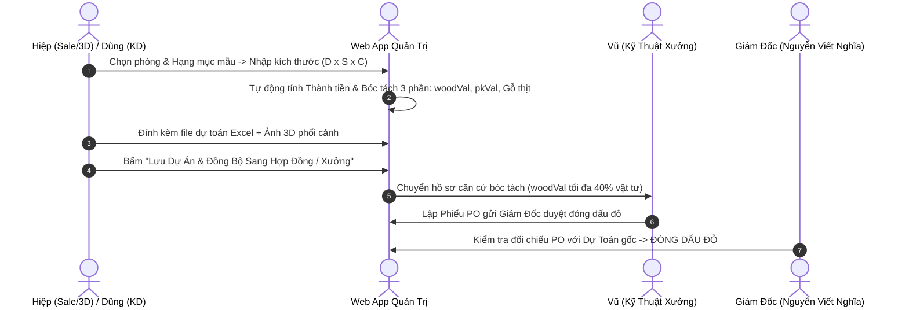

# HƯỚNG DẪN VẬN HÀNH PHÂN HỆ DỰ TOÁN NHÀ Ở, KHỞI TẠO DỰ ÁN & QUẢN LÝ TƯ LIỆU BÁO GIÁ
## CÔNG TY TNHH / HKD NỘI THẤT PHÚ GIA (PG HOME LUXURY)
### *Dành cho Sale Admin (Tống Trần Hiệp), BP Kinh Doanh (Đường Việt Dũng), Kỹ Thuật (Hoàng Công Vũ) & Ban Giám Đốc*

---

> **CHỈ ĐẠO QUẢN TRỊ CỦA GIÁM ĐỐC NGUYỄN VIẾT NGHĨA:**  
> 1. Hiệp và Dũng phải có công cụ lập dự toán nhanh, chính xác theo đơn giá chuẩn Phú Gia, tránh tình trạng báo giá áng chừng gây thất thoát hoặc mất khách.  
> 2. Mọi dự án mới phải được khởi tạo tập trung trên Web App, tải đầy đủ file dự toán Excel, ảnh 3D phối cảnh và bản vẽ kỹ thuật làm tư liệu số.  
> 3. Toàn bộ dự toán phải được tự động bóc tách: Doanh số Xưởng gỗ công nghiệp (`woodVal`) là căn cứ pháp lý để Vũ đặt ván (định mức $\le 40\%$) và tính quỹ thợ ($15\%$). Phụ kiện thương mại bóc tách riêng áp lãi 30%.

---

## 1. CỔNG TRUY CẬP TRỰC TIẾP
* **Trên Web App:** [Dự Toán & Tạo Dự Án Mới](http://localhost:8080/index.html#du-toan-du-an)
* **Tải Mẫu Excel Dự Toán Chuẩn Gốc (Công trình BS Duẩn 345M):** [MAU_DU_TOAN_BAO_GIA_NOI_THAT_PHU_GIA.xlsx](file:///f:/PG%20Home%20-%20Qu%E1%BA%A3n%20tr%E1%BB%8B/web_app/MAU_DU_TOAN_BAO_GIA_NOI_THAT_PHU_GIA.xlsx)
* **Thư mục Báo giá trên máy chủ:** [📁 4. Báo giá](file:///f:/PG%20Home%20-%20Qu%E1%BA%A3n%20tr%E1%BB%8B/4.%20B%C3%A1o%20gi%C3%A1)

---

## 2. BẢNG ĐƠN GIÁ ĐỊNH MỨC NỘI THẤT CHUẨN PHÚ GIA LUXURY (TRÍCH XUẤT TỪ DỰ ÁN THỰC TẾ)

| STT | Không gian & Hạng mục | Quy cách & Chất liệu | ĐVT | Đơn giá chuẩn (VNĐ) | Phân loại khoán |
| :---: | :--- | :--- | :---: | :---: | :---: |
| **01** | **Tủ bếp trên (Melamine)** | Thùng + Cánh MDF Thái Lan cốt xanh chống ẩm phủ Melamine | md | **2.100.000 đ** | Xưởng Gỗ CN |
| **02** | **Tủ bếp trên (Acrylic No-Line)** | Thùng MDF chống ẩm, cánh phủ Acrylic bóng gương No-Line ALD | md | **3.050.000 đ** | Xưởng Gỗ CN |
| **03** | **Tủ bếp dưới (Thùng nhựa Picomat)** | Thùng ván nhựa Picomat chịu nước 100%, cánh MDF Melamine | md | **2.500.000 đ** | Xưởng Gỗ CN |
| **04** | **Tủ bếp dưới (Nhựa Picomat + Acrylic)** | Thùng nhựa Picomat, cánh phủ Acrylic No-Line chống trầy | md | **3.500.000 đ** | Xưởng Gỗ CN |
| **05** | **Tủ khô / Tủ kịch trần** | Ván MDF cốt xanh chống ẩm phủ Melamine | m2 | **2.000.000 đ - 2.100.000 đ** | Xưởng Gỗ CN |
| **06** | **Hệ tủ bao tủ lạnh** | Ván MDF cốt xanh chống ẩm phủ Melamine | m2 | **1.600.000 đ - 1.800.000 đ** | Xưởng Gỗ CN |
| **07** | **Tủ giày kịch trần** | MDF cốt xanh phủ Melamine, chia đợt để giày di động | m2 | **2.400.000 đ - 2.500.000 đ** | Xưởng Gỗ CN |
| **08** | **Kệ tivi treo phòng khách** | MDF cốt xanh phủ Melamine, ngăn kéo ray bi 3 tầng | md | **1.650.000 đ** | Xưởng Gỗ CN |
| **09** | **Vách sofa nan sóng + PVC vân đá** | MDF cốt xanh kết hợp tấm PVC vân đá sang trọng | m2 | **1.200.000 đ - 1.350.000 đ** | Xưởng Gỗ CN |
| **10** | **Tủ quần áo kịch trần (Melamine)** | MDF cốt xanh chống ẩm phủ Melamine, bản lề giảm chấn | m2 | **2.000.000 đ** | Xưởng Gỗ CN |
| **11** | **Tủ áo cánh kính khung nhôm** | Khung nhôm Anode xám khói, kính cường lực 5mm cao cấp | m2 | **3.700.000 đ** | Xưởng Gỗ CN |
| **12** | **Giường ngủ 1m8 x 2m có ngăn kéo** | MDF cốt xanh phủ Melamine, 2 ngăn kéo để đồ, thang dát hộp kẽm | Cái | **5.700.000 đ** | Xưởng Gỗ CN |
| **13** | **Giường ngủ 1m6 x 2m có ngăn kéo** | MDF cốt xanh phủ Melamine, thang dát hộp mạ kẽm chịu lực | Cái | **5.500.000 đ** | Xưởng Gỗ CN |
| **14** | **Bàn trang điểm treo + Gương LED** | MDF phủ Melamine kết hợp gương tròn LED cảm ứng | md | **1.800.000 đ** | Xưởng Gỗ CN |
| **15** | **Bàn học liền giá sách** | MDF cốt xanh chống ẩm, bàn học kết hợp giá sách treo | md | **1.650.000 đ - 1.800.000 đ** | Xưởng Gỗ CN |
| **16** | **Táp đầu giường 2 ngăn kéo** | MDF cốt xanh phủ Melamine | Cái | **1.000.000 đ** | Xưởng Gỗ CN |
| **17** | **Vách phòng thờ cắt CNC chữ Vạn** | MDF cốt xanh chống ẩm cắt CNC hoa văn sơn hoàn thiện | m2 | **1.450.000 đ - 1.550.000 đ** | Xưởng Gỗ CN |
| **18** | **Tủ lavabo thùng cánh nhựa Picomat** | Ván nhựa Picomat chịu nước 100%, bản lề inox 304 | Cái | **2.000.000 đ - 2.400.000 đ** | Xưởng Gỗ CN |
| **19** | **Đèn LED nhôm định hình + Nguồn** | Thanh nhôm định hình dán LED 12V 2835 ánh sáng trung tính | md | **280.000 đ** | Phụ Kiện (30%) |
| **20** | **Giá bát nâng hạ Huge / Eurogold** | Inox 304 có trợ lực cánh mở Blum/Eurogold bảo hành 5 năm | Bộ | **4.800.000 đ** | Phụ Kiện (30%) |
| **21** | **Giá xoong nồi nan dẹt Inox 304** | Inox 304 ray âm giảm chấn chịu lực | Bộ | **3.100.000 đ** | Phụ Kiện (30%) |
| **22** | **Giá dao thớt gia vị đa năng 350** | Inox 304 ray âm giảm chấn kèm ống cắm đũa thìa | Bộ | **3.300.000 đ** | Phụ Kiện (30%) |

---

## 3. QUY TRÌNH 4 BƯỚC KHỞI TẠO DỰ ÁN & CHUYỂN GIAO CHO XƯỞNG

### Bước 1: Tính toán dự toán nhà ở (Estimator Tool)
- Hiệp hoặc Dũng chọn từng phòng (Tầng 1, Tầng 2, Tầng 3...) và chọn hạng mục từ danh sách mẫu.
- Nhập Dài, Sâu, Cao: Hệ thống tự động quy đổi ra `m2` (Dài x Cao / 1.000.000) hoặc `md` (Dài / 1.000).
- Hệ thống tự động phân loại: Gỗ công nghiệp xưởng, Phụ kiện thương mại, hoặc Gỗ tự nhiên ngoài xưởng.

### Bước 2: Bóc tách căn cứ đặt hàng cho Xưởng
- **Công thức sống còn:**
  $$\mathbf{Doanh\ số\ Xưởng\ Gỗ\ CN\ (woodVal)} = \mathbf{Tổng\ Dự\ Toán} - \mathbf{Phụ\ Kiện\ Thương\ Mại} - \mathbf{Gỗ\ Thịt\ Đồ\ Rời}$$
- **Ràng buộc đối với Hoàng Công Vũ:**
  * Khi Vũ nhận dự án để bóc tách cắt ván và lập Phiếu đề xuất PO: **Tổng tiền đặt ván (Lam Giang / Cường Thịnh) tuyệt đối không được vượt quá $40\% \times woodVal$**.
  * Quỹ khoán công thợ thi công không vượt quá $15\% \times woodVal$.
  * Nhờ có hồ sơ dự toán gốc được lưu trên hệ thống, Vũ không thể lập khống hay đặt dư thừa ván gây thất thoát.

### Bước 3: Tải lên tư liệu tập trung (Dossier Attachments)
- Đính kèm file Excel báo giá chi tiết để lưu trữ đối soát sau này.
- Đính kèm ảnh 3D phối cảnh không gian nhà khách để thợ xưởng và đội lắp đặt nắm rõ ý đồ thiết kế.
- Đính kèm file CAD bóc tách kỹ thuật.

### Bước 4: Xuất bản in báo giá & Ký hợp đồng
- Bấm nút **"In / Xuất Báo Giá A4"**: Hệ thống hiển thị bảng báo giá chuyên nghiệp có đầy đủ pháp nhân PG Home Luxury, chữ ký Giám Đốc Nguyễn Viết Nghĩa và các điều khoản tạm ứng 3 đợt rõ ràng.
- Gửi báo giá cho khách duyệt và thu tiền tạm ứng Đợt 1 (50%).
