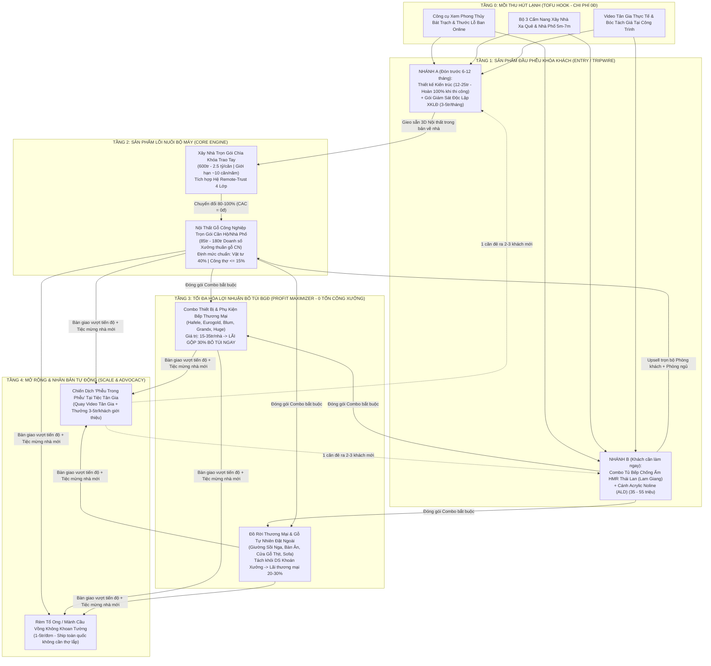

# CHIẾN LƯỢC TỐI ƯU QUẢN TRỊ TOÀN DIỆN, KIẾN TRÚC PHỄU SẢN PHẨM LIÊN HOÀN & LỘ TRÌNH THỰC THI PG HOME LUXURY (2026 – 2027)

> **Đơn vị lập báo cáo:** Hệ thống Trợ lý Quản trị & Chiến lược AI – PG Home Luxury  
> **Người phê duyệt:** Giám Đốc Điều Hành Nguyễn Viết Nghĩa  
> **Cơ sở dữ liệu kết hợp:** Hệ thống 10 Tài liệu Nghiên cứu Phễu Marketing (`F:\MARKETING\MARKETING\`) + Báo cáo Quản trị Tài chính Thực tế CCSC T8–T10/2026 & Đối soát Nhà cung cấp (`f:\PG Home - Quản trị\`).

---

## PHẦN I: HỆ THỐNG 10 TÀI LIỆU NGHIÊN CỨU PHỄU & CHIẾN LƯỢC ĐÃ LƯU TRỮ TRONG HỆ THỐNG

Em đã rà soát toàn bộ ổ đĩa và trích xuất đầy đủ **10 tài liệu nghiên cứu gốc** về Phễu sản phẩm, Phễu Marketing liên hoàn, Khảo giá đối thủ và Bộ tư liệu mồi (Lead Magnet) mà Giám Đốc đã xây dựng trước đây. Dưới đây là danh mục tra cứu nhanh kèm đúc kết cốt lõi:

| STT | Tên Tài Liệu Nghiên Cứu | Đường Dẫn File Gốc | Tinh Hoa Chiến Lược Cốt Lõi Đã Nghiên Cứu |
| :-: | :--- | :--- | :--- |
| **1** | **Phễu Lớn Liên Hoàn Phú Gia** *(Tài liệu gốc quan trọng nhất)* | [PHEU-LON-LIEN-HOAN-PHU-GIA.md](file:///F:/MARKETING/MARKETING/06.%20QC%20FB%20-%20Tr%E1%BB%A5c%20Page/PHEU-LON-LIEN-HOAN-PHU-GIA.md) | Mô hình **"Phễu Chồng Phễu"**: Bắt khách từ *Phong thủy & Thiết kế nhà* trước 6–12 tháng $\rightarrow$ Chốt *Xây nhà trọn gói (~10 căn/năm)* $\rightarrow$ Chốt tự nhiên *Nội thất xưởng (80–100% chuyển đổi, CAC = 0đ)*. Thiết kế gói **"Remote-Trust"** cho tệp XKLĐ Nghệ Tĩnh tại Nhật/Hàn/Đài và chiến lược đánh chiếm 2 "làng tỷ phú" **Đô Thành (Yên Thành) & Cương Gián (Nghi Xuân)**. |
| **2** | **Chiến Lược Phễu Sản Phẩm Dài Hạn (Value Ladder & CLV)** | [06-chien-luoc-pheu-san-pham-dai-han.md](file:///F:/MARKETING/MARKETING/06.%20QC%20FB%20-%20Tr%E1%BB%A5c%20Page/phu-gia-marketing/phu-gia-marketing/06-chien-luoc-pheu-san-pham-dai-han.md) | Xây dựng **Thang Giá Trị (Value Ladder) 4 bậc** nâng CLV từ 15 triệu lên 1.5 tỷ/khách: *Mồi câu (3D sơ bộ free, Thiết kế hoàn phí, Giám sát độc lập 3–5tr/tháng)* $\rightarrow$ *Xây trọn gói* $\rightarrow$ *Nội thất gỗ CN + Rèm mành không khoan tường (1–5tr ship toàn quốc)* $\rightarrow$ *Bậc ẩn (Referral Tân gia)*. Lộ trình mở rộng địa lý 3 tốc độ (Hà Tĩnh $\rightarrow$ Vinh $\rightarrow$ Quảng Bình). |
| **3** | **Phễu Marketing Nội Thất 4 Tầng (Trục Xoay Video Tân Gia)** | [PHEU-MARKETING-NOI-THAT.md](file:///F:/MARKETING/MARKETING/06.%20QC%20FB%20-%20Tr%E1%BB%A5c%20Page/PHEU-MARKETING-NOI-THAT.md) | Phễu **TOFU – MOFU – BOFU – ADVOCACY** lấy **Video Tân Gia** làm "vũ khí hạt nhân": Tặng gói quay video mừng nhà mới $\rightarrow$ 50–100 khách dự tiệc xem tận mắt & hỏi giá $\rightarrow$ Tạo hiệu ứng **"Phễu trong phễu"** sinh ra 1–3 khách mới/công trình mà không tốn tiền Ads. |
| **4** | **Phễu Video Tuần Tự Nội Thất (3+1 Rút Gọn 2 Tầng)** | [PHEU-VIDEO-TUAN-TU-NOI-THAT.md](file:///F:/MARKETING/MARKETING/06.%20QC%20FB%20-%20Tr%E1%BB%A5c%20Page/PHEU-VIDEO-TUAN-TU-NOI-THAT.md) | Giải bài toán ngân sách Ads 300k/ngày tại thị trường tỉnh hẹp (Hà Tĩnh): Gộp 3 video đầu (Tân gia + Xưởng/Vật liệu + Bóc tách giá) vào **Tầng 1 (TOFU ThruPlay)** và dùng Video 4 (Chốt ưu đãi) ở **Tầng 2 (BOFU Retarget 180 ngày)** gộp chung 8.6k fan để chống bão hòa tần suất. |
| **5** | **Chiến Lược Phễu Tổng Đa Fanpage (Hệ Sinh Thái 4 Page)** | [01-chien-luoc-pheu-tong.md](file:///F:/MARKETING/MARKETING/06.%20QC%20FB%20-%20Tr%E1%BB%A5c%20Page/phu-gia-marketing/phu-gia-marketing/01-chien-luoc-pheu-tong.md) | Quy hoạch 4 Fanpage vệ tinh: **Nội Thất Phú Gia (8.6k fan)** làm trục trung tâm nhận ngân sách Ads chính; **Nhà Đẹp Hà Tĩnh** bắt tệp chuẩn bị xây nhà; **Biệt Thự Vườn Garden Homes** bắt tệp cao cấp/XKLĐ; **Việc Làm Nội Thất** tuyển thợ & khoe quy mô xưởng. |
| **6** | **Khảo Giá 10 Đối Thủ Nội Thất & Xây Trọn Gói Hà Tĩnh** | [07-khao-gia-doi-thu-ha-tinh.md](file:///F:/MARKETING/MARKETING/06.%20QC%20FB%20-%20Tr%E1%BB%A5c%20Page/phu-gia-marketing/phu-gia-marketing/07-khao-gia-doi-thu-ha-tinh.md) | Phân tích 10 đối thủ (Việt Tín, F.Home, 386, Happy House, HaGo, Akisa, SBS...): **100% đối thủ nội thất Hà Tĩnh giấu giá ("inbox")**; khẩu hiệu "3D miễn phí" và "xưởng trực tiếp" đã bão hòa. Cơ hội độc tôn của Phú Gia: **Công khai khung giá theo m²/md + Bóc tách cốt gỗ chống ẩm + Gói Remote-Trust XKLĐ**. |
| **7** | **Chiến Lược Tư Liệu Mồi (Lead Magnet) 3 Fanpage** | [00_CHIEN_LUOC_TU_LIEU_3_FANPAGE.md](file:///F:/MARKETING/MARKETING/01_THI%E1%BA%BET%20K%E1%BA%BE%20NH%C3%80/00_CHIEN_LUOC_TU_LIEU_3_FANPAGE.md) | Kịch bản phân phối các cuốn Ebook/Cẩm nang thực chiến để thu SĐT/Zalo khách hàng chuẩn bị làm nhà với giá rẻ hơn chạy tin nhắn trực tiếp 60%. |
| **8** | **Cẩm Nang Xây Biệt Thự Vườn Mái Nhật Cho Gia Chủ Xa Quê** | [CAM_NANG_XAY_BIET_THU_VUON_MAI_NHAT_CHO_GIA_CHU_XA_QUE.md](file:///F:/MARKETING/MARKETING/01_THI%E1%BA%BET%20K%E1%BA%BE%20NH%C3%80/CAM_NANG_XAY_BIET_THU_VUON_MAI_NHAT_CHO_GIA_CHU_XA_QUE.md) | Tài liệu mồi đánh trúng tâm lý con em Nghệ Tĩnh tại Nhật/Hàn/Đài gửi tiền về quê xây biệtự vườn mái Nhật 1–2 tầng báo hiếu bố mẹ. |
| **9** | **Cẩm Nang Thiết Kế Nhà Phố Thở Giếng Trời 5m – 7m** | [CAM_NANG_THIET_KE_NHA_PHO_THO_GIENG_TROI_5M_7M.md](file:///F:/MARKETING/MARKETING/01_THI%E1%BA%BET%20K%E1%BA%BE%20NH%C3%80/CAM_NANG_THIET_KE_NHA_PHO_THO_GIENG_TROI_5M_7M.md) | Tài liệu mồi thu hút tệp gia đình trẻ, công chức, tiểu thương tại TP Hà Tĩnh xây nhà ống mặt tiền 5m–7m cần thông gió, chống nóng gió Lào. |
| **10** | **Sổ Tay Quy Trình Xây Nhà Trọn Gói & Dự Toán Minh Bạch** | [SO_TAY_QUY_TRINH_XAY_NHA_TRON_GOI_VA_DU_TOAN_MINH_BACH.md](file:///F:/MARKETING/MARKETING/01_THI%E1%BA%BET%20K%E1%BA%BE%20NH%C3%80/SO_TAY_QUY_TRINH_XAY_NHA_TRON_GOI_VA_DU_TOAN_MINH_BACH.md) | Công cụ chốt sale BOFU giúp xóa bỏ nỗi sợ "đội vốn, rút ruột vật tư, phát sinh ngầm" trước khi đặt bút ký hợp đồng. |

---

## PHẦN II: NÂNG CẤP KIẾN TRÚC PHỄU SẢN PHẨM LIÊN HOÀN – GẮN KẾT SỐ LIỆU TÀI CHÍNH CCSC THỰC TẾ

> [!IMPORTANT]
> **ĐIỂM ĐỘT PHÁ KHI KẾT HỢP PHỄU MARKETING CŨ VỚI SỐ LIỆU QUẢN TRỊ CCSC THỰC TẾ (T8–T10/2026):**  
> Các nghiên cứu phễu trước đây đã giải quyết xuất sắc bài toán **Thu hút khách hàng (Lead Generation)**, nhưng khi đối chiếu vào **Bảng Quản Trị Tài Chính CCSC Thực Tế** của Giám Đốc, em phát hiện ra **Quy luật Lợi Nhuận Thực Chiến**:
> 1. **Xưởng Sản Xuất Gỗ CN (Core Volume):** Tạo ra dòng tiền lớn (T8+T9 đạt 529.83M) để nuôi bộ máy cố định (Mặt bằng 13M, Marketing 12M, Quản lý, BHXH 6.6M), nhưng **biên lợi nhuận ròng mỏng** và dễ bị ăn mòn nếu công thợ vượt 15% (như T8+T9 âm quỹ thợ -5.86M).
> 2. **Mảng Phụ Kiện Thương Mại & Đồ Rời/Gỗ ThịtGia Công Ngoài (Profit Maximizer):** Mang lại **Lãi gộp 30% bỏ túi trực tiếp cho BGĐ** (như đơn Chị Hoa 30M phụ kiện lãi ngay 9M; đơn Anh Hào 15.2M phụ kiện; đơn Anh Tuấn 14.8M thiết bị Hafele) mà **KHÔNG TỐN 1 GIỜ CÔNG THỢ XƯỞNG NÀO**!
>
> $\implies$ **KẾT LUẬN CHIẾN LƯỢC:** Phễu sản phẩm mới không chỉ dẫn khách từ *"Thiết kế $\rightarrow$ Xây nhà $\rightarrow$ Nội thất gỗ"*, mà bắt buộc phải có **Tầng Khóa Lợi Nhuận (Upsell Phụ Kiện Bếp 30% + Đồ Rời Thương Mại)** để tối đa hóa tiền mặt bỏ túi cho Giám Đốc!

### 2.1. Sơ Đồ Kiến Trúc Phễu Sản Phẩm 5 Tầng (Value Ladder Tài Chính Thực Chiến)

---

### 2.2. Bảng Phân Tích Kinh Tế Đơn Vị (Unit Economics) Theo Từng Tầng Phễu

| Tầng Phễu | Sản Phẩm Chủ Lực | Doanh Thu / Đơn | Cơ Cấu Cost & Hạch Toán CCSC | Lợi Nhuận Gộp Đóng Góp | Vai Trò Chiến Lược |
| :--- | :--- | :---: | :--- | :---: | :--- |
| **Tầng 0 (Hook)** | Phong thủy, Cẩm nang PDF, Video Tân gia | 0 đ | Nằm trong ngân sách Marketing cố định **12M/tháng** (6M lương + 6M Ads). | Tạo 80–120 Lead SĐT/Zalo mỗi tháng | Gom tệp ấm trước 3–12 tháng với chi phí rẻ. |
| **Tầng 1A (Đón đầu)** | Thiết kế Kiến trúc / Giám sát từ xa XKLĐ | 12 – 25 Triệu | Chi phí nhân sự thiết kế (Hiệp + CTV). Hoàn phí khi ký thi công trọn gói. | Hòa vốn hoặc lãi nhẹ 20–30% | **Khóa chặt khách từ lúc mảnh đất còn trống**, chặn đứng 10 đối thủ nội thất. |
| **Tầng 1B (Mồi Bếp)** | **Tủ Bếp HMR Thái Lan + Cánh Acrylic Noline** | 35 – 55 Triệu | Ván Lam Giang (~8–12M) + Cánh NTD/ALD (~10–12M) + Phụ kiện Quốc Tâm (~2M). | ~15 – 20 Triệu *(Trước CP cố định)* | Sản xuất nhanh 5–7 ngày, dễ chốt nhất, là **cầu nối bán kèm Phụ kiện bếp lãi 30%**. |
| **Tầng 2A (Xây dựng)** | Xây Nhà Trọn Gói (~10 căn/năm) | 800Tr – 2.0 Tỷ | Khoán đội thầu phụ theo m² + Giám sát kỹ thuật Phú Gia. | 10% – 14% (~80 – 250M/căn) | Tạo dòng tiền lớn và **nuôi sống Xưởng Nội Thất suốt năm không tốn tiền Ads**. |
| **Tầng 2B (Xưởng Gỗ)** | Nội Thất Gỗ CN Trọn Gói (PK + Bếp + 2-3 PN) | 85 – 180 Triệu *(Thuần Gỗ CN)* | Định mức CCSC: Vật tư **40%** + Công thợ **$\le 15\%$** + Biến phí 4% + Quản lý/Sale. | Nuôi toàn bộ định phí hệ thống + Lãi ròng 8–12% | Xương sống công suất cho 7 nhân sự xưởng (Hòa, Thái, Vũ, Hào, Thoan, Văn Anh, Tuấn Anh). |
| **Tầng 3 (Biên Cao)** | **Phụ Kiện Bếp Hãng + Đồ Rời / Gỗ Thịt** | 25 – 55 Triệu / công trình | **Bóc tách 100% khỏi `woodVal` xưởng**. Nhập thẳng NPP chiết khấu cao. | **30% Lãi ròng bỏ túi BGĐ** *(7.5M – 16.5M/nhà)* | **Cỗ máy in tiền mặt thực sự cho Giám Đốc** mà không làm tăng quỹ lương thợ xưởng. |
| **Tầng 4 (Mở rộng)** | Rèm không khoan + Referral Tiệc Tân Gia | 2 – 5 Triệu *(Rèm)* / HĐ mới | Ship COD toàn quốc (Rèm) / Chi thưởng 3–5M khi ký HĐ mới (Referral). | Lãi ròng 35% (Rèm) / CAC giảm về ~2% | Biến mỗi khách cũ thành đại sứ thương hiệu mang về 1–3 hợp đồng mới. |

---

## PHẦN III: 20 ĐỀ XUẤT TỐI ƯU TOÀN DIỆN CHO QUẢN TRỊ CÔNG TY & CHIẾN LƯỢC KINH DOANH

Để đưa PG Home Luxury từ mức lợi nhuận ròng **44.09 triệu (T8+T9/2026)** tiến tới mục tiêu **Lợi nhuận ròng bỏ túi BGĐ đạt 60 – 90 triệu/tháng** một cách bền vững, em đề xuất **20 Tối Ưu Chiến Lược** chia làm 4 Trụ cột:

---

### TRỤ CỘT I: TỐI ƯU PHỄU SẢN PHẨM & CẤU TRÚC DOANH THU BIÊN LỢI NHUẬN CAO (TỐI ƯU 1 $\rightarrow$ 5)

#### 1. Đóng gói "Tủ Bếp Chống Ẩm Cánh Acrylic No-Line" thành Sản Phẩm Mồi Chủ Lực (Signature Entry Product)
- **Thực trạng:** Khách làm nội thất cả nhà (150–200M) thường đắn đo lâu, nhưng **100% nhà mới đều bắt buộc phải làm Tủ bếp trước khi nhập trạch**. Thực tế chứng từ Zalo cho thấy tổ hợp **Thùng ván HMR Thái Lan (Lam Giang) + Cánh Acrylic bóng gương dán No-line (NTD/ALD)** (như nhà Chị Hoa 12.21M tiền cánh, Shophouse Anh Minh 22.75M tiền cánh) có chất lượng vượt trội và biên lợi nhuận rất tốt.
- **Giải pháp tối ưu:** Thiết kế 3 gói **"Tủ Bếp Chống Nồm Hà Tĩnh"** công khai giá trọn gói (Gói Tiêu chuẩn 35M – Gói Luxury Cánh Acrylic Noline 49M – Gói Biệt thự Đảo bếp 68M). Khi khách chốt Tủ bếp, Hiệp (3D) sẽ dựng luôn phối cảnh Phòng khách liền bếp để **Upsell sang gói Nội thất toàn nhà với tỷ lệ thành công > 75%**.

#### 2. Quy tắc "Bán Tủ Bếp Bắt Buộc Kèm Combo Thiết Bị & Phụ Kiện 30%" (Mandatory Bundling)
- **Thực trạng:** T8+T9 mảng Phụ kiện chỉ đạt doanh thu 38.84M (Lãi gộp 11.65M), nhưng vẫn có những công trình lớn (như Nhà Chị Hiển 129.8M, Nhà Chị Phượng 76M) khách tự mua thiết bị ngoài hoặc chưa được chào gói Combo đồng bộ.
- **Giải pháp tối ưu:** Ban hành quy định cho Hiệp và Dũng: **Mọi báo giá Tủ bếp gửi khách mặc định tích hợp sẵn Combo Phụ kiện thông minh (Eurogold/Hafele/Huge) & Thiết bị bếp (Grandx/Hafele)** trị giá tối thiểu **15 – 30 triệu/bộ** (tương tự đơn Chị Hoa 29.24M, Anh Hào 15.2M, Anh Tuấn 14.8M). Chỉ tính riêng 5 bộ bếp/tháng kèm phụ kiện đã mang về **100 – 150 triệu doanh thu phụ kiện $\rightarrow$ Bỏ túi ngay 30 – 45 triệu tiền lãi ròng cho Giám Đốc** mà xưởng không tốn thêm 1 phút đứng máy!

#### 3. Chuẩn hóa Kịch bản "Gieo 3D Nội Thất Trong Bản Vẽ Kiến Trúc" (Khóa Chuyển Tầng Phễu 1 $\rightarrow$ Phễu 2 $\rightarrow$ Phễu 3)
- **Thực trạng:** Nhiều đơn vị thiết kế nhà xong để khách cầm bản vẽ đi thuê xưởng nội thất khác báo giá.
- **Giải pháp tối ưu:** Áp dụng triệt để cơ chế từ tài liệu `PHEU-LON-LIEN-HOAN-PHU-GIA.md`:
  1. Ngay khi bàn giao Hồ sơ thiết kế kiến trúc (Tầng 1), mặt bằng bố trí nội thất đã được **mã hóa chính xác theo kích thước module ván 17mm chuẩn của xưởng Phú Gia** và mã màu ván Lam Giang (205T, 202T, 388EV).
  2. Tặng khách voucher **"Hoàn 100% phí thiết kế kiến trúc vào Hợp đồng Xây trọn gói & Nội thất"**.
  3. Khi công trình xây đến giai đoạn **Đổ mái tầng 1 (trước khi trát tường)**, Hiệp và Vũ phải chốt xong bản vẽ 3D nội thất với chủ nhà để **đặt chờ sẵn đường điện, ổ cắm, ống hút mùi chuẩn từng milimet** $\rightarrow$ Đối thủ bên ngoài không thể nhảy vào.

#### 4. Bóc tách 100% Hạng mục "Gỗ Tự Nhiên & Đồ Rời Thương Mại" thành Mảng Kinh Doanh Độc Lập
- **Thực trạng:** Trước đây từng có nguy cơ gộp chung Giường sồi Nga (nhà Chị Hoa 22M) hay Cửa/Bàn ghế gỗ thịt (Cậu Chiến 16.5M) vào tổng giá trị hợp đồng tính doanh số xưởng, gây phình quỹ khoán thợ 15% và định mức vật tư 40%.
- **Giải pháp tối ưu:** Trên phần mềm Quản trị và bảng báo giá của Hiệp, tách riêng thành 3 cột độc lập: **(1) Nội thất Gỗ CN Xưởng sản xuất (`woodVal`)** – **(2) Phụ kiện/Thiết bị bếp thương mại** – **(3) Đồ rời & Gỗ tự nhiên liên kết xưởng ngoài**. Phần (2) và (3) được hạch toán thẳng vào Sheet Lợi Nhuận Thương Mại (biên lãi 20–30%) và thưởng hoa hồng bán thêm riêng cho Sale (2–3%), tuyệt đối không cộng vào doanh số xưởng.

#### 5. Khởi chạy Dòng Sản Phẩm "Mồi Thương Mại Điện Tử": Rèm Tổ Ong / Mành Cầu Vồng Không Khoan Tường
- **Thực trạng:** Doanh thu của Phú Gia hiện phụ thuộc 100% vào tiến độ thi công tại Hà Tĩnh – Nghệ An và có tính mùa vụ (tháng Giêng – tháng 3 âm lịch thường chững).
- **Giải pháp tối ưu:** Triển khai nhánh sản phẩm **Rèm không khoan tường lắp khung nhôm kính** (đã nghiên cứu tại `06-chien-luoc-pheu-san-pham-dai-han.md`, đơn giá 1.5 – 5 triệu/đơn).
  - **Với khách nội thất tại Hà Tĩnh:** Dùng làm quà tặng chốt HĐ > 100 triệu (giá vốn chỉ ~900k nhưng giá trị cảm nhận 2.5 triệu) hoặc bán kèm khi bàn giao nhà mới.
  - **Với thị trường toàn quốc (mùa thấp điểm T1–T3 âm lịch):** Chạy Ads video tự lắp trong 3 phút, chốt đơn qua Zalo, xưởng đặt gia công theo kích thước và ship COD toàn quốc $\rightarrow$ Tạo dòng tiền mặt đều đặn không phụ thuộc thợ lắp đặt.

---

### TRỤ CỘT II: TỐI ƯU MARKETING ĐA KÊNH, HỆ "REMOTE-TRUST" XKLĐ & TỶ LỆ CHUYỂN ĐỔI (TỐI ƯU 6 $\rightarrow$ 10)

#### 6. Kích hoạt Chiến dịch "Remote-Trust 4 Lớp" Đánh Chiếm Tệp XKLĐ Nghệ Tĩnh (Nhật – Hàn – Đài) & 2 Làng Tỷ Phú
- **Thực trạng:** Hà Tĩnh và Nghệ An (đặc biệt là **Cương Gián – Nghi Xuân** và **Đô Thành – Yên Thành**) có lượng kiều hối hàng trăm triệu USD mỗi năm gửi về xây biệtự vườn và làm nội thất cho bố mẹ ở quê. Nỗi sợ lớn nhất của người đi xa là **bố mẹ ở nhà già yếu không trông coi được thợ, sợ bị tráo vật tư và đội giá**.
- **Giải pháp tối ưu:** Đóng gói dịch vụ **"Xây Nhà & Làm Nội Thất Từ Xa – An Tâm Tuyệt Đối"** với 4 cam kết vàng:
  1. **Camera 360° 4G lắp tại công trình 24/7:** Con cái ở Tokyo, Seoul, Đài Bắc mở điện thoại xem trực tiếp bất cứ lúc nào.
  2. **Nhật ký Zalo đúng khung giờ vàng 18h00 – 21h00 VN (20h00 – 23h00 Nhật/Hàn):** Hiệp và Dũng trực tư vấn đúng giờ tan ca của lao động nước ngoài.
  3. **Livestream 3 Nghi Lễ Trọng Đại:** Động thổ – Cất nóc – Nhập trạch bàn giao nội thất để con cái ở xa tham dự trực tuyến cùng bố mẹ.
  4. **Hợp đồng "3 Không":** Không phát sinh ngoài dự toán – Không tráo cốt gỗ (sai phạt gấp đôi) – Không chậm tiến độ.

#### 7. Triển khai Phễu Quảng Cáo Video "2 Tầng Rút Gọn (3+1)" Với Ngân Sách Cố Định 6 Triệu Ads/Tháng
- **Thực trạng:** Theo định mức CCSC, ngân sách Marketing cố định là **12,000,000 đ/tháng** (6M nhân sự + **6M ngân sách chạy Ads = 200,000 đ/ngày**). Nếu chia nhỏ ngân sách 200k/ngày cho 4 tầng chiến dịch tại thị trường hẹp như Hà Tĩnh, tần suất lặp sẽ vọt lên > 5 lần/tuần gây cháy tệp.
- **Giải pháp tối ưu:** Áp dụng công thức **Phễu Video 2 Tầng** từ tài liệu nghiên cứu:
  - **Tầng 1 – TOFU (140k/ngày = 70% ngân sách):** Chạy mục tiêu ThruPlay bán kính 25km quanh TP Hà Tĩnh + ghim điểm Cương Gián, Đô Thành, Kỳ Anh với cụm 3 video xoay vòng: *(1) Video Tân gia thực tế $\rightarrow$ (2) Video test ngâm nước ván HMR Thái Lan tại xưởng Trương Quốc Dụng $\rightarrow$ (3) Video bóc tách công khai giá công trình thực tế (như nhà Chị Hoa, Anh Hào)*.
  - **Tầng 2 – BOFU Retarget (60k/ngày = 30% ngân sách):** Chạy tin nhắn Zalo/Messenger nhắm vào **Tệp ấm 180 ngày** (gộp toàn bộ người xem $\ge 50\%$ video Tầng 1 + 8,600 fan cũ + người tương tác 4 Fanpage) với ưu đãi chốt cọc giữ giá vật tư.

#### 8. Phá Vỡ Sự Bão Hòa Thị Trường Bằng Chiến Lược "Minh Bạch Giá & Bóc Tách Cốt Ván Thực Tế"
- **Thực trạng:** Khảo sát 10 đối thủ Hà Tĩnh (`07-khao-gia-doi-thu-ha-tinh.md`) chỉ ra 100% đối thủ nội thất giấu giá ("inbox") và nói chung chung "gỗ MDF chống ẩm".
- **Giải pháp tối ưu:** Phú Gia định vị là **"Đơn vị duy nhất tại Hà Tĩnh công khai định mức bóc tách vật tư trên từng công trình"**. Mỗi bài đăng/video bàn giao đều ghi rõ:
  - *Công trình Nhà Anh Hào (Kỳ Anh): Tổng 100.6M (Gỗ CN xưởng 85.4M + Phụ kiện Eurogold 15.2M).*
  - *Cốt ván sử dụng: HMR chống ẩm Thái Lan nhập chính ngạch Tổng kho Lam Giang, dán cạnh nẹp đồng màu bằng máy tự động 6 chức năng, mặt cánh bếp Acrylic No-line chống nước tuyệt đối.*
  - Sự minh bạch này ngay lập tức hạ gục các xưởng nhỏ báo giá mập mờ để trộn ván thường cốt nâu.

#### 9. Cơ Chế "Phễu Trong Phễu" Tại Tiệc Tân Gia & Chính Sách Thưởng Giới Thiệu (Referral Engine)
- **Thực trạng:** T8–T10 Phú Gia bàn giao hàng loạt công trình đẹp (Cậu Chiến, Thắm Minh, Chị Hiển, Chị Phượng, Anh Hào, Anh Tuấn, Chị Hoa...), nhưng chưa khai thác hết mỏ vàng khách mời đến dự tiệc Tân gia của gia chủ.
- **Giải pháp tối ưu:**
  1. Mỗi công trình hoàn thiện > 80 triệu được tặng **01 Video Phóng Sự Tân Gia Chuyên Nghiệp** + **01 Bộ Quà Tặng Tân Gia Phú Gia** đặt trang trọng tại phòng khách ngày làm lễ.
  2. Trao tận tay gia chủ **"Thẻ Tri Ân Đại Sứ Phú Gia"**: Bất kỳ người thân, hàng xóm, bạn bè nào đến dự tiệc Tân gia và ký hợp đồng làm nội thất/xây nhà tại Phú Gia, **gia chủ cũ được nhận ngay 3,000,000 đ – 5,000,000 đ tiền mặt cảm ơn** (hoặc tặng thêm thiết bị/đồ rời tương đương), khách mới được giảm ngay 2,000,000 đ. Chi phí 3–5 triệu này chỉ bằng 3% giá trị hợp đồng mới nhưng tỷ lệ chốt đạt tới 80%!

#### 10. Chuẩn Hóa Quy Trình Chốt Sale 5 Bước Giữa Hiệp (Sale Admin/3D) & Dũng (Kinh Doanh)
- **Thực trạng:** Cần phối hợp nhịp nhàng giữa bộ phận ngồi văn phòng dựng 3D (Hiệp) và bộ phận đi thị trường đo đạc, tư vấn trực tiếp (Dũng).
- **Giải pháp tối ưu:** Thiết lập SLA (Cam kết tốc độ phục vụ) 48 giờ:
  - **Giờ 0 – Giờ 2:** Khách nhắn tin Page $\rightarrow$ Hiệp lọc nhu cầu, gửi Cẩm nang/Bảng giá khung và xin kết bạn Zalo trong vòng 15 phút.
  - **Giờ 2 – Giờ 24:** Dũng có mặt tại công trình khảo sát thực tế, đo thước Lỗ Ban, quay video hiện trạng gửi vào nhóm Zalo chung (gồm Giám Đốc + Dũng + Hiệp + Vũ).
  - **Giờ 24 – Giờ 48:** Hiệp lên mặt bằng 2D/3D sơ bộ + Báo giá bóc tách 3 phần (Gỗ CN xưởng / Phụ kiện 30% / Đồ rời).
  - **Bước Chốt (Tại Xưởng Ngõ 49 Trương Quốc Dụng hoặc Ngõ 49 Trương Quốc Dụng, P. Thành Sen, TP. Hà Tĩnh):** Mời khách sờ tận tay mẫu ván HMR Thái Lan, cánh Acrylic No-line và ray bản lề giảm chấn $\rightarrow$ Chốt cọc thiết kế 5 triệu.

---

### TRỤ CỘT III: TỐI ƯU QUẢN TRỊ XƯỞNG, ĐỊNH MỨC VẬT TƯ, CÔNG THỢ & NHÀ CUNG CẤP (TỐI ƯU 11 $\rightarrow$ 15)

#### 11. Khóa Trần Quỹ Lương Thợ Xưởng $\le 15\%$ Doanh Số Gỗ CN Để Xóa Sổ Tình Trạng Âm Quỹ Khoán
- **Thực trạng:** Trong T8/2026 công thợ thực chi chiếm **17.06%** (41.29M / 242.05M, âm quỹ -4.98M); sang T9/2026 đã kéo giảm xuống **15.31%** (44.05M / 287.78M, chỉ còn âm nhẹ -0.88M). Điều này chứng tỏ **khi Doanh số xưởng vượt ngưỡng $\ge 295$ triệu/tháng với biên chế 5 thợ sản xuất hiện tại (Hòa, Thoan, Hào, Văn Anh, Tuấn Anh)**, tỷ lệ công thợ sẽ tự động giảm xuống dưới 15%!
- **Giải pháp tối ưu:**
  1. Giao KPI sản lượng tối thiểu cho Quản lý xưởng (Thái + Vũ): **Doanh số nghiệm thu Gỗ CN thuần phải đạt $\ge 300,000,000$ đ/tháng**.
  2. Kiểm soát chặt giờ tăng ca (OT): Chỉ duyệt tăng ca cho các công trình đã thu đủ tạm ứng đợt 1 và có lịch lắp đặt gấp; tránh tình trạng ngày thường làm trùng trinh rồi dồn việc tăng ca buổi tối hưởng hệ số cao.
  3. Duy trì phụ cấp trách nhiệm **20,000 đ/ngày công thực tế cho 2 thợ nòng cốt (Hòa: 550k/công, Hào: 470k/công)** để gắn trách nhiệm tự giác kiểm soát chất lượng kết cấu và lắp đặt, giảm tối đa công đi bảo hành sửa lỗi.

#### 12. Quy Chuẩn Đặt Ván "Gom Đơn Theo Lô & Tối Ưu Nesting CNC" Với Tổng Kho Lam Giang
- **Thực trạng:** Đối soát 155 chứng từ Zalo Lam Giang cho thấy có những tháng xưởng phát sinh rất nhiều đơn lẻ 1–2 tấm ván hoặc vài cuộn nẹp (như `BH25798` 543k, `DH27424` 450k, `DH28290` 406k, `BH29127` 519k) và nhiều phiếu trả lại ván thừa (`BTL00967` -1.31M, `BTL01063` -1.99M).
- **Giải pháp tối ưu:**
  1. **Chuẩn hóa 4 mã màu ván chủ lực tại xưởng** (như mã `205T`, `202T`, `388EV/SC`, `105T` cốt HMR Thái Lan CATL) để phần đề C (ván dư) của công trình trước tái sử dụng làm đợt tủ, hộc ngăn kéo cho công trình sau $\rightarrow$ Giảm tỷ lệ hao hụt ván từ 12% xuống dưới 5%.
  2. Vũ (Kỹ thuật CNC) bắt buộc phải chạy phần mềm tối ưu sơ đồ cắt (Nesting) toàn bộ công trình trước khi lên bảng Excel màu vàng đặt hàng Ms Hoa Lam Giang, hạn chế đặt lắt nhắt phát sinh phí vận chuyển và nhầm mã nẹp.

#### 13. Thiết Lập Cơ Chế "Đặt Sỉ Đầu Tháng – Khóa Hạn Mức 30 Triệu" Với Phụ Kiện Quốc Tâm
- **Thực trạng:** Đối soát sổ nợ viết tay Quốc Tâm ngày 31/10/2026 cho thấy dư nợ đã lên tới **36,255,000 đ** (vượt hạn mức trần 30 triệu khiến nhà cung cấp gửi STK BIDV giục thanh toán) và có tới hàng chục hóa đơn lẻ lấy lắt nhắt từng ngày (200k, 325k, 400k, 770k).
- **Giải pháp tối ưu:**
  1. **Chuyển từ "Lấy lẻ theo ngày" sang "Nhập sỉ theo thùng đầu tháng":** Tận dụng triệt để giá sỉ thùng của Quốc Tâm (*Bản lề thùng 200 cái giá chỉ 6,500 đ/cái; Ray bi 3 tầng thùng 20 bộ giá chỉ 25,000 đ/bộ*). Vũ dự trù định mức phụ kiện cơ bản (bản lề, ray ngăn kéo, ốc cam, chốt đợt, keo hạt, màng PE) cho cả tháng trong 1 đơn sỉ duy nhất.
  2. **Thiết lập cảnh báo đỏ tự động trên Web App:** Khi công nợ Quốc Tâm chạm ngưỡng **25,000,000 đ**, hệ thống báo Giám Đốc giải ngân thanh toán cuốn chiếu 10–15 triệu để luôn giữ uy tín dưới trần 30 triệu và ép nhà cung cấp giữ giá sỉ thấp nhất.

#### 14. Chuẩn Hóa Quy Trình Đặt Gia Công "Cánh Acrylic No-Line" Với NTD / ALD Không Lỗi Kích Thước
- **Thực trạng:** Cánh Acrylic No-line có đơn giá cao (**1,100,000 đ/md** hoặc **1,250,000 đ/m²**, như đơn Chị Hoa 12.21M, đơn Anh Minh 22.75M) và đặt gia công từ nhà máy gửi về. Nếu Vũ bóc sai kích thước chỉ 2mm sẽ không thể cắt sửa lại vì hỏng đường dán cạnh không đường line (No-line), gây thiệt hại nặng.
- **Giải pháp tối ưu:** Áp dụng quy tắc **"Lắp khung thùng xong hoặc chốt cốt ván CNC 100% mới xuất lệnh cắt cánh Acrylic"**:
  1. File đặt cánh Acrylic của Vũ phải ghi rõ chiều vân, vị trí vát tay nắm 45 độ (hoặc tay nắm âm C), và phải có chữ ký nháy đối soát chéo của Quản lý xưởng (Thái) trước khi trình Giám Đốc đóng dấu đỏ.
  2. Bắt buộc thu thêm 10–15% cọc của khách hàng đối với riêng hạng mục Cánh Acrylic đặt theo yêu cầu.

#### 15. Kỷ Luật Thép "Dấu Đỏ Điện Tử Giám Đốc" & Gắn Mã Công Trình Cho 100% Đơn Hàng Zalo
- **Thực trạng:** Trước đây một số đơn đặt ván trên nhóm Zalo Lam Giang và Quốc Tâm chỉ nhắn chung chung mà không ghi rõ tên công trình (hoặc gộp 2–3 nhà vào 1 phiếu xuất kho như `BH26028` 30.79M hay `DH29643` 30.45M), dẫn đến việc bóc tách chi phí thực tế từng nhà rất vất vả.
- **Giải pháp tối ưu:**
  1. **Quy định bắt buộc cho Vũ trên nhóm Zalo Đặt Hàng:** Mọi bảng Excel màu vàng gửi Lam Giang hoặc tin nhắn đặt Quốc Tâm đều phải ghi rõ tiêu đề: **`[MÃ PO - TÊN CÔNG TRÌNH]`** (Ví dụ: *ĐẶT VÁN NHÀ ANH CÔNG - ĐƠN 1*, hoặc nếu gộp 2 nhà phải ghi rõ cột ghi chú *Nhà A bao nhiêu tấm, Nhà B bao nhiêu tấm*).
  2. Tuyệt đối tuân thủ quy tắc phân hệ `XUONG_VATTU`: Lập phiếu trên Web App $\rightarrow$ Giám Đốc bấm **"DUYỆT & ĐÓNG DẤU ĐỎ"** $\rightarrow$ Mới được gửi đơn vào nhóm Zalo nhà cung cấp.

---

### TRỤ CỘT IV: TỐI ƯU QUẢN TRỊ TÀI CHÍNH CCSC, DÒNG TIỀN CÔNG NỢ & NHÂN SỰ (TỐI ƯU 16 $\rightarrow$ 20)

#### 16. Thiết Kế Lại Tiến Độ Thu Tiền Hợp Đồng 4 Đợt "Lấy Tiền Khách Nuôi Xưởng & Trả NCC"
- **Thực trạng:** Hiện tại tổng công nợ 3 nhà cung cấp chính đang ở mức **273,613,250 đ** (Lam Giang 202.40M + Quốc Tâm 36.25M + Acrylic ALD 34.96M) cùng khoản nợ Gỗ NT Cầu Vượt 82.06M, trong khi một số công trình khách hàng còn đọng nợ sau lắp đặt.
- **Giải pháp tối ưu:** Chuẩn hóa điều khoản thanh toán trong mọi Hợp đồng Nội thất do Hiệp soạn thảo thành **4 Đợt Khóa Dòng Tiền**:
  - **Đợt 1 (Ký HĐ & Chốt 3D):** Tạm ứng **50% giá trị hợp đồng** (Số tiền này dư sức thanh toán 100% tiền ván Lam Giang + đặt cọc cánh Acrylic + nhập phụ kiện hãng mà Giám Đốc không phải ứng vốn túi).
  - **Đợt 2 (Khi tập kết toàn bộ ván & phụ kiện tới chân công trình trước khi lắp):** Thu tiếp **30% giá trị hợp đồng** (Đủ trả toàn bộ lương thợ xưởng và chi phí vận hành).
  - **Đợt 3 (Nghiệm thu bàn giao tại công trình):** Thu hết **20% còn lại ngay trong ngày ký biên bản nghiệm thu** (Lợi nhuận ròng của BGĐ về thẳng tài khoản).

#### 17. Lộ Trình Giảm Dư Nợ Gốc Lam Giang (Từ 202.4 Triệu Về Dưới 120 Triệu) Để Đàm Phán Chiết Khấu Thưởng Năm
- **Thực trạng:** Dư nợ lũy kế từ đầu năm đến 31/07/2026 tại Lam Giang là 162.8M, và đến 31/10/2026 là **202,398,250 đ**. Trong tháng 8–10, Phú Gia đã có kỷ luật thanh toán rất tốt cho các đơn mới (như chị Dung và Vũ chuyển khoản đối ứng ngay các đơn tháng 10 hơn 68.8 triệu), nhưng cục nợ gối đầu ~160 triệu vẫn nằm nguyên.
- **Giải pháp tối ưu:**
  1. Áp dụng nguyên tắc **"Đơn mới thanh toán 100% + Trích 10% lợi nhuận ròng mỗi tháng trả dần nợ gốc cũ"** (Mỗi tháng cắt giảm thêm 15–20 triệu nợ gối đầu).
  2. Khi đưa dư nợ Lam Giang về dưới 120 triệu trước Tết Nguyên Đán, Giám Đốc trực tiếp đàm phán với Ban Giám Đốc Lam Giang chính sách **Chiết khấu thương mại theo sản lượng năm (Rebate 2% – 3% tổng doanh số nhập ván ~400–500 triệu/năm)** $\rightarrow$ Thu về thêm 10 – 15 triệu tiền thưởng nhà cung cấp cuối năm.

#### 18. Thực Thi Nghiêm Ngặt Cơ Chế "Treo Thưởng Vượt Mức > 500 Triệu Đến Cuối Năm" (Golden Handcuffs)
- **Thực trạng:** Theo đúng chỉ đạo tại Mục 4.C2 của Giám Đốc, các khoản thưởng vượt ngưỡng doanh số > 500 triệu của **Thái (0.5%), Vũ (0.3%), Hiệp (0.5%)** tuyệt đối không được chi tiền mặt hàng tháng.
- **Giải pháp tối ưu:**
  1. Hàng tháng, Web App hiển thị con số **"Quỹ Thưởng Vượt Mức Tích Lũy Chờ Quyết Toán Tết"** trên bảng lương để anh em nhìn thấy thành quả của mình đang lớn dần lên từng tháng, tạo động lực cày cuốc hết công suất trong cao điểm Tháng 11 – Tháng 12.
  2. **Điều kiện giải ngân dịp Tết Nguyên Đán:** Nhân sự còn làm việc gắn bó đến kỳ nghỉ Tết **VÀ** tỷ lệ thu hồi công nợ khách hàng của các công trình đã bàn giao đạt **$\ge 85\%$**. Cơ chế này vừa giữ chân 100% nhân sự nòng cốt qua vụ Tết, vừa buộc Hiệp, Thái, Vũ phải đốc thúc hoàn thiện nghiệm thu để thu tiền về cho công ty.

#### 19. Tối Ưu Cơ Cấu Chi Phí Cố Định & Điểm Hòa Vốn Hệ Thống (Break-Even Point Optimization)
- **Thực trạng:** Theo Bảng CCSC thực tế, tổng Định phí cố định hàng tháng của PG Home hiện tại khoảng **~85 – 90 triệu/tháng** (Lương BGĐ 12M + Quản lý xưởng Thái & Vũ ~20M + Lương cứng Sale/Admin ~12M + Marketing 12M + Mặt bằng 13M + BHXH 6.6M + Hành chính VPP 4.5M). Với tỷ lệ biến phí xưởng ~59% (Vật tư 40% + Công thợ 15% + Xe tải/Điện nước/BH 4%), tỷ lệ lãi trên biến phí (Contribution Margin) của mảng Gỗ CN là **41%**.
- **Giải pháp tối ưu:**
  - **Điểm hòa vốn Doanh số Xưởng Gỗ CN:** $\frac{88,000,000}{41\%} \approx \mathbf{215,000,000\text{ đ/tháng}}$.
  - Nghĩa là: **215 triệu doanh số gỗ CN đầu tiên trong tháng dùng để nuôi sống toàn bộ bộ máy**. Từ triệu thứ 216 trở đi, cứ **mỗi 100 triệu doanh số Gỗ CN vượt thêm sẽ đẻ ra ngay 41 triệu tiền lãi ròng cho BGĐ** (chưa cộng thêm 30% lãi gộp từ Phụ kiện bán kèm!).
  - Do đó, chiến lược sống còn là **đẩy công suất xưởng từ mức trung bình 265M/tháng (T8–T9) lên mức 350M – 420M/tháng trong Quý 4/2026** mà không tăng thêm nhân sự văn phòng.

#### 20. Số Hóa 100% Luồng Vận Hành Trên Web App Quản Trị PG Home Luxury (Từ Chấm Công $\rightarrow$ PO Zalo $\rightarrow$ CCSC)
- **Thực trạng:** Hệ thống Web App tại `http://localhost:8080/index.html` đã được chuẩn hóa 9 nhân sự Active, khóa sổ lịch sử T8–T9 và cập nhật thực tế T10.
- **Giải pháp tối ưu:** Đưa vào kỷ luật vận hành hàng ngày gồm **3 Thao tác bắt buộc trước 17h30**:
  1. **Thái / Vũ & Hiệp:** Điểm danh 1 chạm (Quick Attendance) công hành chính & giờ tăng ca OT trong ngày trên Web App.
  2. **Vũ:** Mọi đơn hàng phát sinh trên Zalo Lam Giang, Quốc Tâm, ALD trong ngày phải được nhập vào tab Vật Tư kèm mã hóa đơn thực tế (`DH...`, `HD...`) để cập nhật tức thì công nợ nhà cung cấp.
  3. **Hiệp:** Cập nhật tiến độ thu tiền khách hàng và bóc tách 3 cột (`woodVal`, `Phụ kiện`, `Gỗ thịt`) cho từng hợp đồng mới ký.

---

## PHẦN IV: LỘ TRÌNH THỰC HIỆN THỰC CHIẾN (IMPLEMENTATION ROADMAP 2026 – 2027)

Để triển khai 20 tối ưu trên mà không làm quá tải bộ máy 9 nhân sự, em thiết kế lộ trình 3 giai đoạn bám sát chu kỳ mùa vụ ngành Nội thất & Xây dựng tại Hà Tĩnh:

### GIAI ĐOẠN 1: CHIẾN DỊCH CAO ĐIỂM VỤ TẾT BÍNH NGỌ (THÁNG 11 – THÁNG 12/2026)
> **Mục tiêu trọng tâm:** Tối đa hóa công suất xưởng, đẩy mạnh Upsell Phụ kiện 30%, thu hồi công nợ và khóa sổ thưởng Tết.
- **Tuần 1 – Tuần 2/Tháng 11/2026:**
  - Chốt hoàn thiện và thu hồi công nợ các công trình đang chạy (Nhà Chị Hoa Thạch Bàn, Nhà Anh Công, Shophouse Anh Minh, Nhà Anh Trung Tuyết...).
  - Thanh toán giảm nợ Quốc Tâm xuống dưới 25 triệu và chuyển sang đặt sỉ theo thùng đầu tháng.
  - Tung chiến dịch Ads BOFU: **"Hoàn thiện Nội thất & Tủ bếp đón Tết – Nhận lịch sản xuất cho 8 căn cuối cùng trong năm"** (Tạo sự khan hiếm thực tế về công suất xưởng).
- **Tuần 3/Tháng 11 – Hết Tháng 12/2026:**
  - Áp dụng bắt buộc **Combo Tủ bếp + Phụ kiện bếp lãi gộp 30%** cho mọi đơn hàng hoàn thiện cuối năm.
  - Tổ chức quay **5 – 8 Video Tân Gia thực tế** tại các nhà bàn giao trước Tết làm "vũ khí truyền thông" và phát **Thẻ Tri Ân Đại Sứ (Thưởng 3–5M/khách giới thiệu)** ngay tại tiệc mừng nhà mới.
  - **KPI Tài chính Giai đoạn 1:** Doanh số Xưởng Gỗ CN đạt **350 – 400 triệu/tháng**; Doanh thu Phụ kiện đạt **60 – 80 triệu/tháng**; Lợi nhuận ròng bỏ túi BGĐ đạt **55 – 75 triệu/tháng**.

---

### GIAI ĐOẠN 2: ĐÓN SÓNG KIỀU HỐI XKLĐ & KHỞI ĐỘNG "PHỄU CHỒNG PHỄU" ĐẦU NĂM (QUÝ 1 – QUÝ 2/2027)
> **Mục tiêu trọng tâm:** Biến mùa thấp điểm sau Tết thành mùa thu hoạch Hợp đồng Thiết kế & Xây nhà trọn gói để nuôi xưởng cả năm 2027.
- **Dịp Tết Nguyên Đán & Tháng Giêng (Tháng 1 – Tháng 2/2027):**
  - Đây là thời điểm **con em XKLĐ Nhật, Hàn, Đài về quê ăn Tết và bàn chuyện xây nhà báo hiếu bố mẹ**.
  - Kích hoạt tối đa chiến dịch quảng cáo **Bộ Cẩm Nang Biệt Thự Vườn Mái Nhật Xa Quê + Gói Xây Nhà Từ Xa Remote-Trust 4 Lớp** nhắm thẳng vào Cương Gián (Nghi Xuân), Đô Thành (Yên Thành), Thạch Hà, Cẩm Xuyên, Kỳ Anh.
  - Khởi chạy mảng **Rèm tổ ong / Mành cầu vồng không khoan tường** bán online để giữ dòng tiền mặt trong tháng Giêng khi xưởng gỗ chưa lắp đặt nhiều.
- **Tháng 3 – Tháng 6/2027:**
  - Chốt **5 – 8 Hợp đồng Thiết kế & Xây nhà trọn gói** khởi công mùa xuân – hè.
  - Gieo sẵn 100% bản vẽ 3D nội thất gỗ CN vào hồ sơ thiết kế kiến trúc để khóa chặt đầu việc cho xưởng vào nửa cuối năm.

---

### GIAI ĐOẠN 3: TỰ ĐỘNG HÓA VẬN HÀNH & MỞ RỘNG VÙNG ĐỊA LÝ (QUÝ 3 – QUÝ 4/2027)
> **Mục tiêu trọng tâm:** Mở rộng thị trường sang TP Vinh (Nghệ An) & Bắc Quảng Bình, nâng tầm thương hiệu PG Home Luxury.
- **Quý 3/2027 (Tốc độ 2 – Tiến quân ra TP Vinh & Nghi Xuân/Hưng Nguyên):**
  - Tận dụng lợi thế khoảng cách chỉ 45–50km từ xưởng Hà Tĩnh ra TP Vinh (chi phí mặt bằng và nhân công tại Hà Tĩnh rẻ hơn Vinh 20–25%), tung các gói **Nội thất Chung cư & Nhà phố Vinh** với mức giá cạnh tranh hơn các xưởng nội đô Vinh nhưng chất lượng ván HMR Thái Lan / An Cường và Cánh Acrylic No-line vượt trội.
- **Quý 4/2027 (Chuẩn hóa chuỗi):**
  - Hoàn thiện hệ thống quản trị CCSC 12 tháng tự động hóa toàn diện, đưa tỷ lệ công thợ ổn định ở mức **13.5% – 14.5%** và quỹ thưởng vượt mức cuối năm trở thành văn hóa giữ chân nhân tài của PG Home Luxury.

---

## TỔNG KẾT CÁC QUYẾT ĐỊNH CẦN GIÁM ĐỐC PHÊ DUYỆT TRIỂN KHAI NGAY TRONG THÁNG 11/2026

1. **Duyệt Gói Sản Phẩm Mồi Vụ Tết:** Đóng gói 3 mức giá **"Tủ Bếp HMR Thái Lan + Cánh Acrylic No-line"** bắt buộc kèm **Combo Phụ kiện bếp (biên lãi 30%)** để Hiệp và Dũng chào khách ngay tuần này.
2. **Duyệt Chiến Dịch Video Tân Gia & Thẻ Đại Sứ (Thưởng 3–5M):** Áp dụng ngay cho các công trình bàn giao trong tháng 11 (như Nhà Chị Hoa, Nhà Anh Công...) để gom khách từ tiệc mừng nhà mới.
3. **Duyệt Kỷ Luật Công Nợ NCC:** Giải ngân thanh toán 10–15M cho Quốc Tâm để đưa nợ về dưới trần 30M và yêu cầu Vũ chuyển sang đặt sỉ theo thùng đầu tháng; đồng thời bắt buộc mọi đơn Zalo phải gắn tên công trình.
