# ĐỀ XUẤT 30 TỐI ƯU QUẢN TRỊ TOÀN DIỆN HỆ THỐNG CÔNG TY & XƯỞNG SẢN XUẤT PG HOME LUXURY (2026 – 2027)

> **Tài liệu Quy chuẩn Quản trị Điều hành dành riêng cho Giám Đốc Nguyễn Viết Nghĩa.**  
> **Cơ sở xây dựng:** Rà soát toàn diện cấu trúc dự án `f:\PG Home - Quản trị` (Báo cáo CCSC T8–T10/2026, Bảng lương 9 nhân sự Active, Hồ sơ MISA & Tài sản máy CNC/Dán cạnh, Đối soát 155 chứng từ Zalo Lam Giang – Quốc Tâm – Acrylic NTD/ALD – Gỗ NT Cầu Vượt, Hệ thống Web App ERP và Pháp nhân Hộ Kinh Doanh mới thành lập tại Xưởng).

---

## SƠ ĐỒ TỔNG QUAN 6 KHỐI QUẢN TRỊ TRỌNG YẾU (30 TỐI ƯU THỰC CHIẾN)

```mermaid
flowchart TB
    CEO["GIÁM ĐỐC ĐIỀU HÀNH<br/>NGUYỄN VIẾT NGHĨA"]
    
    subgraph K1["KHỐI I (01-05): PHÁP NHÂN KÉP, THUẾ, HÓA ĐƠN & BHXH"]
        O1["01. Pháp nhân kép: Công ty TNHH (VP) + HKD (Xưởng)<br/>02. Quản trị 5.000 HĐĐT VNPT & Cân đối đầu vào<br/>03. Quỹ BHXH 6 nhân sự (6.6M/tháng) qua Cổng DVC<br/>04. Phân quyền Chữ ký số (Nháp tại VP - Duyệt tại ĐT Giám Đốc)<br/>05. Hồ sơ PCCC, Môi trường & An toàn máy CNC/Dán cạnh"]
    end

    subgraph K2["KHỐI II (06-10): TÀI CHÍNH CCSC & BẢO VỆ LỢI NHUẬN BGĐ"]
        O2["06. Bóc tách Tam Phân (Gỗ CN - Phụ kiện 30% - Gỗ thịt)<br/>07. Khóa van: Âm quỹ thợ 15% -> Lợi nhuận xưởng 2.2% = 0đ<br/>08. Quản trị Điểm hòa vốn (215M Gỗ CN) & Đòn bẩy lãi 41%<br/>09. Tách tài khoản riêng giữ 30% Lãi gộp Phụ kiện cho BGĐ<br/>10. Khóa trần Biến phí 4% (Xe tải 1.5%, Điện 1.5%, BH 1%)"]
    end

    subgraph K3["KHỐI III (11-15): DÒNG TIỀN, CÔNG NỢ KHÁCH & NHÀ CUNG CẤP"]
        O3["11. Thu tiền 4 đợt (50% - 30% - 20%) trước khi lắp đặt<br/>12. Giảm nợ gốc Lam Giang (202.4M -> <120M) lấy thưởng năm<br/>13. Khóa trần nợ Quốc Tâm (<25M) & Đặt sỉ thùng đầu tháng<br/>14. Đối soát phiếu trả hàng (BTL) Cầu Vượt, Lam Giang, ALD<br/>15. Thu hồi >=85% nợ khách trong 7 ngày sau nghiệm thu"]
    end

    subgraph K4["KHỐI IV (16-20): SẢN XUẤT XƯỞNG, VẬT TƯ & CHẤT LƯỢNG"]
        O4["16. Dấu đỏ điện tử Giám Đốc & Gắn tên nhà cho 100% đơn Zalo<br/>17. Tối ưu Nesting CNC & Kho Đề-C (Giảm vật tư 40% -> 34%)<br/>18. Quy trình Zero-Defect khi đặt Cánh Acrylic Noline (ALD)<br/>19. Bảo dưỡng định kỳ Máy CNC & Máy Dán Cạnh 6 chức năng<br/>20. Checklist 15 điểm nghiệm thu nội bộ trước khi lên xe tải"]
    end

    subgraph K5["KHỐI V (21-25): NHÂN SỰ, CHẤM CÔNG, LƯƠNG & GIỮ NGƯỜI"]
        O5["21. Biên chế tinh nhuệ 9 người (7 Xưởng + 2 VP), xóa nhân sự ảo<br/>22. Chấm công 2 tầng (HC + OT) trước 17h30 & Khóa trần OT<br/>23. Phụ cấp trách nhiệm 20k/công cho Hòa (550k) & Hào (470k)<br/>24. Treo thưởng vượt mức >500M (Thái, Vũ, Hiệp) đến Tết<br/>25. Thưởng nóng 2-3% cho Sale khi Upsell Phụ kiện lãi 30%"]
    end

    subgraph K6["KHỐI VI (26-30): SỐ HÓA WEB APP ERP & BẢO MẬT HỆ THỐNG"]
        O6["26. Bảo mật 3 phân hệ (Ẩn 100% tỷ lệ khoán 55%, 40%, 15%)<br/>27. Khóa sổ lịch sử Read-Only (T8-T9) & Nhập liệu sống T10<br/>28. Hồ sơ công trình 5 File đồng bộ từ 3D -> PO -> Nghiệm thu<br/>29. Đo lường hiệu suất 12M Marketing qua CAC & ROAS thực tế<br/>30. Giao ban 30 phút sáng Thứ Hai trên Dashboard CCSC"]
    end

    CEO --> K1 & K2 & K3
    CEO --> K4 & K5 & K6
```

---

## KHỐI I: QUẢN TRỊ PHÁP NHÂN KÉP (CÔNG TY + HKD XƯỞNG), THUẾ, HÓA ĐƠN & BHXH *(TỐI ƯU 01 $\rightarrow$ 05)*

### 01. Vận hành Mô hình "Pháp Nhân Kép" (Công ty TNHH tại Văn phòng + Hộ Kinh Doanh tại Xưởng)
- **Thực trạng:** Khách hàng của PG Home gồm 2 nhóm: *(1) Khách hàng cá nhân/hộ gia đình xây nhà, làm nội thất (chiếm 85%, không cần hóa đơn VAT 8–10% của Công ty)* và *(2) Khách hàng doanh nghiệp/cơ quan cần hóa đơn VAT chuẩn Công ty TNHH*.
- **Giải pháp tối ưu:**
  - **Hộ Kinh Doanh (HKD) đặt tại Xưởng (dùng gói `CB11_HKD_NEW 36T` VNPT):** Đứng tên hoạt động sản xuất, gia công đồ gỗ cho toàn bộ tệp khách hàng cá nhân/gia đình. Mức thuế ngành sản xuất, gia công đồ gỗ của HKD chỉ là **1.5% trên doanh thu kê khai** (1% thuế GTGT + 0.5% thuế TNCN) — thấp hơn rất nhiều so với thuế GTGT 8–10% + thuế TNDN 20% của mô hình Công ty.
  - **Công ty TNHH Nội Thất PG Home Luxury (35/49 Ngô Đức Kế):** Đứng ký các hợp đồng lớn cần pháp nhân Công ty và nhận hóa đơn gia công/bán hàng từ HKD Xưởng xuất sang để hợp thức hóa giá vốn hợp pháp.

### 02. Quản trị 5.000 Hóa Đơn Điện Tử (`VNPT Invoice-POS`) & Cân Đối Hóa Đơn Đầu Vào Tại Xưởng
- **Thực trạng:** Khi kích hoạt gói HKD Kê khai của VNPT, mọi hóa đơn xuất ra từ máy tính tiền (`VNPT Invoice-POS`) đều truyền dữ liệu trực tiếp lên Cơ quan Thuế Hà Tĩnh.
- **Giải pháp tối ưu:**
  - **Nguyên tắc "Đầu vào đi trước – Đầu ra đi sau":** Xuất hóa đơn đầu ra ở HKD Xưởng bao nhiêu thì bắt buộc phải yêu cầu **Tổng kho Lam Giang, Cường Thịnh, Kính Việt Nhật, ALD** xuất hóa đơn đầu vào (mua ván MDF, nẹp chỉ, phụ kiện) đúng về Mã số thuế của HKD Xưởng bấy nhiêu.
  - Trên phần mềm `VNPT HKD`, Hiệp cập nhật phiếu nhập kho ván khớp với định mức tiêu hao (~40% giá trị xuất) để 7 sổ kế toán HKD (theo Thông tư 88) luôn sạch đẹp, sẵn sàng khi Thuế kiểm tra.

### 03. Chuẩn hóa Quản trị Quỹ BHXH 6 Nhân Sự Nòng Cốt (`6,600,000 đ/tháng`) Không Tốn Phí Phần Mềm
- **Thực trạng:** Công ty đang đóng BHXH **1,100,000 đ/người/tháng** cho **6 nhân sự trụ cột: Nghĩa, Thái, Vũ, Hiệp, Dũng, Hào** (Tổng **6,600,000 đ/tháng = 79,200,000 đ/năm**).
- **Giải pháp tối ưu:**
  - Dùng chính **Chữ ký số VNPT** trong gói `CB11_HKD_NEW 36T` đăng ký trực tiếp trên **Cổng Dịch vụ công BHXH Việt Nam (`dichvucong.baohiemxahoi.gov.vn` – Miễn phí 100%)**.
  - Lập bộ Hợp đồng lao động chuẩn cho 5 nhân sự (Thái, Vũ, Hiệp, Dũng, Hào) + Hồ sơ Chủ hộ/Giám đốc (Anh Nghĩa) với mức lương cơ bản đóng BHXH khớp đúng số tiền trích nộp 1.1M/tháng.
  - Vì quân số 6 người cố định, chỉ cần làm thủ tục **Báo tăng 1 lần đầu tiên**, các tháng sau không phải kê khai lại mà đặt lịch tự động chuyển khoản 6.6M/tháng trước ngày 28 hàng tháng để không bao giờ bị tính lãi chậm đóng BHXH.

### 04. Cơ chế "Khóa Kép Chữ Ký Số" Giữa Văn Phòng (Lập Nháp) & Giám Đốc (Ký Phát Hành)
- **Thực trạng:** Nếu giao toàn quyền cả tài khoản phần mềm hóa đơn lẫn mật khẩu chữ ký số cho nhân viên ở văn phòng hoặc dưới xưởng, sẽ tiềm ẩn rủi ro xuất nhầm giá trị hóa đơn hoặc tự ý phát hành hóa đơn khi chưa được phép.
- **Giải pháp tối ưu:**
  - **Tách bạch quyền Lập và quyền Ký:** Hiệp (Sale Admin) chỉ được cấp tài khoản đăng nhập phần mềm `VNPT HKD / Invoice-POS` để **lập Hóa đơn nháp (Draft)** và **Tờ khai thuế nháp**.
  - **Quyền Ký số phát hành:** Cài đặt xác thực qua App **VNPT SmartCA trên điện thoại của Giám Đốc Nghĩa** (hoặc Giám Đốc giữ mật khẩu PIN của USB Token). Mọi hóa đơn trước khi đẩy lên Cơ quan Thuế đều phải qua bước Giám Đốc kiểm tra số tiền và bấm duyệt ký.

### 05. Kiện toàn Hồ sơ Pháp lý An Toàn Vận Hành Xưởng (PCCC, Môi trường & An toàn Máy CNC)
- **Thực trạng:** Xưởng sản xuất gỗ công nghiệp tại Thạch Hưng / Trương Quốc Dụng (tiền thuê cố định **7,000,000 đ/tháng**) có đặc thù nhiều bụi gỗ, mùn cưa, dung môi vệ sinh keo và vận hành máy công suất lớn (Máy CNC, Máy dán cạnh tự động). Khi đặt bảng hiệu Hộ Kinh Doanh tại xưởng, Đoàn liên ngành Phường/TP rất hay kiểm tra PCCC và An toàn lao động.
- **Giải pháp tối ưu:**
  - Trang bị đủ **Bình chữa cháy bột/khí CO2 còn hạn kiểm định**, nội quy PCCC, tiêu lệnh chữa cháy và bảng **Cấm hút thuốc tuyệt đối trong khu vực xưởng gỗ**.
  - Lập sổ ký nhận trang bị bảo hộ lao động (kính chắn bụi, khẩu trang, giày bảo hộ) và bảng **Nội quy vận hành an toàn Máy CNC & Máy Dán Cạnh** treo ngay cạnh máy (do Thái và Hòa chịu trách nhiệm giám sát hàng ngày).

---

## KHỐI II: QUẢN TRỊ TÀI CHÍNH CCSC, CƠ CHẾ KHOÁN & BẢO VỆ LỢI NHUẬN RÒNG BGĐ *(TỐI ƯU 06 $\rightarrow$ 10)*

### 06. Quy tắc Sắt "Bóc Tách Tam Phân" Ngay Từ Khâu Báo Giá Để Chống Phình Quỹ Khoán Xưởng
- **Thực trạng:** Bài học xương máu từ các công trình vừa qua: Nếu không bóc tách **Gỗ thịt** (như Giường sồi Nga nhà Chị Hoa 22M, Cửa & Bàn ăn gỗ thịt Cậu Chiến 16.5M) và **Phụ kiện/Thiết bị thương mại** (như Thiết bị Grandx/Huge Chị Hoa 29.24M, Eurogold Anh Hào 15.2M, Hafele Anh Tuấn 14.8M) ra khỏi Tổng Hợp Đồng, thì Doanh số Xưởng (`woodVal`) sẽ bị tính vống lên hàng trăm triệu $\rightarrow$ Làm quỹ khoán thợ 15% và định mức vật tư 40% bị chi khống!
- **Giải pháp tối ưu:**
  - Chuẩn hóa **Mẫu Báo Giá & Hợp Đồng 3 Phần Tách Biệt** bắt buộc cho Hiệp và Dũng:
    1. **Phần I – Nội thất Gỗ Công Nghiệp sản xuất tại Xưởng PG Home (`woodVal`):** Chỉ phần này mới được đưa vào Cột D của Bảng CCSC để tính định mức xưởng.
    2. **Phần II – Thiết bị Bếp & Phụ kiện thông minh chính hãng (Hafele, Eurogold, Blum, Grandx, Huge):** Chuyển thẳng sang Sheet `03_PHU_KIEN_VA_SOFA` để hạch toán lãi gộp thương mại **30%**.
    3. **Phần III – Hạng mục Gỗ tự nhiên & Đồ rời đặt gia công ngoài (Giường gỗ thịt, Sofa, Bàn ăn):** Hạch toán chênh lệch thương mại độc lập, tuyệt đối không tính vào sản lượng của thợ xưởng.

### 07. Cơ chế Tự Động Khóa Van "Lợi Nhuận Xưởng 2.2% = 0đ" Khi Quỹ Lương Thợ Vượt Định Mức 15%
- **Thực trạng:** Trong T8+T9/2026, Quỹ khoán thợ 15% định mức là `79,475,171 đ` nhưng thực tế bảng lương trả thợ là `85,337,813 đ` (chiếm **16.11%** doanh số gỗ CN $\rightarrow$ **Xưởng âm quỹ khoán `-5,862,642 đ`**).
- **Giải pháp tối ưu:**
  - Áp dụng công thức điều kiện cứng trong cả File Excel chuẩn lẫn Web App:
    $$\text{Nếu } (\text{Công thợ thực tế Col AV} > \text{Doanh số Gỗ CN Col D} \times 15\%) \implies \text{Lợi nhuận xưởng (Col BG)} = \mathbf{0\text{ đ}}$$
  - Toàn bộ tiền lương trả thợ thực tế đã được Văn phòng gánh trong Tổng chi phí hệ thống (Col BC). Việc khóa cứng Col BG = 0đ khi âm quỹ giúp Giám Đốc không bao giờ bị báo cáo tài chính "bơm lãi ảo" (như khoản 11.66M nếu nhân nhầm 2.2%).

### 08. Quản trị Điểm Hòa Vốn Hệ Thống (`215 Triệu Gỗ CN/Tháng`) & Đòn Bẩy Lợi Nhuận Biên `41%`
- **Thực trạng:** Tổng chi phí cố định (Định phí) mỗi tháng của PG Home là khoảng **~88,000,000 đ** (Lương BGĐ 12M + Quản lý xưởng Thái & Vũ ~20M + Lương cứng Sale/Admin ~10M + Marketing 12M + Mặt bằng Showroom & Xưởng 13M + BHXH 6.6M + Hành chính VPP 4.5M + Khấu hao). Tỷ lệ biến phí xưởng là **59%** (Vật tư 40% + Công thợ 15% + Xe tải/Điện/BH 4%) $\implies$ **Tỷ lệ lãi trên biến phí (Contribution Margin) đạt 41%**.
- **Giải pháp tối ưu:**
  - **Ngưỡng Hòa Vốn Bắt Buộc:** $\frac{88,000,000}{41\%} \approx \mathbf{215,000,000\text{ đ Doanh số Gỗ CN/tháng}}$.
  - Điều này giải thích vì sao Tháng 8 (DS 242.05M, chỉ vừa nhích qua điểm hòa vốn 27M) chỉ lãi gỗ được **7.05 triệu**, nhưng sang Tháng 9 (DS 287.78M, vượt điểm hòa vốn 72M) lãi gỗ vọt lên gấp 3.6 lần đạt **25.39 triệu**!
  - **Chỉ đạo điều hành:** Giao chỉ tiêu cứng cho Thái, Vũ, Hiệp, Dũng: **Không tháng nào được để Doanh số nghiệm thu Gỗ CN thuần dưới 280 triệu/tháng**. Khi đạt 350 triệu/tháng, riêng mảng gỗ đã mang về ~55 triệu lãi ròng cho BGĐ.

### 09. Thiết lập "Tài Khoản Két Sắt BGĐ" Tách Biệt Lợi Nhuận Gộp 30% Mảng Phụ Kiện & Đồ Rời
- **Thực trạng:** Lợi nhuận từ bán Phụ kiện bếp & Sofa (T8+T9 lãi gộp **11,652,000 đ**, T10 riêng đơn Chị Hoa lãi thêm **9,000,000 đ**) thường bị nằm chung trong tài khoản thu tiền hợp đồng rồi bị rút ra chi trả tiền ván, tiền lặt vặt của xưởng.
- **Giải pháp tối ưu:**
  - Ngay khi khách hàng thanh toán tiền đợt 2 (có bao gồm tiền thiết bị bếp/phụ kiện), sau khi chuyển trả 70% giá vốn cho nhà phân phối Hafele/Eurogold/Grandx, **30% tiền lãi gộp còn lại phải được chuyển khoản tách ngay sang Tài khoản Tích lũy Lợi nhuận Ròng của Giám Đốc Nghĩa**.
  - Tuyệt đối không để dòng tiền lãi thương mại 30% bị hòa lẫn vào quỹ chi tiêu vật tư hàng ngày của xưởng.

### 10. Kiểm soát Chặt Trần Biến Phí Vận Hành `4.0%` (Xe Tải `1.5%` + Điện Nước `1.5%` + Bảo Hành `1.0%`)
- **Thực trạng:** Trong Bảng CCSC, nhóm chi phí biến đổi khác chiếm 4% Doanh số xưởng (T8: 9.68M; T9: 11.51M; Tổng 2 tháng: **21,193,379 đ**). Trên thực tế, nếu điều xe tải không khéo (một công trình ở Kỳ Anh hay Hương Khê phải chở 2–3 chuyến lắt nhắt do thiếu đồ) hoặc máy nén khí, điều hòa, đèn xưởng bật tràn lan giờ nghỉ trưa sẽ làm chi phí thực tế vượt xa định mức 4%.
- **Giải pháp tối ưu:**
  - **Khoán trần chuyến xe tải theo công trình:** Mỗi công trình nội thành TP Hà Tĩnh tối đa 01 chuyến xe tải lớn tập kết toàn bộ ván; nếu phát sinh chuyến xe thứ 2 do lỗi quên phụ kiện hoặc cắt thiếu ván tại xưởng thì trừ trực tiếp vào quỹ thưởng trách nhiệm của bộ phận gây lỗi.
  - **Cầu dao tổng giờ nghỉ:** Giao cho Thái kiểm tra tắt toàn bộ máy hút bụi, máy nén khí và hệ thống chiếu sáng xưởng từ 11h30–13h30 và sau 17h30 (nếu không tăng ca).

---

## KHỐI III: QUẢN TRỊ DÒNG TIỀN, CÔNG NỢ KHÁCH HÀNG & NHÀ CUNG CẤP *(TỐI ƯU 11 $\rightarrow$ 15)*

### 11. Kỷ Luật Dòng Tiền "Thu Tiền 4 Đợt (Cọc – 50% – 30% – 20%)" – Lấy Tiền Khách Nuôi Xưởng
- **Thực trạng:** Ngành nội thất rất dễ rơi vào cảnh "lãi trên giấy nhưng khát tiền mặt" nếu ứng vốn mua ván Lam Giang và cánh Acrylic trước mà khách chậm tạm ứng.
- **Giải pháp tối ưu:** Ban hành quy định cứng trong Hợp đồng thi công của PG Home:
  1. **Bước 1 (Chốt thiết kế 3D):** Đặt cọc thiết kế & giữ giá vật tư **5,000,000 đ – 10,000,000 đ**.
  2. **Bước 2 (Ký Hợp đồng sản xuất – Trước khi Vũ đặt ván):** Thu đủ **50% giá trị Hợp đồng** (Số tiền 50% này lớn hơn toàn bộ 40% chi phí vật tư ván + phụ kiện $\rightarrow$ Giám Đốc **không bao giờ phải bỏ vốn túi** ra mua vật tư cho khách).
  3. **Bước 3 (Khi xe tải chở toàn bộ hàng tập kết đến chân công trình):** Thu tiếp **30% giá trị Hợp đồng** ngay khi bốc hàng xuống (Lũy kế thu đạt **80%** trước khi thợ bắt đầu khoan vít lắp đặt).
  4. **Bước 4 (Nghiệm thu bàn giao):** Thu nốt **20% cuối cùng** ngay tại buổi ký biên bản nghiệm thu.

### 12. Lộ trình Hạ Dư Nợ Gốc Lam Giang (`202,398,250 đ` $\rightarrow$ `< 120 Triệu`) & Đàm Phán Chiết Khấu Năm
- **Thực trạng:** Theo bản đối soát 5 lần đến ngày 31/10/2026, tổng công nợ tại **Tổng Kho Ván Lam Giang** là **202,398,250 đ** (trong đó nợ gối đầu từ trước tháng 8 là ~162.8M, cộng thêm 2 đơn lớn cuối tháng 10 là `DH29643` 30.45M ngày 28/10 và `DH29767` Nhà Anh Công 11.93M ngày 30/10).
- **Giải pháp tối ưu:**
  - **Cơ chế "Chặn nợ mới – Trả dần nợ cũ":** Duy trì kỷ luật như đợt ngày 09/10 và 22/10 (khi chị Dung và Vũ chuyển khoản thanh toán dứt điểm từng đơn mới phát sinh `25.15M`, `15.23M`, `16.90M`), đồng thời mỗi tháng trích thêm **15 – 20 triệu từ dòng tiền thu hồi công nợ** để gọt dần cục nợ gốc 160M.
  - **Đàm phán Rebate cuối năm:** Với tổng doanh số mua ván tại Lam Giang cả năm 2026 đạt hàng trăm triệu đồng, Giám Đốc yêu cầu Lam Giang áp dụng chính sách **Thưởng chiết khấu doanh số năm (1.5% – 2.5%)** trừ trực tiếp vào công nợ kỳ quyết toán Tết.

### 13. Chặn Đứng Vượt Trần Công Nợ Phụ Kiện Quốc Tâm (`36,255,000 đ`) Bằng "1 Đơn Sỉ Thùng Đầu Tháng"
- **Thực trạng:** Sổ tay kế toán Quốc Tâm chốt đến sáng 31/10/2026 là **36,255,000 đ**, đã vượt hạn mức công nợ 30 triệu (khiến Quốc Tâm gửi STK BIDV Trần Quang Tú giục thanh toán). Nguyên nhân chính là xưởng lấy tới hơn 20 đơn lẻ lắt nhắt trong tháng (200k, 325k, 400k, 770k) vừa mất công theo dõi, vừa dễ bị tính giá lẻ.
- **Giải pháp tối ưu:**
  - **Xử lý ngay tuần đầu tháng 11:** Giải ngân thanh toán **10,000,000 đ – 12,000,000 đ** để đưa dư nợ Quốc Tâm về mốc an toàn **~24 – 26 triệu** (dưới trần 30M).
  - **Gom đơn sỉ ngày mùng 1 – mùng 5 hàng tháng:** Vũ kiểm kê tồn kho phụ kiện tại xưởng và đặt **01 đơn sỉ theo thùng duy nhất đầu tháng** (Bản lề giảm chấn lấy nguyên thùng 200 cái giá **6,500 đ/cái**; Ray bi 3 tầng lấy nguyên thùng 20 bộ giá **25,000 đ/bộ**; ốc cam, chốt đợt, keo hạt, màng bọc). Cấm lấy lắt nhắt hàng ngày trừ phụ kiện đặc chủng phát sinh theo yêu cầu riêng của khách.

### 14. Quy trình Đối Soát Chéo "Hàng Bán Trả Lại (BTL)" Với Lam Giang, Gỗ NT Cầu Vượt & ALD
- **Thực trạng:** Xưởng thường xuyên có các khoản trả lại ván dư, nẹp dư hoặc hàng lỗi (như đơn trả Lam Giang `BTL00967` **-1,310,000 đ**, đơn trả `BTL01063` ngày 29/10 **-1,990,000 đ**, Vũ báo trả 2 cuộn nẹp ngày 31/10; và đơn trả Gỗ NT Cầu Vượt `SON00337` ngày 23/10 **-750,000 đ** trên tổng nợ 82.065M). Nếu không có sổ theo dõi riêng các khoản trả hàng này, kế toán nhà cung cấp rất dễ "quên" giảm trừ khi chốt sổ cuối tháng!
- **Giải pháp tối ưu:**
  - Trên tab **Quản lý Vật tư & Công nợ** của Web App, lập danh mục riêng **"Phiếu Trả Hàng Chờ Giảm Trừ (Credit Note)"**.
  - Khi Vũ nhắn tin trả lại nẹp hoặc tấm ván trên Zalo (như ngày 31/10 trả 2 cuộn nẹp 44 và 205T), bắt buộc phải đòi Ms Hoa Lam Giang xuất **Phiếu Hàng Bán Trả Lại (`BTL...`) có số tiền âm rõ ràng** gửi vào nhóm Zalo mới được coi là hoàn tất thủ tục trả hàng.

### 15. Kiểm soát "Tuổi Nợ Khách Hàng" (AR Aging) Gắn Chặt Với Điều Kiện Giải Ngân Thưởng Tết
- **Thực trạng:** Một số công trình lắp đặt xong nhưng còn vướng 1–2 chi tiết nhỏ (như chờ bổ sung mặt kính, chờ chỉnh lại cánh tủ hoặc lắp thêm phụ kiện) khiến khách hàng giữ lại 15–20% tiền đợt cuối kéo dài từ tháng này sang tháng khác.
- **Giải pháp tối ưu:**
  - Thiết lập quy tắc **"7 Ngày Vàng Sau Lắp Đặt"**: Mọi hạng mục dặm vá, chỉnh bản lề, lắp kính bếp (như đơn Kính Việt Nhật ngày 30/10) phải được xử lý dứt điểm trong vòng **72 giờ** kể từ khi lắp xong gỗ để Hiệp và Dũng thu hồi 100% số tiền còn lại trong vòng **7 ngày**.
  - Gắn cứng chỉ tiêu **Thu hồi công nợ $\ge 85\%$** làm điều kiện tiên quyết để mở khóa Quỹ thưởng vượt mức cuối năm của Thái, Vũ và Hiệp.

---

## KHỐI IV: QUẢN TRỊ SẢN XUẤT XƯỞNG, VẬT TƯ, ĐỊNH MỨC HAO HỤT & CHẤT LƯỢNG *(TỐI ƯU 16 $\rightarrow$ 20)*

### 16. Kỷ Luật "Dấu Đỏ Điện Tử Giám Đốc" & Định Danh Tên Công Trình Trên 100% Đơn Hàng Zalo
- **Thực trạng:** Qua rà soát 155 ảnh Zalo Lam Giang, có những đơn hàng lớn (như `BH26028` 30.79M hay `DH29643` 30.45M gồm 64 tấm ván) Vũ đặt gộp nhiều nhà vào chung 1 bảng mà không ghi chú tách từng nhà, gây khó khăn khi Giám Đốc muốn soi chi phí vật tư thực tế của riêng từng công trình.
- **Giải pháp tối ưu:**
  - **Quy chuẩn Bảng Đặt Hàng Màu Vàng của Vũ:** Bắt buộc phải có cột **"Công trình sử dụng"** (Ví dụ: *Đơn DH29643: 38 tấm Nhà Chị Hoa + 26 tấm Nhà Anh Minh*).
  - Tuân thủ tuyệt đối quy trình: Vũ tạo PO trên Web App $\rightarrow$ **Giám Đốc bấm nút "DUYỆT & ĐÓNG DẤU ĐỎ"** $\rightarrow$ Vũ mới được chụp bảng đặt hàng gửi vào nhóm Zalo Lam Giang / Quốc Tâm / ALD.

### 17. Tối ưu Sơ Đồ Cắt "Nesting CNC" & Quản Trị Kho Đề-C (Ván Dư) Để Hạ Tỷ Lệ Vật Tư Thực Tế Xuống `< 35%`
- **Thực trạng:** Định mức CCSC đang tạm tính Vật tư = **40% Doanh số xưởng**. Tuy nhiên, đối soát thực tế các nhà đã bóc tách (như Nhà Chị Hiển 18.9M/129.8M, Nhà Chị Phượng 21.56M/76M, Nhà Anh Tuấn 11.76M/58.2M) cho thấy nếu quản trị tốt ván và phụ kiện, chi phí vật tư thực tế chỉ chiếm khoảng **28% – 34% Doanh số gỗ CN**!
- **Giải pháp tối ưu:**
  - **Quy hoạch "Giá Để Ván Đề-C Theo Mã Màu" tại xưởng:** Mọi tấm ván dư có kích thước $\ge 300\times 600\text{mm}$ của 4 mã màu thông dụng nhất (`205T`, `202T`, `388`, `105`) sau khi chạy máy CNC phải được dán tem ghi kích thước và dựng vào giá phân loại.
  - Trước khi đặt ván công trình mới, Vũ bắt buộc phải ưu tiên đưa các tấm Đề-C này vào sơ đồ cắt CNC làm đợt tủ, hộc ngăn kéo, xương giường. Chỉ cần tiết kiệm được 5% tiền ván so với định mức 40% là **mỗi tháng Giám Đốc bỏ túi thêm 15 – 20 triệu tiền mặt thực tế**!

### 18. Quy trình "Kiểm Soát Kép (Double-Check)" Đối Với Đơn Đặt Cánh Acrylic No-Line (`NTD / ALD`)
- **Thực trạng:** Hạng mục Cánh phủ Acrylic bóng gương dán No-line đặt tại NTD/ALD có giá thành rất cao (**1,100,000 đ/md** hoặc **1,250,000 đ/m²**, tổng 2 đơn Nhà Chị Hoa & Shophouse Anh Minh đã là **34,960,000 đ**). Đặc thù cánh Acrylic No-line là gia công hoàn thiện từ nhà máy gửi về, nếu sai kích thước hoặc nhầm chiều mở bản lề là bỏ đi hoàn toàn, không sửa được tại xưởng.
- **Giải pháp tối ưu:**
  - Ban hành quy tắc **"2 Chữ Ký Kỹ Thuật"**: Bản vẽ kích thước đặt cánh Acrylic do Vũ bóc tách bắt buộc phải được **Thái (Quản lý xưởng) hoặc Hòa (Thợ cả)** dùng thước đo đối chiếu trực tiếp với khung thùng tủ bếp đã dựng tại xưởng (hoặc kiểm tra chéo kích thước phủ bì/lọt lòng trên file CNC) trước khi trình Giám Đốc duyệt đặt hàng.

### 19. Chế độ Bảo Dưỡng Định Kỳ "Tài Sản Cốt Lõi": Máy CNC & Máy Dán Cạnh Tự Động
- **Thực trạng:** Trong hồ sơ tài sản của PG Home (từ giai đoạn 2022–2023 đến nay), **Máy cắt CNC trung tâm** và **Máy dán cạnh tự động** là "trái tim" quyết định năng suất và độ sắc nét của sản phẩm PG Home Luxury. Nếu nồi keo máy dán cạnh bị cháy keo đen hoặc trục chính CNC bị rơ lệch sẽ làm mép dán bị hở đường chỉ đen, mất chất lượng Luxury và tốn công thợ cạo sửa bằng tay.
- **Giải pháp tối ưu:**
  - Giao trách nhiệm đích danh: **Lê Văn Thoan (Thợ phụ trách dán cạnh)** chịu trách nhiệm vệ sinh nồi keo, con lăn ép và dao cạo keo vào chiều Thứ Bảy hàng tuần; **Hoàng Công Vũ & Hà Viết Hòa** chịu trách nhiệm kiểm tra hệ thống hút chân không, bơm dầu bôi trơn ray trượt và độ sắc của mũi dao CNC định kỳ.

### 20. Áp dụng "Checklist 15 Điểm Nghiệm Thu Nội Bộ Tại Xưởng" Trước Khi Bọc Hàng Lên Xe Tải
- **Thực trạng:** Sai lầm phổ biến nhất làm tăng chi phí công thợ (vượt 15%) và tốn tiền xe tải (vượt 1.5%) là: Hàng chở đến nhà khách mới phát hiện thiếu thanh T, thiếu vài con pitton Blumk 80N, thiếu tay nắm C500 (như các đơn lấy lẻ cấp tốc ở Quốc Tâm ngày 29–31/10) hoặc cánh tủ chưa khoan lỗ bản lề chuẩn.
- **Giải pháp tối ưu:**
  - Trước khi **Tuấn Anh (Thợ đóng gói)** quấn màng PE và bốc lên xe tải, **Thái (Quản lý xưởng)** phải tích đủ **Phiếu Soát Hàng Xuất Xưởng** gồm: *(1) Đủ số kiện ván theo bản vẽ lắp đặt $\rightarrow$ (2) Đủ 100% hộp phụ kiện đi kèm (Bản lề, ray, pitton, tay nắm, ốc liên kết, nắp chụp ốc, keo Silicon đồng màu) $\rightarrow$ (3) Đã lau sạch vết keo và bụi gỗ tại xưởng*.

---

## KHỐI V: QUẢN TRỊ NHÂN SỰ, CHẤM CÔNG, LƯƠNG THƯỞNG & GIỮ CHÂN NÒNG CỐT *(TỐI ƯU 21 $\rightarrow$ 25)*

### 21. Duy Trì Biên Chế Tinh Nhuệ "9 Nhân Sự Thực Chiến" & Khóa Chặt Định Biên Gián Tiếp
- **Thực trạng:** Hệ thống đã làm sạch hoàn toàn 4 nhân sự nghỉ việc/0 ngày công (Lực, Hùng, Bình, Tuyết), giữ lại đội hình chuẩn **9 nhân sự đang công tác (Active)**:
  - **Khối Xưởng (7 người):** Hà Viết Hòa (Thợ cả), Nguyễn Văn Thái (QLX), Lê Văn Thoan (Dán cạnh), Hoàng Công Vũ (Kỹ thuật/CNC), Lương Thể Hào (Thợ lắp ráp), Trần Văn Anh (Thợ lắp đặt), Tuấn Anh (Đóng gói).
  - **Khối Văn phòng (2 người):** Tống Trần Hiệp (Sale Admin/3D), Đường Việt Dũng (Kinh doanh).
- **Giải pháp tối ưu:**
  - **Không tuyển thêm nhân sự hành chính văn phòng:** Với công cụ Web App ERP và phần mềm `VNPT HKD`, chỉ cần Hiệp phụ trách đầu mối Sale Admin/Sổ sách dưới sự kiểm soát của Giám Đốc.
  - Khi vào đỉnh điểm vụ Tết (Tháng 11–12) nếu khối lượng lắp đặt tăng đột biến, ưu tiên **khoán gọn từng hạng mục phụ (như bốc xếp, vận chuyển hoặc sơn/kính/đá) cho tổ đội vệ tinh theo m²** thay vì tuyển thêm thợ phụ cố định nuôi lương cả năm.

### 22. Kỷ Luật Chấm Công 2 Tầng (Hành Chính `HC` + Tăng Ca `OT`) Trước 17h30 & Kiểm Soát Hiệu Suất Tăng Ca
- **Thực trạng:** Bảng chấm công xưởng có 2 dòng cho mỗi nhân sự: Công hành chính (`1`, `0.5`, `P`, `K`) và Giờ làm thêm ngoài giờ (`OT`: `1h`, `1.5h`, `2h`, `2.5h`, `3h`). Nếu không kiểm soát chặt, giờ tăng ca rất dễ bị ghi theo thói quen mà không gắn với khối lượng sản phẩm hoàn thành.
- **Giải pháp tối ưu:**
  - **Chấm công 1 chạm (Quick Attendance) hàng ngày:** Thái/Vũ và Hiệp phải chốt điểm danh trên Web App trước 17h30 mỗi ngày.
  - **Quy tắc duyệt OT:** Mọi buổi tăng ca tối tại xưởng (từ 18h00 – 21h00) phải đăng ký trước mục tiêu sản lượng với Giám Đốc trong nhóm Zalo (Ví dụ: *"Tối nay Hòa + Thoan + Hào tăng ca 2.5h cắt và dán xong 100% đơn ván DH29767 Nhà Anh Công"*). Không có sản lượng đầu ra rõ ràng thì không tính giờ OT.

### 23. Tối Ưu Hiệu Quả "Phụ Cấp Trách Nhiệm 20.000đ/Công Thực Tế" Cho 2 Đầu Tàu Thợ Xưởng (Hòa & Hào)
- **Thực trạng:** Giám Đốc đã ban hành quyết sách rất sắc bén: Cộng thêm **20,000 đ/ngày công thực tế** cho **Hà Viết Hòa** (530k + 20k = **550,000 đ/công**) và **Lương Thể Hào** (450k + 20k = **470,000 đ/công**).
- **Giải pháp tối ưu:**
  - Gắn khoản phụ cấp trách nhiệm (~500k–540k/tháng/người) này với **2 Nhiệm vụ Đầu Tàu**:
    - **Với Hà Viết Hòa (Đầu tàu trong xưởng):** Chịu trách nhiệm kiểm soát kết cấu mộng, cam chốt và hướng dẫn thợ phụ (Văn Anh, Tuấn Anh) dựng khung chuẩn xác ngay tại xưởng.
    - **Với Lương Thể Hào (Đầu tàu ngoài công trình):** Chịu trách nhiệm trưởng nhóm đi lắp đặt tại nhà khách, giữ gìn vệ sinh công trình, thái độ giao tiếp chuẩn mực với chủ nhà và chụp ảnh nghiệm thu gửi về nhóm Zalo.

### 24. Vận hành Cơ chế "Khóa Vàng Cuối Năm" – Treo Thưởng Vượt Mức `> 500 Triệu` Đến Tết Nguyên Đán
- **Thực trạng:** Các khoản thưởng vượt mức doanh số $> 500\text{M}$ của **Thái (0.5% DS), Vũ (0.3% DS), Hiệp (0.5% DS)** nếu chia nhỏ trả hàng tháng sẽ làm hao hụt vốn lưu động và mất đi lực hút giữ người vào dịp cuối năm.
- **Giải pháp tối ưu:**
  - Thực thi đúng chỉ đạo tại Mục 4.C2 của Giám Đốc: **Ghi nhận minh bạch số dư tích lũy hàng tháng trên bảng lương Web App nhưng treo 100% tiền mặt đến kỳ quyết toán Tết Nguyên Đán**.
  - Cơ chế này tạo ra **"Chiếc còng tay vàng" (Golden Handcuffs)**: Anh em nhìn thấy quỹ thưởng Tết của mình đang tích lũy lên hàng triệu đồng mỗi tháng nên sẽ toàn tâm toàn ý chiến đấu hết mình qua cao điểm Tết và chủ động đi đòi công nợ khách hàng đạt $\ge 85\%$ để được lĩnh thưởng.

### 25. Thiết kế Cơ chế Thưởng Nóng "Upsell Phụ Kiện & Đồ Rời Biên Cao" Cho Hiệp & Dũng
- **Thực trạng:** Hiện tại Hiệp (Lương cứng 6.5M + % SP như nhà Chị Phượng) và Dũng (Lương công + % SP như nhà Anh Hoàn + PC 500k) chủ yếu tập trung vào ký phần gỗ. Trong khi đó, **mảng Phụ kiện bếp & Thiết bị thương mại** mang lại biên lãi gộp tới **30%** cho BGĐ mà không làm tốn công xưởng.
- **Giải pháp tối ưu:**
  - Tách riêng cơ chế thưởng thêm cho Hiệp và Dũng khi bán kèm thành công **Combo Thiết bị bếp (Grandx, Hafele) & Phụ kiện tủ bếp (Eurogold, Blum, Huge)**: Trích thưởng nóng **3% trên doanh thu Phụ kiện/Thiết bị** (từ quỹ lãi gộp 30% của mảng này, Giám Đốc vẫn bỏ túi ròng **27%**!).
  - Động lực này sẽ biến Hiệp và Dũng thành "chiến binh bán kèm", đảm bảo 100% hợp đồng tủ bếp đều bán kèm được 15–30 triệu tiền phụ kiện.

---

## KHỐI VI: QUẢN TRỊ HỆ THỐNG SỐ HÓA (WEB APP ERP), BẢO MẬT & ĐIỀU HÀNH *(TỐI ƯU 26 $\rightarrow$ 30)*

### 26. Thực Thi Nghiêm Ngặt "Bảo Mật Cơ Chế Khoán 3 Phân Hệ" Trên Web App Quản Trị
- **Thực trạng:** Các tỷ lệ cốt lõi như **Khoán xưởng 55%**, **Định mức vật tư 40%**, **Quỹ khoán thợ 15%**, **Biên lãi phụ kiện 30%** và **Lợi nhuận ròng bỏ túi BGĐ** là bí mật sống còn của Giám Đốc.
- **Giải pháp tối ưu:**
  - Duy trì bức tường lửa phân quyền cứng trên Web App (`http://localhost:8080/index.html`):
    - **Tài khoản `ADMIN` (Giám Đốc Nghĩa):** Duy nhất được mở tab Báo cáo CCSC 12 tháng, CCSC T8+T9, Phân tích Lợi nhuận ròng và nút Duyệt đóng dấu đỏ PO.
    - **Tài khoản `XUONG_VATTU` (Vũ / Thái):** Chỉ hiển thị Chấm công xưởng, Lập phiếu PO vật tư thực tế và Tiến độ sản xuất. Ẩn hoàn toàn mọi con số % định mức khoán.
    - **Tài khoản `VANPHONG_SALE` (Hiệp / Dũng):** Chỉ hiển thị Hợp đồng, Tiến độ thu tiền khách hàng và Chấm công văn phòng.

### 27. Cơ chế "Khóa Sổ Bất Biến (Immutable Lock)" Cho Kỳ Đã Quyết Toán (T8–T9) & Kiểm Toán Dữ Liệu Sống (Từ T10)
- **Thực trạng:** Khi dữ liệu lương và CCSC của các tháng trước đã chốt chi trả xong, nếu để mở quyền chỉnh sửa sẽ dẫn đến nguy cơ lệch số liệu lịch sử.
- **Giải pháp tối ưu:**
  - **Khóa cứng Read-Only 100%** đối với toàn bộ dữ liệu Chấm công, Bảng lương và Báo cáo CCSC của **Tháng 8 và Tháng 9/2026** (khớp tuyệt đối Tổng lợi nhuận ròng 2 tháng = **44,090,721 đ**).
  - Vào ngày mùng 5 hàng tháng (sau khi Giám Đốc chốt lương tháng trước), hệ thống tự động chuyển tháng vừa qua sang trạng thái **`LOCKED (Đã khóa sổ)`** và mở kỳ nhập liệu sống cho tháng tiếp theo.

### 28. Chuẩn hóa "Hồ Sơ Số Hóa 5 File" Cho Từng Công Trình Để Phục Vụ Bảo Hành & Bán Thêm (Upsell)
- **Thực trạng:** Trong thư mục `5. Tài liệu\PG Home\Danh sách khách hàng` đã có thói quen lưu thư mục từng nhà (như Nhà BS Duẩn, Nhà Anh Toàn Viettel, Nhà Huy BIDV...), nhưng định dạng file giữa các năm chưa đồng nhất.
- **Giải pháp tối ưu:**
  - Quy định cho Hiệp: Mỗi khách hàng ký hợp đồng phải có **01 Thư mục chuẩn mang mã `[NĂM_THÁNG_TÊN KHÁCH_ĐỊA CHỈ]`** chứa đủ 5 tài liệu:
    1. `01_Ban_Ve_3D_Kich_Thuoc_Chot.pdf` (như file `Chi_Hoa_kich_thuoc_chot.pdf`).
    2. `02_Bao_Gia_Boc_Tach_3_Phan.xlsx` (Tách rõ Gỗ CN – Phụ kiện – Gỗ thịt).
    3. `03_Hop_Dong_Va_Chung_Tu_Tam_Ung.pdf`.
    4. `04_Tong_Hop_PO_Vat_Tu_Thuc_Te.json/xlsx` (Gắn mã đơn Lam Giang, Quốc Tâm, ALD).
    5. `05_Bien_Ban_Nghiem_Thu_Va_Video_Tan_Gia.mp4`.
  - Khi khách cần bảo hành hoặc muốn đóng thêm tủ áo/phòng ngủ con sau 1–2 năm, chỉ cần mở thư mục ra là biết chính xác mã ván (`205T`, `388EV`...) đã dùng trước đó trong 30 giây!

### 29. Quản trị Hiệu Suất Khoản Định Phí Marketing `12,000,000 đ/Tháng` Bằng Chỉ Số CAC & Giá Trị Vòng Đời (CLV)
- **Thực trạng:** Chi phí Marketing đang được hạch toán cố định **12,000,000 đ/tháng** (gồm 6M lương nhân sự Content/Media + 6M ngân sách chạy Ads).
- **Giải pháp tối ưu:**
  - Không coi 12 triệu này là "chi phí mất đi" mà phải quản trị như một **Khoản đầu tư có định mức đầu ra bắt buộc**:
    - **KPI Nhân sự Media (6M/tháng):** Mỗi tháng phải sản xuất tối thiểu **08 Video thực tế** (gồm 2–3 Video Tân gia bàn giao nhà mới + 3 Video quay thực tế Xưởng/Vật liệu ván HMR Thái Lan, cánh Acrylic No-line + 2–3 Video bóc tách giá công trình).
    - **KPI Ngân sách Ads (6M/tháng):** Chạy theo đúng **Phễu Video 2 Tầng Rút Gọn**, thu về tối thiểu **40 – 60 SĐT/Zalo khách hàng ấm** có nhu cầu làm nội thất/xây nhà thực sự $\rightarrow$ Chốt tối thiểu **3 – 4 Hợp đồng mới/tháng** (Chi phí Marketing trên mỗi hợp đồng thành công CAC $\le 3 - 4\text{ triệu}$, tức chỉ chiếm **$< 3.5\%$ doanh thu**).

### 30. Thiết lập "Nghi Thức Giao Ban Điều Hành 30 Phút Sáng Thứ Hai" Của Giám Đốc Trên Dashboard Web App
- **Thực trạng:** Mọi quy trình và phần mềm chỉ phát huy 100% sức mạnh khi gắn với nhịp đập kiểm soát định kỳ của người đứng đầu.
- **Giải pháp tối ưu:**
  - **8h00 – 8h30 sáng Thứ Hai hàng tuần:** Giám Đốc Nghĩa chủ trì buổi họp ngắn 30 phút với 4 vị trí chủ chốt (**Thái, Vũ, Hiệp, Dũng**), bật trực tiếp màn hình **Web App Quản Trị PG Home Luxury (`http://localhost:8080/index.html`)** và điểm danh đúng 4 chỉ số:
    1. **Sản lượng Xưởng tuần này (Thái & Vũ):** Công trình nào xuất xưởng? Tỷ lệ lương thợ lũy kế từ đầu tháng đang là bao nhiêu % so với mốc trần 15%?
    2. **Vật tư & Công nợ NCC (Vũ):** Tuần này đặt những đơn nào? Đã gắn tên công trình và trình Giám Đốc đóng dấu đỏ chưa? Công nợ Lam Giang và Quốc Tâm đang ở mức nào?
    3. **Kinh doanh & Thiết kế 3D (Dũng & Hiệp):** Tuần này chốt mấy bộ Tủ bếp/Nội thất? Tỷ lệ bán kèm Combo Phụ kiện 30% đạt bao nhiêu?
    4. **Dòng tiền & Thu hồi nợ (Hiệp):** Hôm nay thu tạm ứng đợt 2, đợt 3 của những nhà nào để chuyển trả tiền ván và đưa lãi ròng về két BGĐ?

---

## BẢNG TỔNG HỢP TÁC ĐỘNG TÀI CHÍNH DỰ KIẾN KHI ÁP DỤNG ĐỒNG BỘ 30 TỐI ƯU

| Hạng Mục Tối Ưu | Trước Khi Tối Ưu (T8–T9/2026) | Sau Khi Áp Dụng 30 Tối Ưu (Mục Tiêu Quý 4/2026 – 2027) | Giá Trị Tiền Mặt Tăng Thêm Cho BGĐ / Tháng |
| :--- | :---: | :---: | :---: |
| **1. Doanh số Xưởng Gỗ CN thuần (`woodVal`)** | ~264.9 Triệu/tháng | **350 – 420 Triệu/tháng** *(Vượt xa điểm hòa vốn 215M)* | **+35 – 60 Triệu/tháng** *(Nhờ đòn bẩy lãi biên 41%)* |
| **2. Tỷ lệ Chi phí Công thợ Xưởng** | 16.11% *(Âm quỹ -5.86M)* | **13.8% – 14.8%** *(Nằm gọn dưới trần khoán 15%)* | **+3 – 5 Triệu/tháng** *(Xóa sổ âm quỹ thợ)* |
| **3. Tỷ lệ Vật tư Xưởng thực tế (Nhờ Nesting & Đề-C + Đặt sỉ thùng)** | 40.0% *(Định mức)* | **33.0% – 35.0% thực tế** | **+15 – 20 Triệu/tháng** *(Tiết kiệm ván & phụ kiện sỉ)* |
| **4. Lợi nhuận gộp Phụ kiện 30% & Đồ rời** | ~5.8 Triệu/tháng *(T8+T9 = 11.65M)* | **20 – 30 Triệu/tháng** *(Bán kèm bắt buộc theo Tủ bếp)* | **+15 – 24 Triệu/tháng** *(0 tốn công thợ xưởng)* |
| **5. Tối ưu Thuế & Pháp nhân kép (HKD Xưởng)** | Chưa tách HKD Xưởng | **Thuế suất HKD sản xuất gỗ 1.5% + Đóng BHXH chuẩn 6 người** | Hợp thức hóa 100% dòng tiền & tiết kiệm thuế hợp pháp |
| 💎 **TỔNG LỢI NHUẬN RÒNG BỎ TÚI BGĐ / THÁNG** | **~22.05 Triệu/tháng** *(T8: 9.7M; T9: 34.4M)* | **75,000,000 đ – 105,000,000 đ / THÁNG** | **Tăng trưởng gấp 3.5 – 4.5 lần lợi nhuận ròng thực tế** |
